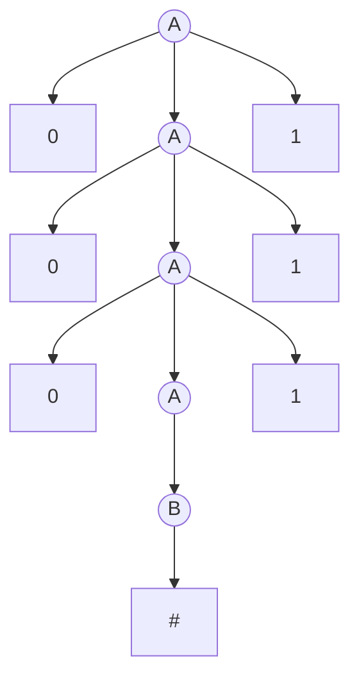
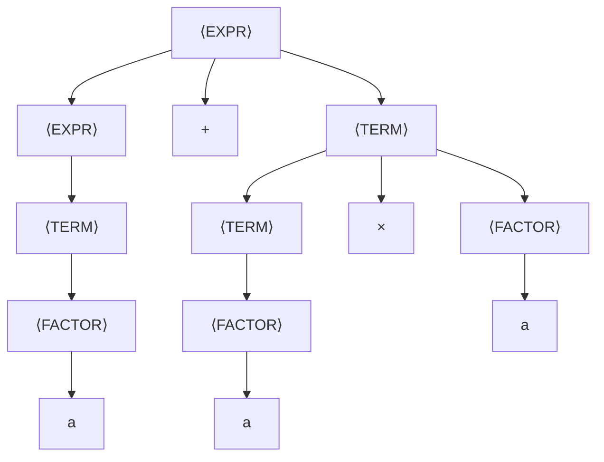
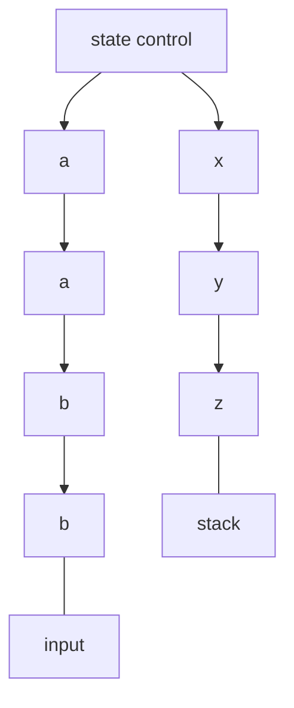
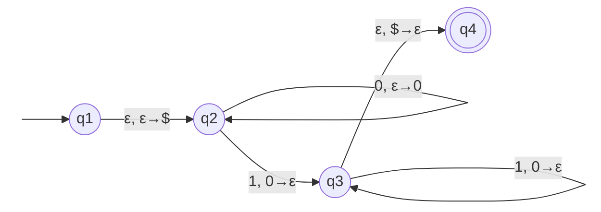

___

##### CONTEXT-FREE GRAMMARS (CFGs)

**Context-free grammars (CFGs)** are a more powerful method, compared to finite automata, for describing languages. They can generate languages that no finite automaton is able to recognize, for example $\{0^n1^n \mid n \ge 0\}$.

A grammar is a collection of **substitution rules**, also called **productions**. Each rule consists of a **variable** (usually an uppercase letter) on the left and a string of variables and **terminals** (lowercase letters, numbers, or special symbols) on the right. One variable is designated as the **start variable** (usually the left-hand side of the topmost rule).

The sequence of substitutions used to obtain a string is called a **derivation**. A derivation of the string $000\#111$ in grammar $G_1$ is:
$$A \Rightarrow 0A1 \Rightarrow 00A11 \Rightarrow 000A111 \Rightarrow 000B111 \Rightarrow 000\#111.$$

> [!info] GRAMMAR $G_1$:
> $$A \to 0A1 \mid B$$
> $$B \to \#$$
> $G_1$ has **variables** $A$ and $B$ (with $A$ as the **start variable**) and **terminals** $0$, $1$, and $\#$. Several rules with the same left-hand variable can be abbreviated on a single line using the symbol $\mid$ as an "**or**" (e.g. $A \to 0A1 \mid B$).

>[!example] To **generate** a string from a grammar:
>1. Write down the start variable.
>2. Find a variable written down and a rule that starts with that variable. Replace the written down variable with the right-hand side of that rule.
>3. Repeat step 2 until no variables remain.

All the strings generated in this way constitute the **language of the grammar**, written $L(G_1)$. Experimentation shows that $L(G_1) = \{0^n\#1^n \mid n \ge 0\}$. Any language that can be generated by some context-free grammar is called a **context-free language (CFL)**.

**TREE GRAPH**:

---

##### FORMAL DEFINITION OF A CONTEXT-FREE GRAMMAR

To avoid any ambiguity we need to formalize the notion of a context-free grammar (CFG).

> [!example] DEFINITION:
> A **context-free grammar** is a **4-tuple** $(V, \Sigma, R, S)$, where
> 	1. $V$ is a finite set called the **variables**,
> 	2. $\Sigma$ is a finite set, disjoint from $V$, called the **terminals**,
> 	3. $R$ is a finite set of **rules**, with each rule being a variable and a string of variables and terminals, and
> 	4. $S \in V$ is the **start variable**.

If $u$, $v$, and $w$ are strings of variables and terminals, and $A \to w$ is a rule of the grammar, we say that $uAv$ **yields** $uwv$, written $uAv \Rightarrow uwv$. We say that $u$ **derives** $v$, written $u \Rightarrow^* v$, if $u = v$ or if a sequence $u_1, u_2, \dots, u_k$ exists for $k \ge 0$ and
$$u \Rightarrow u_1 \Rightarrow u_2 \Rightarrow \dots \Rightarrow u_k \Rightarrow v.$$
The **language of the grammar** is $\{\, w \in \Sigma^* \mid S \Rightarrow^* w \,\}$.

In grammar $G_1$, $V = \{A, B\}$, $\Sigma = \{0, 1, \#\}$, $S = A$, and $R$ is the collection of the three rules given above. Often we specify a grammar by writing down only its rules: the **variables** are the symbols appearing on the left-hand side, the **terminals** are the remaining symbols, and by convention the **start variable** is the one on the left-hand side of the **first rule**.

**Some examples**:

> [!info] EXAMPLE 1:
> Consider grammar $G_3 = (\{S\}, \{a, b\}, R, S)$, with rules
> $$S \to aSb \mid SS \mid \varepsilon.$$
> This grammar generates strings such as $abab$, $aaabbb$, and $aababb$. If you think of $a$ as a left parenthesis "(" and $b$ as a right parenthesis ")", then $L(G_3)$ is the language of all strings of **properly nested parentheses**. Observe that the right-hand side of a rule may be the empty string $\varepsilon$.

> [!info] EXAMPLE 2:
> Consider grammar $G_4 = (V, \Sigma, R, \langle\text{EXPR}\rangle)$, where $V = \{\langle\text{EXPR}\rangle, \langle\text{TERM}\rangle, \langle\text{FACTOR}\rangle\}$ and $\Sigma = \{a, +, ×, (, )\}$. The rules are
> $$\langle\text{EXPR}\rangle \to \langle\text{EXPR}\rangle + \langle\text{TERM}\rangle \mid \langle\text{TERM}\rangle$$
> $$\langle\text{TERM}\rangle \to \langle\text{TERM}\rangle × \langle\text{FACTOR}\rangle \mid \langle\text{FACTOR}\rangle$$
> $$\langle\text{FACTOR}\rangle \to (\langle\text{EXPR}\rangle) \mid a$$
> 
The two strings $a+a×a$ and $(a+a)×a$ can be generated with grammar $G_4$

**TREE GRAPH OF EXAMPLE 2 (a+a x a)**:

---

##### DESIGNING CONTEXT-FREE GRAMMARS

As with the design of finite automata, the design of context-free grammars requires **creativity**. The following techniques are helpful, singly or in combination:

1. **Union of simpler CFLs.** Many CFLs are the union of simpler CFLs. Build a grammar for each piece, then merge them by combining their rules and adding the new rule $S \to S_1 \mid S_2 \mid \dots \mid S_k$, where each $S_i$ is the start variable of a piece. For example, to get a grammar for $\{0^n1^n \mid n \ge 0\} \cup \{1^n0^n \mid n \ge 0\}$:
$$S \to S_1 \mid S_2 \qquad S_1 \to 0S_11 \mid \varepsilon \qquad S_2 \to 1S_20 \mid \varepsilon.$$

2. **Regular languages.** Constructing a CFG for a regular language is easy if you first build a DFA for it. Make a variable $R_i$ for each state $q_i$ of the DFA. Add the rule $R_i \to aR_j$ whenever $\delta(q_i, a) = q_j$ is a transition. Add the rule $R_i \to \varepsilon$ if $q_i$ is an accept state. Make $R_0$ the start variable. The resulting CFG generates the same language the DFA recognizes.

3. **Linked substrings.** Certain CFLs contain strings with two substrings "**linked**", in the sense that a machine would need to remember an unbounded amount of information about one substring to verify that it corresponds to the other (e.g. $\{0^n1^n \mid n \ge 0\}$). Handle this with a rule of the form $R \to uRv$, which generates strings in which the portion containing the $u$'s corresponds to the portion containing the $v$'s.

4. **Recursive structures.** In more complex languages, structures may appear **recursively** as part of other (or the same) structures, as in the arithmetic-expression grammar $G_4$. Whenever the symbol $a$ appears, an entire parenthesized expression might appear recursively instead. Place the variable generating the structure in the location of the rules corresponding to where that structure may recursively appear.

---

##### AMBIGUITY

Sometimes a grammar can generate the same string in several different ways. Such a string has several different parse trees and thus several different meanings. This is undesirable for certain applications, such as programming languages, where a program should have a unique interpretation. 

Sometimes, when we have an ambiguous grammar, we can find an unambiguous grammar that generates the same language. Some context-free languages, however, can be generated **only** by ambiguous grammars; such languages are called **inherently ambiguous**. For example, the language $\{a^ib^jc^k \mid i = j \text{ or } j = k\}$ is inherently ambiguous.

>[!example] DEFINITION:
>If a grammar generates the same string in several different ways, we say that the string is derived **ambiguously** in that grammar. If a grammar generates some string ambiguously, we say that the grammar is **ambiguous**.

**Some Examples**:

> [!info] GRAMMAR $G_5$:
> $$\langle\text{EXPR}\rangle \to \langle\text{EXPR}\rangle + \langle\text{EXPR}\rangle \mid \langle\text{EXPR}\rangle × \langle\text{EXPR}\rangle \mid (\langle\text{EXPR}\rangle) \mid a$$
> This grammar generates the string $a+a×a$ **ambiguously**, because it doesn't capture the usual precedence relations and so may group the $+$ before the $×$ or vice versa.

In contrast, grammar $G_4$ generates exactly the same language, but every generated string has a unique parse tree. Hence $G_4$ is **unambiguous**, whereas $G_5$ is **ambiguous**. Grammar $G_2$ is another example of an ambiguous grammar: the sentence `the girl touches the boy with the flower` has two different derivations.

> [!warning] When we say that a grammar generates a string ambiguously, we mean that the string has two different **parse trees**, not two different **derivations**. Two derivations may differ merely in the order in which they replace variables, yet not in their overall structure. To concentrate on structure we define a **leftmost derivation**, in which at every step the **leftmost** remaining variable is the one replaced.

---

##### CHOMSKY NORMAL FORM

When working with context-free grammars it is often convenient to have them in a simplified form. One of the simplest and most useful forms is called the **Chomsky normal form**, useful in giving algorithms for working with CFGs (Chapters 4 and 7 in the book).

>[!example] DEFINITION:
>A context-free grammar is in **Chomsky normal form** if every rule is of the form
>$$A \to BC \qquad A \to a$$
>where $a$ is any terminal and $A$, $B$, and $C$ are any variables — except that $B$ and $C$ may **not** be the start variable. In addition, we permit the rule $S \to \varepsilon$, where $S$ is the start variable.

###### THEOREMS LINKED:
- [[TEOREMI - CAPITOLO 2#THEOREM 2.9 CHOMSKY NORMAL FORM - (PAGE 109)|THEOREM 2.9]]

---

##### PUSHDOWN AUTOMATA

**Pushdown automata (PDAs)** are a new computational model: they are like nondeterministic finite automata but with an extra component called a **stack**. The stack provides additional memory beyond the finite amount available in the control, and it allows PDAs to recognize some **nonregular** languages.

PDAs are **equivalent in power to context-free grammars**. This equivalence is useful because it gives us two options for proving that a language is context free: give a CFG generating it, or a PDA recognizing it. Certain languages are more easily described in terms of **generators**, whereas others are more easily described by **recognizers**.

A PDA can write symbols on the stack and read them back later. Writing a symbol "pushes down" the other symbols — this is called **pushing**; reading and removing the symbol on top of the stack is called **popping**. All access to the stack, for both reading and writing, is done **only at the top**, so a stack is a "**last in, first out**" (LIFO) storage device. A stack is valuable because it can hold an **unlimited** amount of information: this is what lets a PDA recognize $\{0^n1^n \mid n \ge 0\}$, a language no finite automaton can.

> [!example] INFORMAL DESCRIPTION:
> Read symbols from the input. As each 0 is read, push it onto the stack. As soon as 1s are seen, pop a 0 off the stack for each 1 read. If reading the input is finished exactly when the stack becomes empty of 0s, accept the input. If the stack becomes empty while 1s remain, or if the 1s are finished while the stack still contains 0s, or if any 0s appear in the input following 1s, reject the input.

**GRAPH OF A PDA**:

---

##### FORMAL DEFINITION OF A PUSHDOWN AUTOMATA

>[!example] DEFINITION:
>A **pushdown automaton** is a **6-tuple** $(Q, \Sigma, \Gamma, \delta, q_0, F)$, where
>1. $Q$ is the finite set of the **states**,
>2. $\Sigma$ is the finite set of the **input alphabet**,
>3. $\Gamma$ is the finite set of the **stack alphabet**,
>4. $\delta : Q \times \Sigma_\varepsilon \times \Gamma_\varepsilon \longrightarrow \mathcal{P}(Q\times \Gamma_\varepsilon)$ is the **transition function**,
>5. $q_0 \in Q$ is the **start state**, and
>6. $F \subseteq Q$ is the set of the **accept states**.

A PDA $M = (Q, \Sigma, \Gamma, \delta, q_0, F)$ **accepts** input $w$ if $w$ can be written as $w = w_1w_2 \cdots w_m$, where each $w_i \in \Sigma_\varepsilon$, and sequences of states $r_0, r_1, \dots, r_m \in Q$ and strings $s_0, s_1, \dots, s_m \in \Gamma^*$ exist that satisfy the following three conditions (the strings $s_i$ represent the stack contents on the accepting branch):
1. $r_0 = q_0$ and $s_0 = \varepsilon$ (start properly, in the start state with an empty stack);
2. for $i = 0, \dots, m-1$, we have $(r_{i+1}, b) \in \delta(r_i, w_{i+1}, a)$, where $s_i = at$ and $s_{i+1} = bt$ for some $a, b \in \Gamma_\varepsilon$ and $t \in \Gamma^*$ (move properly according to the state, stack, and next input symbol);
3. $r_m \in F$ (an accept state occurs at the input end).

**Some Examples**:

>[!info] EXAMPLE :
>The following is the formal description of the PDA that recognizes $\{0^n1^n \mid n \ge 0\}$. Let $M_1 = (Q, \Sigma, \Gamma, \delta, q_1, F)$, where
>$$Q = \{q_1, q_2, q_3, q_4\}, \quad \Sigma = \{0, 1\}, \quad \Gamma = \{0, \$\}, \quad F = \{q_1, q_4\},$$
>and $\delta$ is given by the following table (blank entries signify $\emptyset$):

We write "**$a, b \to c$**" on an arrow to signify that when the machine is reading an $a$ from the input, it may replace the symbol $b$ on the top of the stack with a $c$. Any of $a$, $b$, $c$ may be $\varepsilon$: if $a$ is $\varepsilon$ the machine doesn't read the input, if $b$ is $\varepsilon$ it doesn't read/pop the stack, and if $c$ is $\varepsilon$ it doesn't write on the stack.

| State   | Input           | Stack Top       | Move                      |
| ------- | --------------- | --------------- | ------------------------- |
| $$q_1$$ | $$\varepsilon$$ | $$\varepsilon$$ | $$q_2, \text{push } $\ $$ |
| $$q_2$$ | $$0$$           | $$\varepsilon$$ | $$q_2, \text{push } 0 $$  |
| $$q_2$$ | $$1$$           | $$0$$           | $$q_3, \text{pop } 0 $$   |
| $$q_3$$ | $$1$$           | $$0$$           | $$q_3, \text{pop } 0 $$   |
| $$q_3$$ | $$\varepsilon$$ | $$\$$$          | $$q_4, \text{pop } $\ $$  |

**State Diagram for $M_1$** :

