##### THEOREM 1.25 : CLOSURE OF THE UNION OPERATION - (PAGE 45)
#THEOREM1

**THESIS**: The class of regular languages is closed under the union operation. In other words , if $A_1$ and $A_2$ are regular languages so is the union $A_1 \cup A_2$.

**PROOF IDEA**: We know that $A_1$ and $A_2$ are regular, so for each one there is a machine. We will call the machines as $M_1$ and $M_2$. To demonstrate the theorem we will proceed with a **Proof by Construction** creating a new machine $M$ capable of recognize the union $A_1 \cup A_2$.

This machine works simulating both $M_1$ and $M_2$ at the same time so that it needs to read the input string one time only from the beginning to the end.
Obviously that bring up a question like "How will the machine keep track of both if we have limited memory?" and the response to that is in the states, because the machine will only need two remember the last two  states to know at what point they are. Therefore, the set of $M_1$ and $M_2$ states will be obtained from the **Cartesian Product** of the two.

The machine $M$ will ultimately accept the input if at least one of the two simulated machines ($M_1$ or $M_2$) ends its run in an accepting state.

**PROOF**: 
Let $M_1$ recognize $A_1$, where $M_1$ = ($Q_1, \Sigma_1, \delta_1, q_1, F_1$), and 
$M_2$ recognize $A_2$, where $M_2$ = ($Q_2, \Sigma_2, \delta_2, q_2, F_2$).

Construct $M$ = ($Q, \Sigma, \delta, q_0, F$).

1. $Q = \{(r_1,r_2) \mid r_1 \in Q_1 \land r_2 \in Q_2\}$, 
   This set is the Cartesian Product $Q_1 \times Q_2$.
2. $\Sigma$ the alphabet, we assume for simplicity that it is the same for both machines. 
   In case it isn't we would simply write $\Sigma = \Sigma_1 \cup \Sigma_2$ .
3. $\delta$ is defined as: 
   $\forall (r_1,r_2) \in Q \text{ and each a} \in \Sigma$, let $\delta((r_1,r_2),a) = (\delta_1(r_1,a),\delta_2(r_2,q)).$
   It combines the two states into one and returns the next.
4. $q_0$ is the pair $(q_1,q_2)$.
5. $F$ is the set of pair in which either member is an accept state. Can be write as:
   $F = \{(r_1,_2)\mid r_1 \in F_1 \lor r_2 \in F_2\} \lor F = (F_1 \times Q_2) \cup (F_2 \times Q_1)$.

This concludes the construction.

---

##### THEOREM 1.26 : CLOSURE OF THE CONCATENATION - (PAGE 47)
#THEOREM2

**THESIS**: The class of regular languages is closed under the concatenation operation. In other words , if $A_1$ and $A_2$ are regular languages so is the union $A_1 \circ A_2$.

**PROOF IDEA**: If we tried to demonstrate this following the path opened by the union one we would get in front of an enormous obstacle. The machine $M$ would have to accept the input string broken in two parts (the first accepted by $M_1$ and the second by $M_2$), but $M$ couldn't have any ideas in advance about where the first one ends and the second one begins.

So to resolve this problem the theory introduces to us the **nondeterminism**.

---

##### THEOREM 1.39 : EQUIVALENCE OF NFAs AND DFAs - (PAGE 55)
#THEOREM3

**THESIS**: Every NFA has an **equivalent** DFA.

**PROOF IDEA**: The key idea is to convert the NFA into an equivalent DFA that simulates the NFA.
Having that the NFA has k states, the DFA must remember in which subset of this states the NFA could be in a given moment and because of that the DFA will have $2^k$ states.

**PROOF**: 
Let $N$ = ($Q, \Sigma, \delta, q_0, F$) be the NFA recognizing some language $A$,
we construct a DFA M = ($Q', \Sigma, \delta', q'_0, F'$) recognizing $A$.

To get going with the construction at first  we consider the easier case where N has no $\varepsilon$ arrows.

1. $Q = \mathcal{P}(Q)$, every state of $M$ is a set of states of $N$.
2. For $R \in Q' \text { and } a \in \Sigma, \text{ let } \delta'(R,a) = \{q \in Q  \mid q \in \delta (r,a) \text{ for some } r \in R\}$, if $R$ is a state of $M$, it is also a set of states of $N$. When $M$ reads the symbol $a$ in states $R$ it shows where $a$ takes each state in $R$.
   We can also write it like: $\delta'(R,a) = \bigcup_{r \in R} \ \delta (r,a)$.
3. $q'_0 = \{q_0\}$, $M$ starts in the corresponding collection containing just the start state of $N$.
4. $F' = \{ R\in Q' \mid R \text{ contains an accept state of } N\}$.

Now we need to consider the **empty arrows** so we introduce new notation.
For every state $R$ of $M$, we define $E(R)$ the collection of states that can only be reached only following empty arrows. 

Formally we define: 
$\text{For }R \subseteq Q \text{ let } E(R) = \{q \mid q \text{ can be reached from } R \text{ by traveling from } 0 \text{ or more } \varepsilon \text{ arrows} \}$.

Now we modify the transition function by replacing $\delta (r,a)$ with $E(\delta (r,a))$:
$\delta'(R,a) = \{q \in Q  \mid q \in E(\delta (r,a)) \text{ for some } r \in R\}$.

Additionally we need to modify the start state with: $q'_0 = E(\{q_0\})$ 

---

##### THEOREM 1.45: CLOSURE UNDER UNION - (PAGE 59)
#THEOREM4

**THESIS**: The class of regular languages is closed under the **union operation**.

**PROOF IDEA**: Instead of proceeding with the Cartesian product we take two NFAs, $N_1$ and $N_2$, and combine them into one new NFA, $N$.

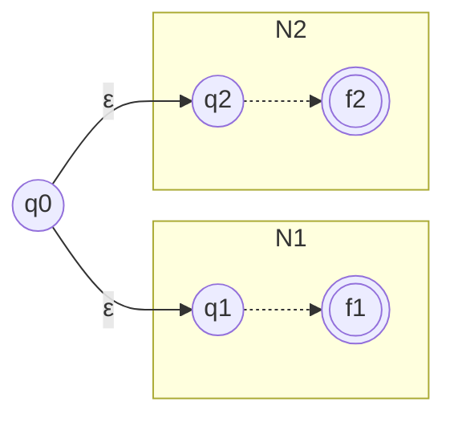

**PROOF**:
Let $N_1 = (Q_1, \Sigma_1, \delta_1, q_1, F_1)$ recognize $A_1$, and
$N_2 = (Q_2, \Sigma_2, \delta_2, q_2, F_2)$ recognize $A_2$.

Construct $N = (Q, \Sigma, \delta, q_0, F)$ to recognize $A_1 \cup A_2$.

1. $Q = \{q_0\} \cup Q_1 \cup Q_2$.
2. $q_0$ is the start of $N$.
3. $F = F_1 \cup F_2$.
4. Define $\delta$ so that $\forall q\in Q \land \forall a \in \Sigma_{\varepsilon}$, $$
\delta(q, a) =
\begin{cases} 
\delta_1(q, a) & q \in Q_1 \\ 
\delta_2(q, a) & q \in Q_2 \\ 
\{q_1, q_2\} & q = q_0 \text{ and } a = \varepsilon \\ 
\emptyset & q = q_0 \text{ and } a \neq \varepsilon 
\end{cases}
$$

---

##### THEOREM 1.47: CLOSURE UNDER CONCATENATION - (PAGE 60)
#THEOREM5

**THESIS**: The class of regular languages is closed under the **concatenation operation**.

**PROOF IDEA**: For this case we follow what was done for the union but with some exceptions. We assign $N$'s start to be the same as $N_1$ and transform the accept states of $N_1$ adding $\varepsilon$ arrows that nondeterministically allow branching to $N_2$ 

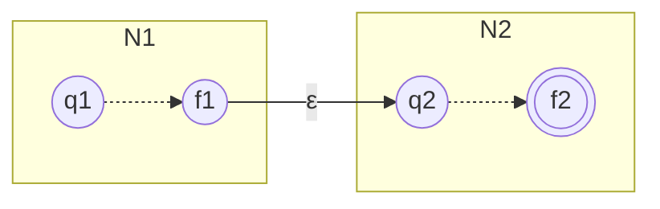

**PROOF**:
Let $N_1 = (Q_1, \Sigma_1, \delta_1, q_1, F_1)$ recognize $A_1$, and
$N_2 = (Q_2, \Sigma_2, \delta_2, q_2, F_2)$ recognize $A_2$.

Construct $N = (Q, \Sigma, \delta, q_1, F_2)$ to recognize $A_1 \circ A_2$.

1. $Q = Q_1 \cup Q_2$.
2. $q_1$ is the same as the start state of $N_1$.
3. $F_2$ are the same accept states as the ones of $N_2$.
4. Define $\delta$ so that $\forall q\in Q \land \forall a \in \Sigma_{\varepsilon}$, $$
\delta(q, a) =
\begin{cases} 
\delta_1(q, a) & q \in Q_1 \text{ and } q \notin F_1 \\ 
\delta_1(q, a) & q \in F_1 \text{ and } a \neq \varepsilon \\ 
\delta_1(q, a) \cup \{q_2\} & q \in F_1 \text{ and } a = \varepsilon \\ 
\delta_2(q, a) & q \in Q_2
\end{cases}
$$
---

##### THEOREM 1.49: CLOSURE UNDER STAR - (PAGE 62)
#THEOREM6

**THESIS**: The class of regular languages is closed under the **star operation**.

**PROOF IDEA**: We take an NFA $N_1$ for $A_1$ and modify it to recognize $A^*_1$, the resulting $N$ will be like $N_1$ with additional $\varepsilon$ arrows returning to the start state from the accept states. So that when the machine arrives to the end of a valid piece it can jump back and read the next one. 

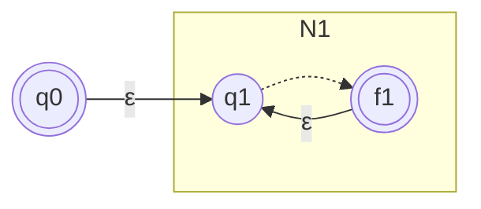

**PROOF**:
Let $N_1 = (Q_1, \Sigma_1, \delta_1, q_1, F_1)$ recognize $A_1$.

Construct $N = (Q, \Sigma, \delta, q_0, F)$ to recognize $A^*_1$.

1. $Q = \{q_0\} \cup Q_1$.
2. $q_0$ is the new start state.
3. $F = \{q_0\} \cup F_1$.
4. Define $\delta$ so that $\forall q\in Q \land \forall a \in \Sigma_{\varepsilon}$, 
$$
\delta(q, a) =
\begin{cases} 
\delta_1(q, a) & q \in Q_1 \text{ and } q \notin F_1 \\ 
\delta_1(q, a) & q \in F_1 \text{ and } a \neq \varepsilon \\ 
\delta_1(q, a) \cup \{q_1\} & q \in F_1 \text{ and } a = \varepsilon \\ 
\{q_1\} & q = q_0 \text{ and } a = \varepsilon \\ 
\emptyset & q = q_0 \text{ and } a \neq \varepsilon
\end{cases}
$$

---

##### THEOREM 1.54: REGULAR EXPRESSION - (PAGE 66)
#THEOREM7 #LEMMA1

**THESIS**: A language is regular if and only if some regular expression describes it.

**NOTE**: this theorem has two directions so we will prove each direction separately.

**LEMMA**: If a language is described by a regular expression, then it is regular.

**PROOF IDEA**: Given a regular expression $R$ describing $A$, we show how to convert $R$ into a NFA recognizing $A$. So we are reminded that **if an NFA recognizes $A$, then it is regular**. 

**PROOF**:
Converting $R$ into an NFA we have to consider the six cases in the definition of an NFA.

1. $R = a \text{ for some } a \in \Sigma$. Then $L(R) = \{a\}$ and the NFA recognizes it.
   Formally we have $N = (\{q_1,q_2\}, \Sigma, \delta, q_1, \{q_2\})$

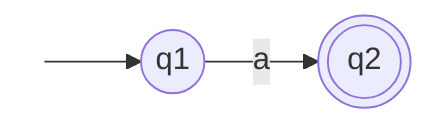

2. $R = \varepsilon$. Then $L(R) = \{\varepsilon\}$, and the following NFA recognizes $L(R)$.
   Formally we have $N = (\{q_1\}, \Sigma, \delta, q_1, \{q_1\})$

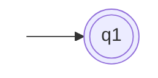

3. $R = \emptyset$. Then $L(R) = \emptyset$, and the following NFA recognizes it.
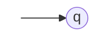

4. $R = R_1 \cup R_2$
5. $R = R_1 \circ R_2$
6. $R = R^*_1$

For the last three we use the constructions given in the proof that the class of regular languages is closed under the regular operations.

---

##### LEMMA 1.60: OTHER DIRECTION OF 1.54 - (PAGE 69)
#LEMMA2

**LEMMA**: If a language is regular, then it is described by a regular expression.

**PROOF IDEA**: We need to show that if a language A is regular, a regular
expression describes it. So we will convert a DFA into equivalent regular expressions. The conversion is divided in two steps, the first we convert the DFA into a GNFA and then for the second step we convert the GNFA into a regular expression.

>[!info] For convenience is required to use a GNFA in a special form thatt meets some conditions:
> - The start state has transition arrows going to every other state but no arrows coming in from any other state.
>
> - There is only a single accept state, and it has arrows coming in from every other state but no arrows going to any other state. Furthermore, the accept state is not the same as the start state.
>
> - Except for the start and accept states, one arrow goes from every state to every other state and also from each state to itself.

We can easily convert a DFA into a GNFA in the special form. We simply add a new start state with an ε arrow to the old start state and a new accept state with ε arrows from the old accept states. If any arrows have multiple labels (or if there are multiple arrows going between the same two states in the same direction), we replace each with a single arrow whose label is the union of the previous labels.

###### COMPLETE TRANSITION GRAPH AND GNFA TO REGULAR:
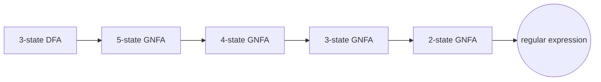

**Before:**

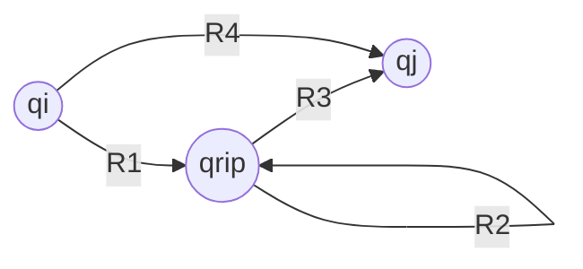

**After**:

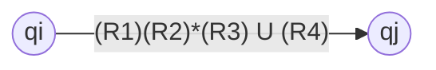

**PROOF**:
Let $M$ be a DFA for language $A$. Then we convert it to a GNFA adding a new start state, accept state and if necessary new $\varepsilon$ arrows. We use the procedure CONVERT($G$), which takes a GNFA and returns an equivalent regular expression using **recursion**.

**CONVERT($G$)**:

1. Let $k$ be the number of stets of $G$.
2. If $k = 2$, then $G$ must have only two states. It returns the REG expression $R$.
3. If $K > 2$, we select any state $q_{rip} \in Q$ different from $q_{start}$ and $q_{accept}$ and let $G'$ be GNFA $(Q', \Sigma, \delta', q_{start}, q_{accept})$, where $Q' = Q - \{q_{rip}\}$. For any $q_i \in Q' - \{q_{accept}\}$ and any $q_j \in Q' - \{q_{start}\}$, the new transition function is:

$$\delta'(q_i, q_j) = (R_1)(R_2)^*(R_3) \cup (R_4)$$

	with $R_1 = \delta(q_i, q_{rip})$, $R_2 = \delta(q_{rip}, q_{rip})$, $R_3 = \delta(q_{rip}, q_j)$ and $R_4 = \delta(q_i, q_j)$.

4. Compute CONVERT($G'$) and return its value.

---

##### CLAIM 1.65 - (PAGE 74)

---

##### THEOREM 1.70: PUMPING LEMMA FOR REGULAR LANGUAGES - (PAGE 78)
#THEOREM8

**THESIS**: If A is a regular language, then there is a number $p$ (the
pumping length) where if $s$ is any string in A of length at least $p$, then $s$ may be divided into three pieces, $s = xyz$, satisfying the following conditions:

1. $\forall i \geq 0, xy^iz \in A$,
2. $|y| > 0$, and
3. $|xy| \leq p$.

>[!info] Recall the notation where $|s|$ represents the length of string $s$, $y^i$ means that $i$ copies of $y$ are concatenated together, and $y^0$ equals $\varepsilon$.

>[!warning] Observe that without **condition 2** the theorem would be trivially true. **Condition 3** states that the pieces x and y together have length at most p. It is an extra technical condition that we occasionally find useful when proving certain languages to be **nonregular**.

**PROOF IDEA**: Let $M$ be a DFA for $A$. We assign the pumping length $p$ to be $p = |Q|$, we show that any string $s \in A$ of length $\geq p$ may be broken into $xyz$. If there are no string like that the theorem becomes **vacuously true**.
Then if there exists this string we consider now the sequence of states that $M$ goes through when computing it. It starts with $q_1$ and goes on until it reaches the end in state $q_{13}$, because $s \in A$ than $M$ accepts $s$, so $q_{13}$ is an **accept state**.
If we let $n$ be the length of $s$, the sequence of states $q_1,...,q_{13}$ has length $n + 1$. Because $n$ is at least $p$, we know that $n + 1$ is greater than $p$, the number of states of M. Therefore we occur in the **pigeonhole principle**.

>[!info] THE PIGEONHOLE PRINCIPLE:
>It is a fancy name for the rather obvious fact that if $p$ pigeons are placed into fewer than $p$ holes, some hole has to have more than one pigeon in it.

Example of the repetition of $q9$: 
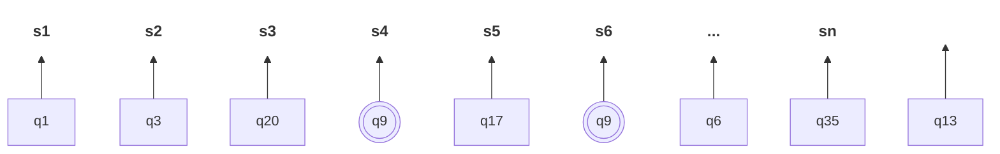

After dividing it:
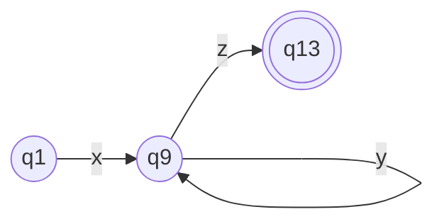

Now we consider for example that we run $M$ on input $xyyz$. So it starts with $q_1,...,q_9$ than it repeats two times $q_9,...,q_9$ and it finishes in the accept state $q_13$ thanks to $z$. Similarly any case of $xy^iz$ will be accepted and so every division of $s$ satisfies **condition 1**.
For **condition 2** we already have it, because it was the part of $s$ that occurred between two different occurrences of state $q_9$.
In order to get **condition 3**, we make sure that $q_9$ is the first repetition in the sequence. By the **pigeonhole principle**, the first $p + 1$ states in the sequence must contain a repetition. Therefore, $|xy|\leq p$.

**PROOF**:
Let $M = (Q, \Sigma, \delta, q_0, F) \land p = |Q|$. Let $s = s_1,...,s_n$ be a string in $A$ of length $n$,where $n \geq p$.
Let $r_1,...,r_{n+1}$ be the sequences during the processing of $s$ so that $r_{n+1} = \delta(r_i,s_i) \text{ for } 1\leq i \leq n$. This sequence has length $n + 1$, which is at least $p + 1$.
Among the first $p + 1$ elements in the sequence, two must be the same state, by the **pigeonhole principle**. We call the first of these $r_j$ and the second $r_l$. Because $r_l$ occurs among the first $p + 1$ places in a sequence, we have $l \leq p + 1$.
Now let $x = s_1,..., s_{j−1}, y = s_j,..., s_{l−1}, and \ z = s_l,..., s_n$.
SO by dividing $s$ we have $x$ that takes $M$ from $r_1,..., r_j$ , $y$ from $r_j,.., r_j$ , and $z$ from $r_j,.., r_{n+1}$, now $M$ must accept $xy^iz$ for $i \geq 0$. 
We know that $j \neq l \to |y| > 0 \land l \leq p + 1 \to |xy| \leq p$. Thus we have satisfied all conditions of the **pumping lemma**.

>[!info] We can demonstrate non regularity by contradiction of the lemma, see page 80.
