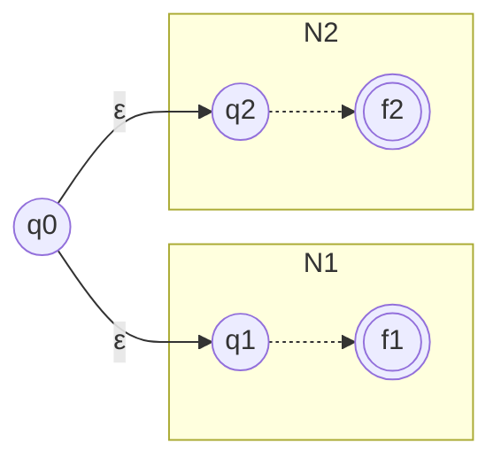
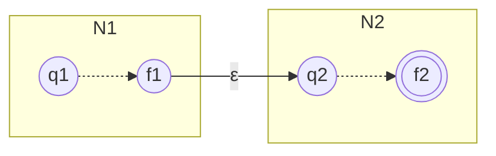
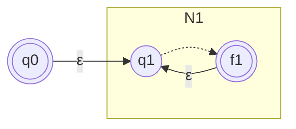

##### THEOREM 1.25 : CLOSURE OF THE UNION OPERATION - (PAGE 45)
#THEOREM1

**THESIS**: The class of regular languages is closed under the union operation. In other words , if $A_1$ and $A_2$ are regular languages so is the union $A_1 \cup A_2$.

**PROOF IDEA**: We know that $A_1$ and $A_2$ are regular, so for each one there is a machine. We will call the machines as $M_1$ and $M_2$. To demonstrate the theorem we will proceed with a **Proof by Construction** creating a new machine $M$ capable of recognize the union $A_1 \cup A_2$.

This machine works simulating both $M_1$ and $M_2$ at the same time so that it needs to read the input string one time only from the beginning to the end.
Obviously that bring up a question like "How will the machine keep track of both if we have limited memory?" and the response to that is in the states, because the machine will only need two remember the last two  states to know at what point they are. Therefore, the set of $M_1$ and $M_2$ states will be obtained from the **Cartesian Product** of the two.

The machine $M$ will ultimately accept the input if at least one of the two simulated machines ($M_1$ or $M_2$) ends its run in an accepting state.

**PROOF**: 
Let $M_1$ recognize $A_1$, where $M_1$ = ($Q_1, \Sigma_1, \delta_1, q_1, F_1$), and 
$M_2$ recognize $A_2$, where $M_2$ = ($Q_2, \Sigma_2, \delta_2, q_2, F_2$).

Construct $M$ = ($Q, \Sigma, \delta, q_0, F$).
1. $Q = \{(r_1,r_2) \mid r_1 \in Q_1 \land r_2 \in Q_2\}$, 
   This set is the Cartesian Product $Q_1 \times Q_2$.
2. $\Sigma$ the alphabet, we assume for simplicity that it is the same for both machines. 
   In case it isn't we would simply write $\Sigma = \Sigma_1 \cup \Sigma_2$ .
3. $\delta$ is defined as: 
   $\forall (r_1,r_2) \in Q \text{ and each a} \in \Sigma$, let $\delta((r_1,r_2),a) = (\delta_1(r_1,a),\delta_2(r_2,q)).$
   It combines the two states into one and returns the next.
4. $q_0$ is the pair $(q_1,q_2)$.
5. $F$ is the set of pair in which either member is an accept state. Can be write as:
   $F = \{(r_1,_2)\mid r_1 \in F_1 \lor r_2 \in F_2\} \lor F = (F_1 \times Q_2) \cup (F_2 \times Q_1)$.

This concludes the construction.

---

##### THEOREM 1.26 : CLOSURE OF THE CONCATENATION - (PAGE 47)
#THEOREM2

**THESIS**: The class of regular languages is closed under the concatenation operation. In other words , if $A_1$ and $A_2$ are regular languages so is the union $A_1 \circ A_2$.

**PROOF IDEA**: If we tried to demonstrate this following the path opened by the union one we would get in front of an enormous obstacle. The machine $M$ would have to accept the input string broken in two parts (the first accepted by $M_1$ and the second by $M_2$), but $M$ couldn't have any ideas in advance about where the first one ends and the second one begins.

So to resolve this problem the theory introduces to us the **nondeterminism**.

---

##### THEOREM 1.39 : EQUIVALENCE OF NFAs AND DFAs - (PAGE 55)
#THEOREM3

**THESIS**: Every NFA has an **equivalent** DFA.

**PROOF IDEA**: The key idea is to convert the NFA into an equivalent DFA that simulates the NFA.
Having that the NFA has k states, the DFA must remember in which subset of this states the NFA could be in a given moment and because of that the DFA will have $2^k$ states.

**PROOF**: 
Let $N$ = ($Q, \Sigma, \delta, q_0, F$) be the NFA recognizing some language $A$,
we construct a DFA M = ($Q', \Sigma, \delta', q'_0, F'$) recognizing $A$.

To get going with the construction at first  we consider the easier case where N has no $\varepsilon$ arrows.
1. $Q = \mathcal{P}(Q)$, every state of $M$ is a set of states of $N$.
2. For $R \in Q' \text { and } a \in \Sigma, \text{ let } \delta'(R,a) = \{q \in Q  \mid q \in \delta (r,a) \text{ for some } r \in R\}$, if $R$ is a state of $M$, it is also a set of states of $N$. When $M$ reads the symbol $a$ in states $R$ it shows where $a$ takes each state in $R$.
   We can also write it like: $\delta'(R,a) = \bigcup_{r \in R} \ \delta (r,a)$.
3. $q'_0 = \{q_0\}$, $M$ starts in the corresponding collection containing just the start state of $N$.
4. $F' = \{ R\in Q' \mid R \text{ contains an accept state of } N\}$.

Now we need to consider the **empty arrows** so we introduce new notation.
For every state $R$ of $M$, we define $E(R)$ the collection of states that can only be reached only following empty arrows. 

Formally we define: 
$\text{For }R \subseteq Q \text{ let } E(R) = \{q \mid q \text{ can be reached from } R \text{ by traveling from } 0 \text{ or more } \varepsilon \text{ arrows} \}$.

Now we modify the transition function by replacing $\delta (r,a)$ with $E(\delta (r,a))$:
$\delta'(R,a) = \{q \in Q  \mid q \in E(\delta (r,a)) \text{ for some } r \in R\}$.

Additionally we need to modify the start state with: $q'_0 = E(\{q_0\})$ 

---

##### THEOREM 1.45: CLOSURE UNDER UNION - (PAGE 59)
#THEOREM4

**THESIS**: The class of regular languages is closed under the **union operation**.

**PROOF IDEA**: Instead of proceeding with the Cartesian product we take two NFAs, $N_1$ and $N_2$, and combine them into one new NFA, $N$.

**PROOF**:
Let $N_1 = (Q_1, \Sigma_1, \delta_1, q_1, F_1)$ recognize $A_1$, and
$N_2 = (Q_2, \Sigma_2, \delta_2, q_2, F_2)$ recognize $A_2$.

Construct $N = (Q, \Sigma, \delta, q_0, F)$ to recognize $A_1 \cup A_2$.
1. $Q = \{q_0\} \cup Q_1 \cup Q_2$.
2. $q_0$ is the start of $N$.
3. $F = F_1 \cup F_2$.
4. Define $\delta$ so that $\forall q\in Q \land \forall a \in \Sigma_{\varepsilon}$, $$
\delta(q, a) =
\begin{cases} 
\delta_1(q, a) & q \in Q_1 \\ 
\delta_2(q, a) & q \in Q_2 \\ 
\{q_1, q_2\} & q = q_0 \text{ and } a = \varepsilon \\ 
\emptyset & q = q_0 \text{ and } a \neq \varepsilon 
\end{cases}
$$
---

##### THEOREM 1.47: CLOSURE UNDER CONCATENATION - (PAGE 60)
#THEOREM5

**THESIS**: The class of regular languages is closed under the **concatenation operation**.

**PROOF IDEA**: For this case we follow what was done for the union but with some exceptions. We assign $N$'s start to be the same as $N_1$ and transform the accept states of $N_1$ adding $\varepsilon$ arrows that nondeterministically allow branching to $N_2$ 

**PROOF**:
Let $N_1 = (Q_1, \Sigma_1, \delta_1, q_1, F_1)$ recognize $A_1$, and
$N_2 = (Q_2, \Sigma_2, \delta_2, q_2, F_2)$ recognize $A_2$.

Construct $N = (Q, \Sigma, \delta, q_1, F_2)$ to recognize $A_1 \circ A_2$.
1. $Q = Q_1 \cup Q_2$.
2. $q_1$ is the same as the start state of $N_1$.
3. $F_2$ are the same accept states as the ones of $N_2$.
4. Define $\delta$ so that $\forall q\in Q \land \forall a \in \Sigma_{\varepsilon}$, $$
\delta(q, a) =
\begin{cases} 
\delta_1(q, a) & q \in Q_1 \text{ and } q \notin F_1 \\ 
\delta_1(q, a) & q \in F_1 \text{ and } a \neq \varepsilon \\ 
\delta_1(q, a) \cup \{q_2\} & q \in F_1 \text{ and } a = \varepsilon \\ 
\delta_2(q, a) & q \in Q_2
\end{cases}
$$
---

##### THEOREM 1.49: CLOSURE UNDER STAR - (PAGE 62)
#THEOREM6

**THESIS**: The class of regular languages is closed under the **star operation**.

**PROOF IDEA**: We take an NFA $N_1$ for $A_1$ and modify it to recognize $A^*_1$, the resulting $N$ will be like $N_1$ with additional $\varepsilon$ arrows returning to the start state from the accept states. So that when the machine arrives to the end of a valid piece it can jump back and read the next one. 

**PROOF**:
Let $N_1 = (Q_1, \Sigma_1, \delta_1, q_1, F_1)$ recognize $A_1$.

Construct $N = (Q, \Sigma, \delta, q_0, F)$ to recognize $A^*_1$.
1. $Q = \{q_0\} \cup Q_1$.
2. $q_0$ is the new start state.
3. $F = \{q_0\} \cup F_1$.
4. Define $\delta$ so that $\forall q\in Q \land \forall a \in \Sigma_{\varepsilon}$, $$
\delta(q, a) =
\begin{cases} 
\delta_1(q, a) & q \in Q_1 \text{ and } q \notin F_1 \\ 
\delta_1(q, a) & q \in F_1 \text{ and } a \neq \varepsilon \\ 
\delta_1(q, a) \cup \{q_1\} & q \in F_1 \text{ and } a = \varepsilon \\ 
\{q_1\} & q = q_0 \text{ and } a = \varepsilon \\ 
\emptyset & q = q_0 \text{ and } a \neq \varepsilon
\end{cases}
$$
