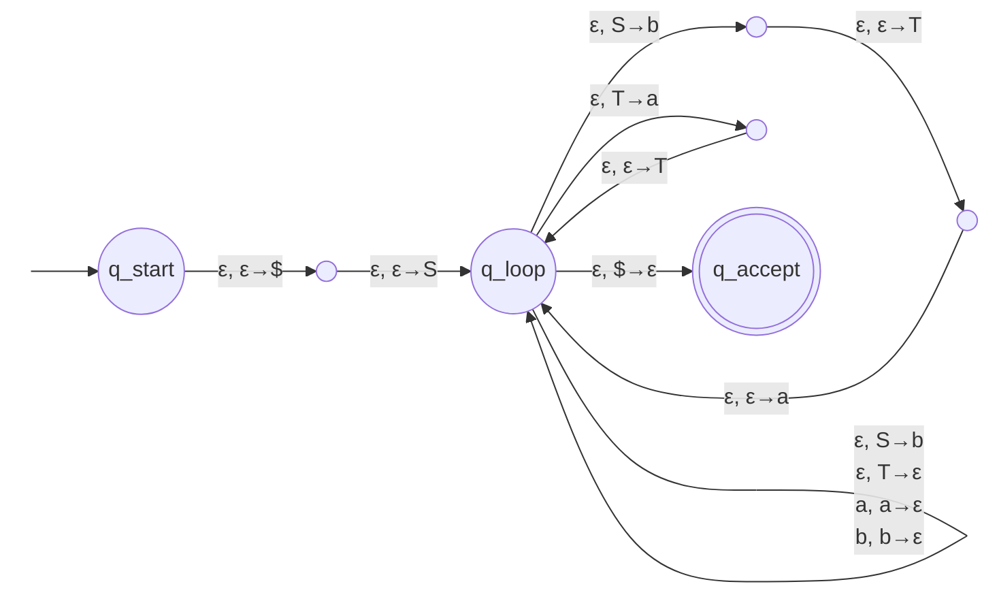

##### THEOREM 2.9 : CHOMSKY NORMAL FORM - (PAGE 109)
#THEOREM9

**THESIS**: Any context-free language is generated by a context-free grammar in Chomsky normal form.

**PROOF IDEA**: We convert any grammar $G$ into Chomsky normal form. The conversion has several stages in which rules that violate the conditions are replaced with equivalent ones that are satisfactory.
**First** we add a new start variable. Then we eliminate all $\varepsilon$-rules of the form $A \to \varepsilon$. We also eliminate all **unit rules** of the form $A \to B$. In both cases we patch up the grammar to be sure that it still generates the same language. Finally we convert the remaining rules into the proper form.

**PROOF**:
Let $G$ be any context-free grammar.

1. **New start variable.** First we add a new start variable $S_0$ and the rule $S_0 \to S$, where $S$ was the original start variable. This change guarantees that the start variable doesn't occur on the right-hand side of a rule.

2. **Eliminate $\varepsilon$-rules.** We remove an $\varepsilon$-rule $A \to \varepsilon$, where $A$ is not the start variable. Then, for each occurrence of an $A$ on the right-hand side of a rule, we add a new rule with that occurrence **deleted**. In other words, if $R \to uAv$ is a rule in which $u$ and $v$ are strings of variables and terminals, we add the rule $R \to uv$. We do so for each occurrence of $A$, so the rule $R \to uAvAw$ causes us to add $R \to uvAw$, $R \to uAvw$, and $R \to uvw$. If we have the rule $R \to A$, we add $R \to \varepsilon$ unless we had previously removed the rule $R \to \varepsilon$. We repeat these steps until we eliminate all $\varepsilon$-rules not involving the start variable.

3. **Eliminate unit rules.** We remove a unit rule $A \to B$. Then, whenever a rule $B \to u$ appears, we add the rule $A \to u$ unless this was a unit rule previously removed. As before, $u$ is a string of variables and terminals. We repeat these steps until we eliminate all unit rules.

4. **Convert to the proper form.** Finally, we convert all remaining rules into the proper form. We replace each rule $A \to u_1u_2\cdots u_k$, where $k \ge 3$ and each $u_i$ is a variable or terminal symbol, with the rules
$$A \to u_1A_1, \quad A_1 \to u_2A_2, \quad A_2 \to u_3A_3, \quad \dots, \quad A_{k-2} \to u_{k-1}u_k.$$
The $A_i$'s are new variables. We replace any terminal $u_i$ in the preceding rule(s) with the new variable $U_i$ and add the rule $U_i \to u_i$.

This concludes the construction: the resulting grammar is in Chomsky normal form and is equivalent to $G$.

---

##### THEOREM 2.20 : EQUIVALENCE OF CFGs AND PDAs - (PAGE 117)
#THEOREM10

**THESIS**: A language is context free if and only if some pushdown automaton recognizes it.

**NOTE**: this theorem has two directions, proved separately by Lemma 2.21 (forward) and Lemma 2.27 (reverse).

**PROOF**: 
The forward direction is Lemma 2.21: every context-free language is recognized by some PDA. The reverse direction is Lemma 2.27: every language recognized by a PDA is context free. Together they establish the "if and only if".

---

##### LEMMA 2.21 : CFL → PDA - (PAGE 117)
#LEMMA3

**LEMMA**: If a language is context free, then some pushdown automaton recognizes it.

**PROOF IDEA**:
Let $A$ be a CFL. From the definition, $A$ has a CFG $G$ generating it. We show how to convert $G$ into an equivalent PDA, which we call $P$.

$P$ accepts its input $w$ if $G$ generates $w$, by determining whether there is a derivation for $w$. Each step of a derivation yields an intermediate string of variables and terminals. The difficulty is figuring out which substitutions to make; the PDA's **nondeterminism** lets it guess the sequence of correct substitutions. $P$ begins by writing the start variable on its stack, goes through intermediate strings one substitution at a time, and eventually arrives at a string containing only terminals; then it accepts if that string is identical to the input.

The PDA can access only the top of the stack, which may be a terminal instead of a variable. The way around this is to keep only **part** of the intermediate string on the stack: the symbols starting with the first variable. Any terminal symbols before the first variable are matched immediately with symbols in the input string.

**PROOF**:

We construct $P = (Q, \Sigma, \Gamma, \delta, q_{start}, F)$. To write an entire string on the stack in one step, we use a shorthand, simulating it by introducing additional states that write the string one symbol at a time. Let $q, r$ be states, $a \in \Sigma_\varepsilon$, $s \in \Gamma_\varepsilon$, and suppose we want to go from $q$ to $r$ reading $a$ and popping $s$, while pushing $u = u_1\cdots u_l$. Introduce new states $q_1, \dots, q_{l-1}$ and set:
$$\delta(q, a, s) \ni (q_1, u_l), \quad \delta(q_1, \varepsilon, \varepsilon) = \{(q_2, u_{l-1})\}, \quad \dots, \quad \delta(q_{l-1}, \varepsilon, \varepsilon) = \{(r, u_1)\}.$$

The states of $P$ are $Q = \{q_{start}, q_{loop}, q_{accept}\} \cup E$, where $E$ is the set of states needed for the shorthand. The start state is $q_{start}$ and the only accept state is $q_{accept}$. The transition function is defined as follows:
$$\delta(q_{start}, \varepsilon, \varepsilon) = \{(q_{loop}, S\$)\}$$
$$\delta(q_{loop}, \varepsilon, A) = \{(q_{loop}, w) \mid A \to w \text{ is a rule in } R\}$$
$$\delta(q_{loop}, a, a) = \{(q_{loop}, \varepsilon)\}$$
$$\delta(q_{loop}, \varepsilon, \$) = \{(q_{accept}, \varepsilon)\}$$

**Some examples**:

> [!info] EXAMPLE 2.25:
> We use the procedure above to construct a PDA $P_1$ from the CFG $G$: $S \to aTb \mid b$ and $T \to Ta \mid \varepsilon$. The state diagram of $P_1$ is shown in Figure 2.26.

**STATE DIAGRAM OF $P_1$**:

---

##### LEMMA 2.27 : PDA → CFL - (PAGE 121)
#LEMMA4

**LEMMA**: If a pushdown automaton recognizes some language, then it is context free.

**PROOF IDEA**: We have a PDA $P$ and want a CFG $G$ that generates all the strings $P$ accepts. For each pair of states $p$ and $q$, the grammar has a variable $A_{pq}$ generating all the strings that take $P$ from $p$ with an empty stack to $q$ with an empty stack.

First, modify $P$ so that it has three features:
1. a single accept state, $q_{accept}$;
2. it empties its stack before accepting;
3. each transition either **pushes** or **pops** one symbol, never both.

To design $G$, note that for any such string $x$, the first move on $x$ must be a push (every move is a push or a pop, and $P$ can't pop an empty stack), and the last move must be a pop (the stack ends up empty). Either the symbol popped at the end is the symbol pushed at the beginning — giving the rule $A_{pq} \to aA_{rs}b$ — or the initially pushed symbol gets popped before the end, so the stack becomes empty at some intermediate point — giving the rule $A_{pq} \to A_{pr}A_{rq}$.

**PROOF**:
Let $P = (Q, \Sigma, \Gamma, \delta, q_0, \{q_{accept}\})$ and construct $G$. The variables of $G$ are $\{A_{pq} \mid p, q \in Q\}$ and the start variable is $A_{q_0, q_{accept}}$. The rules are given in three parts:
1. for each $p, q, r, s \in Q$, $u \in \Gamma$, and $a, b \in \Sigma_\varepsilon$, if $\delta(p, a, \varepsilon)$ contains $(r, u)$ and $\delta(s, b, u)$ contains $(q, \varepsilon)$, put $A_{pq} \to aA_{rs}b$;
2. for each $p, q, r \in Q$, put $A_{pq} \to A_{pr}A_{rq}$;
3. for each $p \in Q$, put $A_{pp} \to \varepsilon$.

**Figure 2.28**:

![[figure2.28.png]]

>[!info] The stack is **empty at $p$, $r$, and $q$**. The first part takes $P$ from $p$ to $r$ and the second from $r$ to $q$, each starting and ending with an empty stack — this is exactly the concatenation $x = yz$ generated by $A_{pq} \to A_{pr}A_{rq}$.

**Figure 2.29**

![[figure2.29.png]]

> [!info] The dashed line at **stack height 1** represents the symbol $u$ pushed when reading $a$. The middle computation stays **above** $u$ (it never touches it), and $u$ is popped only when reading $b$ at the end — this is exactly the string $x = ayb$ generated by $A_{pq} \to aA_{rs}b$.

---

