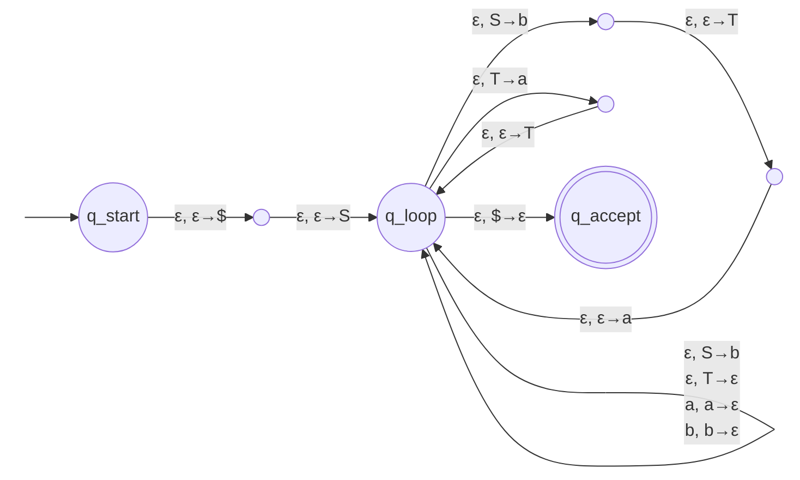
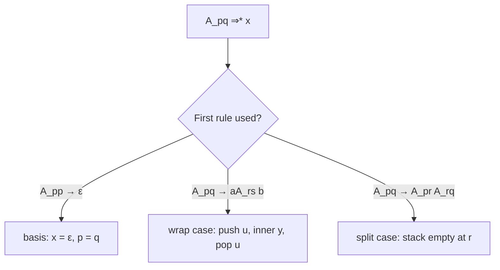
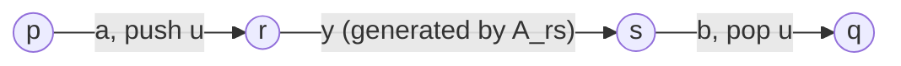
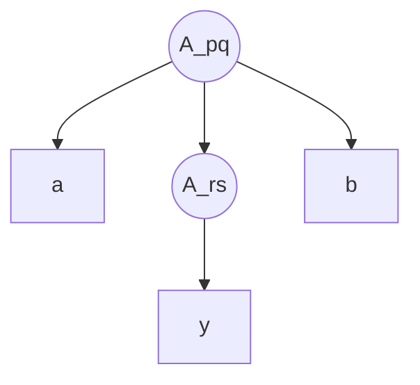
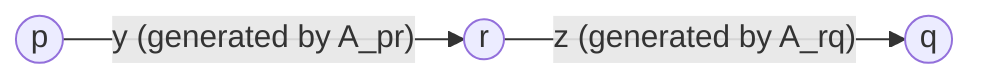
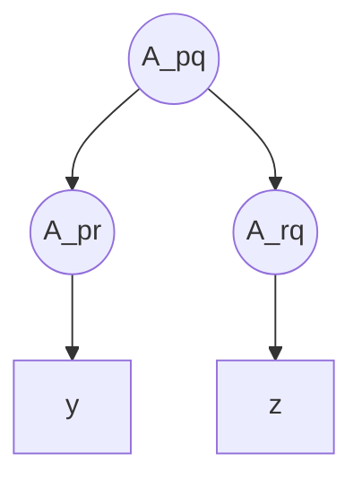
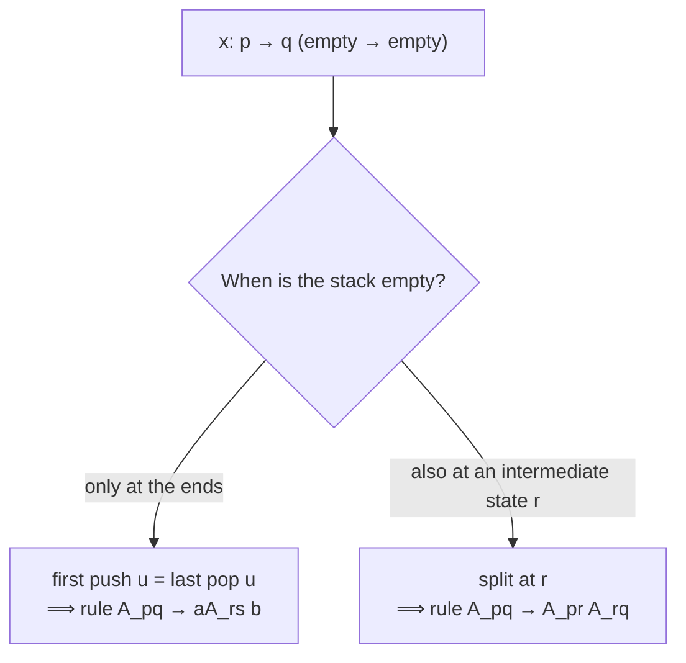
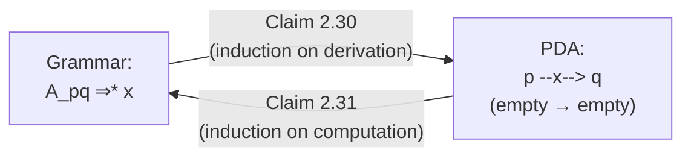

##### THEOREM 2.9 : CHOMSKY NORMAL FORM - (PAGE 109)
#THEOREM9

**THESIS**: Any context-free language is generated by a context-free grammar in Chomsky normal form.

**PROOF IDEA**: We convert any grammar $G$ into Chomsky normal form. The conversion has several stages in which rules that violate the conditions are replaced with equivalent ones that are satisfactory.
**First** we add a new start variable. Then we eliminate all $\varepsilon$-rules of the form $A \to \varepsilon$. We also eliminate all **unit rules** of the form $A \to B$. In both cases we patch up the grammar to be sure that it still generates the same language. Finally we convert the remaining rules into the proper form.

**PROOF**:
Let $G$ be any context-free grammar.

1. **New start variable.** First we add a new start variable $S_0$ and the rule $S_0 \to S$, where $S$ was the original start variable. This change guarantees that the start variable doesn't occur on the right-hand side of a rule.

2. **Eliminate $\varepsilon$-rules.** We remove an $\varepsilon$-rule $A \to \varepsilon$, where $A$ is not the start variable. Then, for each occurrence of an $A$ on the right-hand side of a rule, we add a new rule with that occurrence **deleted**. In other words, if $R \to uAv$ is a rule in which $u$ and $v$ are strings of variables and terminals, we add the rule $R \to uv$. We do so for each occurrence of $A$, so the rule $R \to uAvAw$ causes us to add $R \to uvAw$, $R \to uAvw$, and $R \to uvw$. If we have the rule $R \to A$, we add $R \to \varepsilon$ unless we had previously removed the rule $R \to \varepsilon$. We repeat these steps until we eliminate all $\varepsilon$-rules not involving the start variable.

3. **Eliminate unit rules.** We remove a unit rule $A \to B$. Then, whenever a rule $B \to u$ appears, we add the rule $A \to u$ unless this was a unit rule previously removed. As before, $u$ is a string of variables and terminals. We repeat these steps until we eliminate all unit rules.

4. **Convert to the proper form.** Finally, we convert all remaining rules into the proper form. We replace each rule $A \to u_1u_2\cdots u_k$, where $k \ge 3$ and each $u_i$ is a variable or terminal symbol, with the rules
$$A \to u_1A_1, \quad A_1 \to u_2A_2, \quad A_2 \to u_3A_3, \quad \dots, \quad A_{k-2} \to u_{k-1}u_k.$$
The $A_i$'s are new variables. We replace any terminal $u_i$ in the preceding rule(s) with the new variable $U_i$ and add the rule $U_i \to u_i$.

This concludes the construction: the resulting grammar is in Chomsky normal form and is equivalent to $G$.

---

##### THEOREM 2.20 : EQUIVALENCE OF CFGs AND PDAs - (PAGE 117)
#THEOREM10

**THESIS**: A language is context free if and only if some pushdown automaton recognizes it.

**NOTE**: this theorem has two directions, proved separately by Lemma 2.21 (forward) and Lemma 2.27 (reverse).

**PROOF**: 
The forward direction is Lemma 2.21: every context-free language is recognized by some PDA. The reverse direction is Lemma 2.27: every language recognized by a PDA is context free. Together they establish the "if and only if".

---

##### LEMMA 2.21 : CFL → PDA - (PAGE 117)
#LEMMA3

**LEMMA**: If a language is context free, then some pushdown automaton recognizes it.

**PROOF IDEA**:
Let $A$ be a CFL. From the definition, $A$ has a CFG $G$ generating it. We show how to convert $G$ into an equivalent PDA, which we call $P$.

$P$ accepts its input $w$ if $G$ generates $w$, by determining whether there is a derivation for $w$. Each step of a derivation yields an intermediate string of variables and terminals. The difficulty is figuring out which substitutions to make; the PDA's **nondeterminism** lets it guess the sequence of correct substitutions. $P$ begins by writing the start variable on its stack, goes through intermediate strings one substitution at a time, and eventually arrives at a string containing only terminals; then it accepts if that string is identical to the input.

The PDA can access only the top of the stack, which may be a terminal instead of a variable. The way around this is to keep only **part** of the intermediate string on the stack: the symbols starting with the first variable. Any terminal symbols before the first variable are matched immediately with symbols in the input string.

**PROOF**:

We construct $P = (Q, \Sigma, \Gamma, \delta, q_{start}, F)$. To write an entire string on the stack in one step, we use a shorthand, simulating it by introducing additional states that write the string one symbol at a time. Let $q, r$ be states, $a \in \Sigma_\varepsilon$, $s \in \Gamma_\varepsilon$, and suppose we want to go from $q$ to $r$ reading $a$ and popping $s$, while pushing $u = u_1\cdots u_l$. Introduce new states $q_1, \dots, q_{l-1}$ and set:
$$\delta(q, a, s) \ni (q_1, u_l), \quad \delta(q_1, \varepsilon, \varepsilon) = \{(q_2, u_{l-1})\}, \quad \dots, \quad \delta(q_{l-1}, \varepsilon, \varepsilon) = \{(r, u_1)\}.$$

The states of $P$ are $Q = \{q_{start}, q_{loop}, q_{accept}\} \cup E$, where $E$ is the set of states needed for the shorthand. The start state is $q_{start}$ and the only accept state is $q_{accept}$. The transition function is defined as follows:
$$\delta(q_{start}, \varepsilon, \varepsilon) = \{(q_{loop}, S\$)\}$$
$$\delta(q_{loop}, \varepsilon, A) = \{(q_{loop}, w) \mid A \to w \text{ is a rule in } R\}$$
$$\delta(q_{loop}, a, a) = \{(q_{loop}, \varepsilon)\}$$
$$\delta(q_{loop}, \varepsilon, \$) = \{(q_{accept}, \varepsilon)\}$$

**Some examples**:

> [!info] EXAMPLE 2.25:
> We use the procedure above to construct a PDA $P_1$ from the CFG $G$: $S \to aTb \mid b$ and $T \to Ta \mid \varepsilon$. The state diagram of $P_1$ is shown in Figure 2.26.

**STATE DIAGRAM OF $P_1$**:

---

##### LEMMA 2.27 : PDA → CFL - (PAGE 121)
#LEMMA4

**LEMMA**: If a pushdown automaton recognizes some language, then it is context free.

**PROOF IDEA**: We have a PDA $P$ and want a CFG $G$ that generates all the strings $P$ accepts. For each pair of states $p$ and $q$, the grammar has a variable $A_{pq}$ generating all the strings that take $P$ from $p$ with an empty stack to $q$ with an empty stack.

First, modify $P$ so that it has three features:
1. a single accept state, $q_{accept}$;
2. it empties its stack before accepting;
3. each transition either **pushes** or **pops** one symbol, never both.

To design $G$, note that for any such string $x$, the first move on $x$ must be a push (every move is a push or a pop, and $P$ can't pop an empty stack), and the last move must be a pop (the stack ends up empty). Either the symbol popped at the end is the symbol pushed at the beginning — giving the rule $A_{pq} \to aA_{rs}b$ — or the initially pushed symbol gets popped before the end, so the stack becomes empty at some intermediate point — giving the rule $A_{pq} \to A_{pr}A_{rq}$.

**PROOF**:
Let $P = (Q, \Sigma, \Gamma, \delta, q_0, \{q_{accept}\})$ and construct $G$. The variables of $G$ are $\{A_{pq} \mid p, q \in Q\}$ and the start variable is $A_{q_0, q_{accept}}$. The rules are given in three parts:
1. for each $p, q, r, s \in Q$, $u \in \Gamma$, and $a, b \in \Sigma_\varepsilon$, if $\delta(p, a, \varepsilon)$ contains $(r, u)$ and $\delta(s, b, u)$ contains $(q, \varepsilon)$, put $A_{pq} \to aA_{rs}b$;
2. for each $p, q, r \in Q$, put $A_{pq} \to A_{pr}A_{rq}$;
3. for each $p \in Q$, put $A_{pp} \to \varepsilon$.

**Figure 2.28**:

![[figure2.28.png]]

>[!info] The stack is **empty at $p$, $r$, and $q$**. The first part takes $P$ from $p$ to $r$ and the second from $r$ to $q$, each starting and ending with an empty stack — this is exactly the concatenation $x = yz$ generated by $A_{pq} \to A_{pr}A_{rq}$.

**Figure 2.29**

![[figure2.29.png]]

> [!info] The dashed line at **stack height 1** represents the symbol $u$ pushed when reading $a$. The middle computation stays **above** $u$ (it never touches it), and $u$ is popped only when reading $b$ at the end — this is exactly the string $x = ayb$ generated by $A_{pq} \to aA_{rs}b$.

---

##### CLAIM 2.30 : FROM DERIVATION TO COMPUTATION - (PAGE 123)
#CLAIM1

**CLAIM**: If $A_{pq}$ generates $x$, then $x$ can bring $P$ from $p$ with an empty stack to $q$ with an empty stack.

**PROOF IDEA**: We prove the claim by **induction on the number of steps** in the derivation of $x$ from $A_{pq}$. Each rule of $G$ mirrors a possible shape of a PDA computation.

**PROOF**:
**Basis:** A derivation with a single step must use a rule whose right-hand side contains no variables; the only such rules are $A_{pp} \to \varepsilon$. Then $x = \varepsilon$, and $\varepsilon$ clearly takes $P$ from $p$ with an empty stack back to $p$ with an empty stack.

**Induction step:** Assume the claim true for derivations of length at most $k \ge 1$, and prove it for derivations of length $k+1$. Suppose $A_{pq} \Rightarrow^* x$ in $k+1$ steps. The first step is either $A_{pq} \Rightarrow aA_{rs}b$ or $A_{pq} \Rightarrow A_{pr}A_{rq}$; we handle the two cases separately.

**Case 1 — $A_{pq} \Rightarrow aA_{rs}b$:** Consider the portion $y$ of $x$ that $A_{rs}$ generates, so $x = ayb$. Since $A_{rs} \Rightarrow^* y$ in $k$ steps, the induction hypothesis tells us that $P$ can go from $r$ on an empty stack to $s$ on an empty stack. Because $A_{pq} \to aA_{rs}b$ is a rule, $\delta(p,a,\varepsilon)$ contains $(r,u)$ and $\delta(s,b,u)$ contains $(q,\varepsilon)$ for some stack symbol $u$. Hence, starting at $p$ with an empty stack, after reading $a$ the machine can go to $r$ and push $u$; reading $y$ brings it to $s$ leaving $u$ on the stack; then reading $b$ it goes to $q$ and pops $u$. Therefore $x$ brings $P$ from $p$ with an empty stack to $q$ with an empty stack.

**Figure 1:**

**Figure 2:**

**Case 2 — $A_{pq} \Rightarrow A_{pr}A_{rq}$.** Consider the portions $y$ and $z$ of $x$ that $A_{pr}$ and $A_{rq}$ respectively generate, so $x = yz$. Since $A_{pr} \Rightarrow^* y$ in at most $k$ steps and $A_{rq} \Rightarrow^* z$ in at most $k$ steps, the induction hypothesis tells us that $y$ brings $P$ from $p$ to $r$ and $z$ brings it from $r$ to $q$, with empty stacks at the beginning and end. Hence $x$ brings $P$ from $p$ to $q$ with empty stacks. This completes the induction step.

**Figure 1:**

**Figure 2:**

---

##### CLAIM 2.31 : FROM COMPUTATION TO DERIVATION - (PAGE 123)
#CLAIM2 

**CLAIM**: If $x$ can bring $P$ from $p$ with an empty stack to $q$ with an empty stack, then $A_{pq}$ generates $x$.

**PROOF IDEA**: We prove the claim by **induction on the number of steps** in the computation of $P$ on input $x$. We look at *when* the stack becomes empty: only at the two endpoints, or also at some intermediate state $r$.

**PROOF**:
**Basis:** A computation with 0 steps starts and ends at the same state — say $p$. In 0 steps $P$ cannot read any characters, so $x = \varepsilon$; by construction $G$ has the rule $A_{pp} \to \varepsilon$.

**Induction step:** Assume the claim true for computations of length at most $k \ge 0$, and prove it for computations of length $k+1$. Suppose $x$ brings $p$ to $q$ with empty stacks in $k+1$ steps. Either the stack is empty only at the beginning and end of this computation, or it becomes empty elsewhere too.

**Case 1 — the stack is empty only at the ends:** The symbol pushed at the first move must be the same as the symbol popped at the last move; call it $u$. Let $a$ be the input read in the first move, $b$ that read in the last move, $r$ the state after the first move, and $s$ the state before the last move. Then $\delta(p,a,\varepsilon)$ contains $(r,u)$ and $\delta(s,b,u)$ contains $(q,\varepsilon)$, so the rule $A_{pq} \to aA_{rs}b$ is in $G$. Let $y$ be the portion of $x$ without $a$ and $b$, so $x = ayb$. Input $y$ can bring $P$ from $r$ to $s$ without touching the symbol $u$ on the stack, so $P$ goes from $r$ with an empty stack to $s$ with an empty stack on input $y$. We removed the first and last steps, so this computation on $y$ has $(k+1)-2 = k-1$ steps; by the induction hypothesis $A_{rs} \Rightarrow^* y$. Hence $A_{pq} \Rightarrow^* x$.

**Case 2 — the stack becomes empty at an intermediate state $r$.** The portions of the computation from $p$ to $r$ and from $r$ to $q$ each contain at most $k$ steps. If $y$ is the input read during the first portion and $z$ that read during the second, the induction hypothesis gives $A_{pr} \Rightarrow^* y$ and $A_{rq} \Rightarrow^* z$. Because the rule $A_{pq} \to A_{pr}A_{rq}$ is in $G$, we get $A_{pq} \Rightarrow^* x$. This completes the induction step and the proof.

> [!info] The two claims together establish the **iff**: $A_{pq}$ generates $x$ **if and only if** $x$ takes $P$ from $p$ to $q$ with empty stacks. This is exactly the correctness of the grammar $G$ built from $P$.

---

##### THEOREM 2.34 : PUMPING LEMMA FOR CONTEXT-FREE LANGUAGES - (PAGE 125)
#THEOREM11

**THESIS**: If $A$ is a context-free language, then there is a number $p$ (the **pumping length**) where, if $s$ is any string in $A$ of length at least $p$, then $s$ may be divided into five pieces $s = uvxyz$ satisfying the conditions
1. for each $i \ge 0$, $uv^ixy^iz \in A$,
2. $|vy| > 0$, and
3. $|vxy| \le p$.

> [!info] Condition 2 says that either $v$ or $y$ is not the empty string; otherwise the theorem would be trivially true. Condition 3 says that the pieces $v$, $x$, and $y$ together have length at most $p$; it is a technical condition, sometimes useful when proving that a language is not context free.

**PROOF IDEA**: Let $A$ be a CFL and let $G$ be a CFG that generates it. Any sufficiently long string $s \in A$ has a parse tree that is **very tall**, so some long path from the root to a leaf contains a variable $R$ that **repeats** (pigeonhole principle). This repetition allows us to replace the subtree under the **second** occurrence of $R$ with the subtree under the **first** occurrence and still obtain a legal parse tree. Cutting $s$ into five pieces $uvxyz$ as in Figure 2.35, we may repeat the second and fourth pieces together and obtain a string still in the language.

**PROOF**:
Let $G$ be a CFG for the CFL $A$. Let $b$ be the maximum number of symbols on the right-hand side of a rule (assume at least 2). In any parse tree using $G$, a node can have no more than $b$ children: at most $b$ leaves are 1 step from the start variable, at most $b^2$ are within 2 steps, and at most $b^h$ are within $h$ steps. So a parse tree of height at most $h$ generates a string of length at most $b^h$; conversely, a string of length at least $b^h + 1$ requires every parse tree to be at least $h+1$ high.

Let $|V|$ be the number of variables in $G$, and set the pumping length to $p = b^{|V|+1}$. If $s \in A$ has length at least $p$, its parse tree must be at least $|V|+1$ high, because $b^{|V|+1} \ge b^{|V|} + 1$. Choose a parse tree $\tau$ for $s$ with the **smallest number of nodes**. Its longest root-to-leaf path has at least $|V|+1$ variables, so some variable $R$ appears more than once on that path; for convenience, choose $R$ to be a variable that repeats among the **lowest** $|V|+1$ variables on the path.

Divide $s$ into $uvxyz$ according to Figure 2.35. The upper occurrence of $R$ generates $vxy$, while the lower occurrence generates just $x$; both subtrees are generated by the same variable, so we may substitute one for the other and still obtain a valid parse tree.

- Replacing the smaller subtree by the larger repeatedly gives parse trees for $uv^ixy^iz$ for each $i > 1$; replacing the larger by the smaller gives $uxz$. This establishes **condition 1**.
- To get **condition 2**, note that if $v$ and $y$ were both $\varepsilon$, substituting the smaller subtree for the larger would give a parse tree for $s$ with fewer nodes than $\tau$, which is impossible by the choice of $\tau$.
- To get **condition 3**, the upper occurrence of $R$ generates $vxy$. Since both occurrences fall within the bottom $|V|+1$ variables of the longest path, the subtree generating $vxy$ has height at most $|V|+1$, so it generates a string of length at most $b^{|V|+1} = p$.

![[figure2.35.png]]

> [!info] In the original tree the **upper** $R$ generates $vxy$ and the **lower** $R$ generates $x$. **Pump up:** replace the lower subtree with a copy of the upper one → $uv^2xy^2z$. **Pump down:** replace the upper subtree with the lower one → $uxz$.

---

##### LEMMA 2.41 : DPDA READS THE WHOLE INPUT - (PAGE 132)
#LEMMA5

**THESIS**: Every DPDA has an equivalent DPDA that always reads the entire input string.

**PROOF IDEA**: A DPDA may fail to read the whole input by **hanging** (trying to pop an empty stack) or by **looping** (endless ε-input moves). Hanging is fixed by initializing the stack with a special symbol: if it is popped before the end, the DPDA reads to the end and rejects. Looping is fixed by identifying the looping situations and reprogramming the machine to read and reject.

**PROOF**:
Let $P = (Q, \Sigma, \Gamma, \delta, q_0, F)$ be a DPDA. Add a new start state $q_{start}$, an accept state $q_{accept}$, a reject state $q_{reject}$, and auxiliary states.
1. **Accepting states persist until the next input symbol:**For each $q \in Q$ add a copy $q_a$; if $\delta(q,\varepsilon,x) = (r,y)$, set $\delta(q_a,\varepsilon,x) = (r_a,y)$, and if $q \in F$ also set $\delta(q,\varepsilon,x) = (r_a,y)$. For $a \in \Gamma$, if $\delta(q,a,x) = (r,y)$, set $\delta(q_a,a,x) = (r,y)$.
2. **No hanging:** Set $\delta(q_{start},\varepsilon,\varepsilon) = (q_0,\$)$. If $P$ sees $\$$ in a non-accepting state, it enters $q_{reject}$ and scans to the end; if it sees $\$$ in an accepting state, it enters $q_{accept}$, and if input remains it enters $q_{reject}$ and scans to the end.
3. **No looping:** For $q \in Q$ and $x \in \Gamma$, call $(q,x)$ a **looping situation** if, starting in $q$ with $x$ on top, $P$ never pops below $x$ and never reads an input symbol. If it is accepting, set $\delta(q,\varepsilon,x) = (q_{accept},\varepsilon)$; otherwise set $\delta(q,\varepsilon,x) = (q_{reject},\varepsilon)$.

Henceforth we assume DPDAs read their input to the end.

---

##### THEOREM 2.42 : DCFLs ARE CLOSED UNDER COMPLEMENT - (PAGE 133)
#THEOREM12

**THESIS**: The class of DCFLs is closed under complementation.

**PROOF IDEA**: For DFAs it suffices to swap accept and non-accept states. For DPDAs there is a catch: the machine may enter both accept and non-accept states in a sequence of moves at the end of the input, and swapping would still accept. The fix is to modify the DPDA so that acceptance can occur only in **reading states** — states that are about to read the next input symbol. Then swap acceptance only among reading states.

**PROOF**:
First modify $P$ as in Lemma 2.41, so that it always reads the entire input and, once it enters an accept state, remains in accepting states until the next input symbol. Identify the **reading states**: if $\delta(q,a,\varepsilon) \neq \emptyset$ for $a \in \Sigma$, then $q$ is a reading state. If a step both reads and pops, split it into a pop followed by a read: for $\delta(q,a,x) = (r,y)$ with $a \in \Sigma$ and $x \in \Gamma$, add a new state $q_x$ and set $\delta(q,\varepsilon,x) = (q_x,\varepsilon)$ and $\delta(q_x,a,\varepsilon) = (r,y)$; make $q_x$ a reading state, accepting iff $q \in F$. Remove the accepting designation from every non-reading state, then swap which reading states are accepting. The resulting DPDA recognizes the complement.

> [!warning] CONSEQUENCE: 
> Some CFLs are not DCFLs. Any CFL whose complement is not a CFL cannot be a DCFL. For example $A = \{a^ib^jc^k \mid i \ne j \text{ or } j \ne k\}$ is a CFL but not a DCFL.

---

##### THEOREM 2.43 : ENDMARKERS AND DCFLs - (PAGE 134)
#THEOREM13

**THESIS**: $A$ is a DCFL if and only if $A\dashv$ is a DCFL.

**PROOF IDEA**:
- **Forward direction:** if $P$ recognizes $A$, a DPDA $P'$ recognizes $A\dashv$ by simulating $P$ until it reads the endmarker $\dashv$. At that point $P'$ accepts iff $P$ had entered an accept state during the previous symbol; $P'$ reads no symbol after $\dashv$.
- **Reverse direction:** if $P$ recognizes $A\dashv$, we build $P'$ recognizing $A$. Before reading each symbol, $P'$ determines whether $P$ would accept if that symbol were the endmarker. Since this may depend on the stack, $P'$ stores extra information (sets of states) interleaved with the stack.

**PROOF**:
**Forward direction:** Let $P = (Q, \Sigma, \Gamma, \delta, q_0, F)$ be a DPDA recognizing $A$; by Lemma 2.41 we may assume that $P$ always reads its entire input. Construct a DPDA $P'$ recognizing $A\dashv$. On input $w\dashv$, $P'$ simulates $P$ on $w$ exactly as $P$ does. When the next input symbol is the endmarker $\dashv$, $P'$ does **not** simulate a move of $P$ on $\dashv$; instead, it accepts iff $P$ had entered an accept state during the previous symbol (i.e. after reading the last symbol of $w$, including any ε-moves performed at that point). In every other case $P'$ rejects. Thus $P'$ accepts exactly the strings $w\dashv$ with $w \in A$, and it never reads past $\dashv$.

**Reverse direction:** Let $P = (Q, \Sigma \cup \{\dashv\}, \Gamma, \delta, q_0, F)$ recognize $A\dashv$. Modify $P$ so that each move does exactly one of: read an input symbol, push a symbol, or pop a symbol. Construct $P' = (Q', \Sigma, \Gamma', \delta', q_0', F')$ with $\Gamma' = \Gamma \cup \mathcal{P}(Q)$: the stack of $P'$ interleaves symbols of $P$ with subsets of $Q$. A subset $R$ on top means that, starting $P$ in any state of $R$, $P$ eventually accepts without reading more input. Initially push $R_0$, the set of states from which $P$ accepts with an empty stack without reading input.
- **Pop move:** pop and discard the top set, then pop the symbol $P$ would pop.
- **Push move** $\delta(q,\varepsilon,\varepsilon) = (r,x)$: push $x$, then push the set $S = \{q \mid q \in F \text{ or } (\delta(q,\varepsilon,x) = (r,\varepsilon) \text{ and } r \in R)\}$, where $R$ is the set previously on top.
- **Read move** $\delta(q,a,\varepsilon) = (r,\varepsilon)$: examine the top set $R$; enter an accept state iff $r \in R$ (and, if input remains, continue simulating $P$).

This $P'$ accepts exactly the strings $w$ such that $w\dashv \in A\dashv$, i.e. $w \in A$.

---

