# OGA — Lezione 6: Dal bilancio alla start-up

> **Lezione n. 6 — 16/10/2026**
> Appunti sintetici e lineari. Sono omesse le slide amministrative (Business Game del 5 novembre, aggiornamento esonero, formazione gruppi).

---

## Indice

1. [Un esempio reale di bilancio: AST SpA 2025](#1-un-esempio-reale-di-bilancio-ast-spa-2025)
2. [Che cos'è una start-up](#2-che-cosè-una-start-up)
3. [Start-up e impresa: le differenze](#3-start-up-e-impresa-le-differenze)
4. [La crescita "hockey stick"](#4-la-crescita-hockey-stick)
5. [I quattro stadi della crescita](#5-i-quattro-stadi-della-crescita)
6. [Esempi reali](#6-esempi-reali)
7. [La start-up in Italia](#7-la-start-up-in-italia)
8. [Glossario della lezione](#8-glossario-della-lezione)

---

## 1. Un esempio reale di bilancio: AST SpA 2025

La lezione parte da un **bilancio vero**, scaricato dalla **CCIAA** (Camera di Commercio). Serve a capire come i concetti della lezione 5 (Stato Patrimoniale, Conto Economico, indici) si applicano a un'azienda reale.

### 1.1 Cosa contiene un fascicolo di bilancio

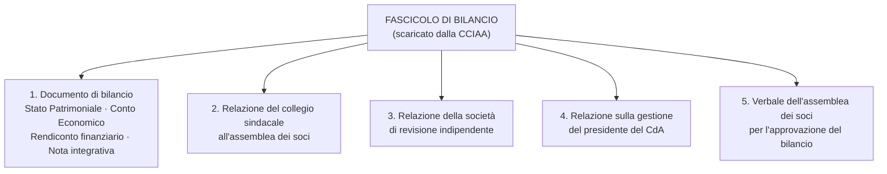

> [!info] Da ricordare
> Il bilancio **non è solo** SP + CE + Nota Integrativa: il fascicolo include anche **Rendiconto finanziario**, relazioni dei sindaci e dei revisori, relazione sulla gestione e verbale assembleare.

### 1.2 Gli indici calcolati su AST SpA 2025

| Indice | Formula | Valori AST SpA 2025 | Risultato |
|---|---|---|---|
| **ROI** | Reddito operativo / Capitale investito | 25.392.314 / (500.471.797 + 1.389.154.732) | **1,34%** |
| **ROS** | Reddito operativo / Ricavi | 25.392.314 / 2.299.218.712 | **1,10%** |
| **ROE** | Utile / Mezzi propri | 981.348 / 599.221.122 | **0,16%** |

**Come leggerli:**

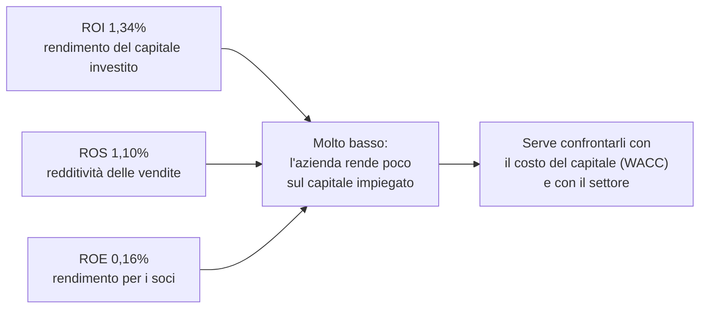

> Un ROI dell'1,34% è **molto contenuto**: se il costo medio del capitale (WACC) fosse superiore, l'impresa **non creerebbe valore** (ROI < WACC). Il ROE dello 0,16% dice che il rendimento per i soci è quasi nullo. Sono numeri tipici di settori **capital intensive** o a **bassa marginalità**: non basta il valore assoluto, serve il **confronto** con il costo del capitale e con i concorrenti.

---

## 2. Che cos'è una start-up

Non esiste una definizione unica. La lezione ne riporta **tre**, poi le combina.

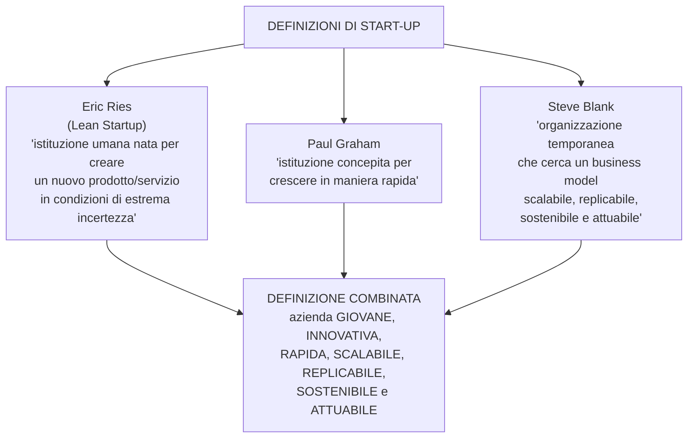

> [!example] La definizione da ricordare
> La start-up è un'**azienda giovane, innovativa, rapida, scalabile, replicabile, sostenibile e attuabile**.

Le tre definizioni mettono l'accento su aspetti diversi:

- **Ries** → l'**incertezza**: si crea qualcosa di nuovo senza sapere se funzionerà.
- **Graham** → la **crescita rapida**.
- **Blank** → la **ricerca del business model**, temporanea e per definizione non ancora stabile.

---

## 3. Start-up e impresa: le differenze

### 3.1 Ogni impresa ha la sua fase di start-up

> Ogni impresa attraversa un periodo iniziale di "startup", in cui si definiscono **processi organizzativi** e **investimenti economici**.

La differenza non è quindi "start-up = giovane, impresa = vecchia". La differenza è **strutturale**.

### 3.2 La differenza principale: la scalabilità

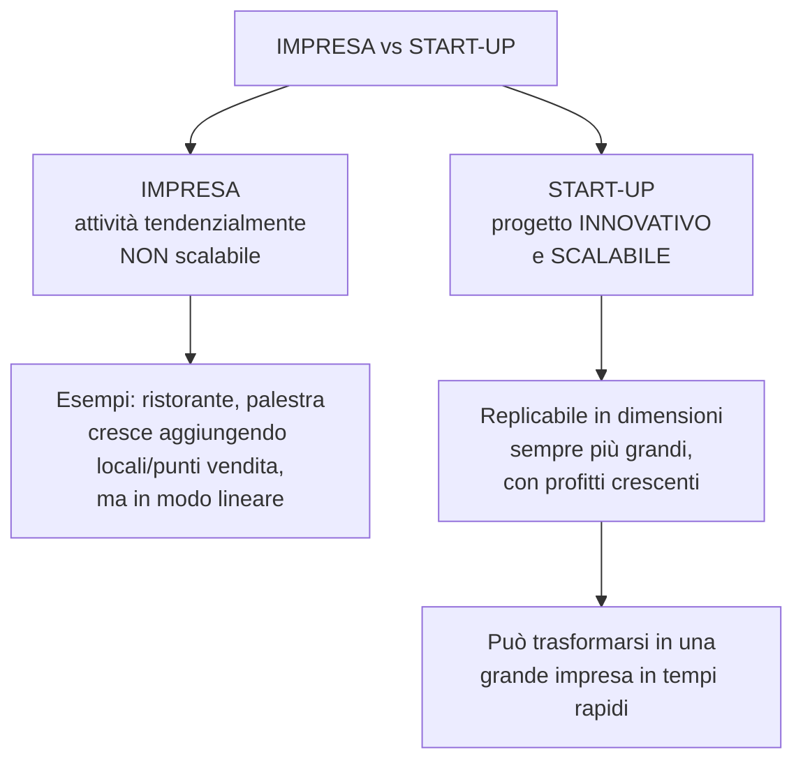

- **Impresa "tradizionale":** non ha tendenzialmente un'attività **scalabile** (es. aprire un ristorante o una palestra). Per crescere deve moltiplicare i punti vendita.
- **Start-up:** si fonda su un **progetto innovativo e scalabile**, cioè **replicabile** su scala sempre più grande, con **profitti crescenti**, per diventare una grande impresa in tempi rapidi.

### 3.3 La differenza di obiettivo

| | Impresa | Start-up innovativa |
|---|---|---|
| **Obiettivo principale** | Generare **profitto** | **Stupire il mercato** con un'idea nuova che può cambiare la vita delle persone o un intero settore |
| **Modo di crescere** | Lineare (più punti vendita, più capacità) | Esponenziale (replicabilità del modello) |
| **Rischio** | Contenuto / noto | Alto (estrema incertezza) |

---

## 4. La crescita "hockey stick"

La start-up è associata a un modello di crescita a **"bastone da hockey"**:

- **fase iniziale** di crescita **lenta o stagnante**;
- poi un'**improvvisa impennata** verso l'alto;
- crescita **esponenziale**.

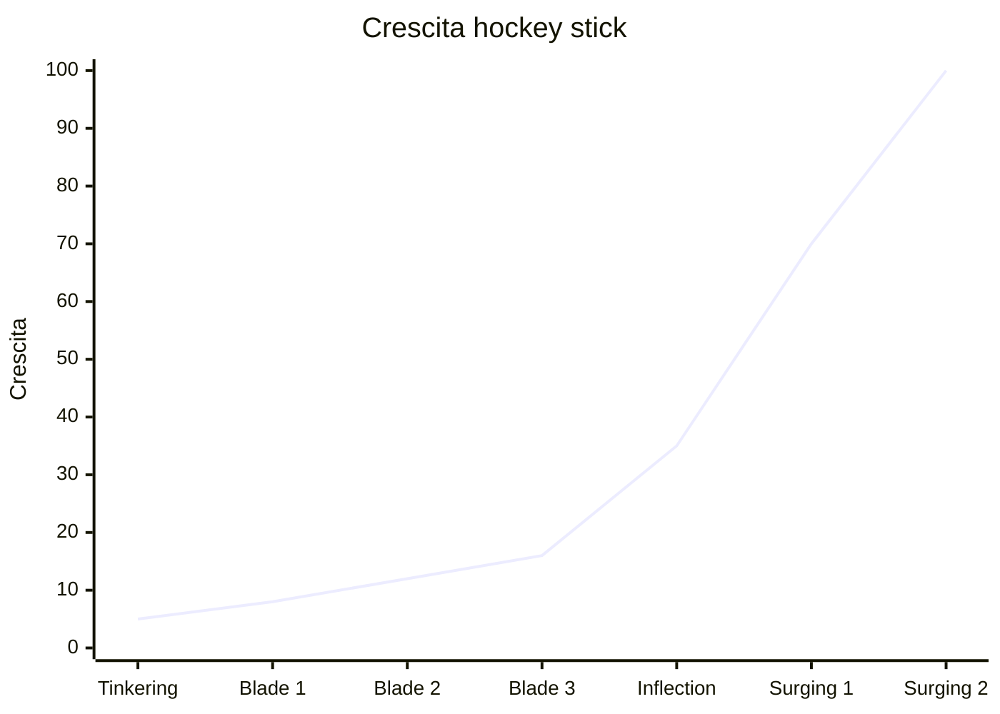

> [!info] Perché si chiama così
> Il grafico ricorda la forma di un **bastone da hockey**: lungo e quasi piatto all'inizio, poi piegato verso l'alto. È la rappresentazione visiva della **crescita esponenziale**.

---

## 5. I quattro stadi della crescita

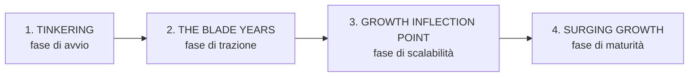

### 5.1 Tinkering — fase di avvio

- Gli imprenditori **analizzano ed esplorano** l'idea, verificano la **fattibilità commerciale** e cercano l'equilibrio tra **problema e soluzione**.
- Termina quando i fondatori si **impegnano a fondo** per trasformare l'idea in realtà.
- Di solito i fondatori **non abbandonano** il proprio lavoro in questa fase.
- È la fase con **meno pressione**, ma alcuni errori possono rovinare tutto:
  - perdere tempo a costruire un **business model elaborato**;
  - **non mostrare campioni reali** e non cercare feedback per paura che i concorrenti copino l'idea.

> **Focus:** sperimentazione e sviluppo dell'offerta **sulla base del feedback** dei potenziali clienti.

### 5.2 The Blade Years — fase di trazione

- L'idea viene **convalidata sul mercato** con le prime versioni (**MVP**, versione **beta**).
- Si sviluppano l'**offerta finale** e il **business model**.
- I fondatori **lasciano il lavoro** e si dedicano completamente all'azienda.
- Dura in genere **3-4 anni**; i ricavi sono **esigui**.
- Si finanzia spesso con **bootstrapping** (autofinanziamento).

**Errori tipici:**

1. Dedicare troppo tempo a **pitch deck** elaborati per raccogliere capitali;
2. spendere cifre esorbitanti in **vendite e marketing**;
3. **non essere disposti** a modificare ulteriormente il prodotto.

### 5.3 Growth Inflection Point — fase di scalabilità

- È il **punto di svolta**: il business model viene **perfezionato**.
- La start-up registra un **aumento esponenziale dei ricavi**.
- Si possono attirare **venture capitalist** e altri investitori.

**Rischi:**

1. la crescita è **troppo rapida** e alcune start-up **crollano**;
2. si cambia un modello che **funzionava già bene**.

> **Obiettivo:** valutare attentamente le operazioni e **sincronizzarle** con la crescita dei ricavi.

### 5.4 Surging Growth — fase di maturità

- La crescita **accelera** e attira sempre più clienti.
- Si devono gestire le **complessità** organizzative dell'esplosione del mercato.
- Molte grandi aziende fanno **offerte di acquisto**.

**Tre scelte possibili:**

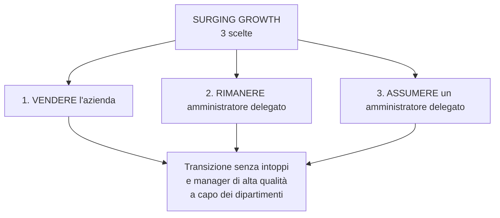

> **Attenzione:** assumere manager **di alta qualità**, non persone non qualificate dalla propria rete personale.

### 5.5 Schema riassuntivo dei 4 stadi

| Stadio | Obiettivo | Chi lavora | Ricavi | Rischio principale |
|---|---|---|---|---|
| **Tinkering** | Verificare fattibilità e problem-solution fit | Fondatori, spesso con altri lavori | Nessuno | Non testare il prodotto / perdere tempo |
| **Blade Years** | Validare sul mercato (MVP/beta) | Fondatori full-time | Esigui (3-4 anni) | Pitch deck e marketing eccessivi |
| **Growth Inflection Point** | Scalare il modello | Team in crescita + VC | Crescita esponenziale | Crescere troppo e crollare |
| **Surging Growth** | Gestire la complessità e consolidare | Manager professionali | Elevati e crescenti | Perdere il controllo / transizione |

---

## 6. Esempi reali

La lezione applica i 4 stadi a **9 start-up**. Qui la sintesi essenziale.

### 6.1 Tabella comparativa

| Start-up | Tinkering | Blade Years | Growth Inflection | Surging Growth |
|---|---|---|---|---|
| **Airbnb** | 2007-08: materassi gonfiabili, 2 prenotazioni a SXSW | 2009-10: nome Airbnb, app, Instant Book | 2011-13: 1 mln di notti, ufficio a Berlino | 2014-17: 10 mln ospiti (2013) → 150 mln (2015) → 260 mln (2016) |
| **Spotify** | 2006-07: tecnologia streaming + accordi con le case discografiche | 2008-10: lancio in Europa, mobile, 10 mln utenti, freemium | 2011-14: ingresso negli USA ed espansione | 2015-18: Discover Weekly, 71 mln Premium (2017), IPO 2018 |
| **Netflix** | 1997-99: noleggio DVD via Internet, abbonamento | 2000-06: raccomandazioni, catalogo, IPO 2002, 5 mln abbonati | 2007-12: streaming, Canada, America Latina, Europa | 2013-18: House of Cards, 130 Paesi (2016), 190+ mercati (2018) |
| **YOOX** | 2000-02: e-commerce di moda e design | 2003-06: USA, Giappone, partnership con i brand | 2007-12: crescita ricavi, IPO 2009, automazione logistica | 2013-15: FTSE MIB, fusione con Net-a-Porter (2015) |
| **Satispay** | 2013-15: problema dei piccoli pagamenti elettronici, lancio app | 2015-17: rete di esercenti, massa critica | 2018-21: 500k utenti (2018), 1 mln (2020), 93 mln € | 2022-26: unicorno (2022), welfare (2023), 6,5 mln utenti (2026) |
| **Scalapay** | 2019: BNPL, lancio in Italia | 2020: Francia, rate nei negozi fisici | 2021: 40 mln € seed + 155 mln $ Series A, ~700 mln $ | 2022-25: 497 mln $ Series B, unicorno ~1,9 mld $, partnership Visa/Deutsche Bank |
| **Musixmatch** | 2010: catalogo di testi autorizzati, API | 2013-18: 10 mln download, Apple Music (2016) | 2019-22: Instagram, Spotify globale, TPG | 2023-24: Musixmatch Pro, 80 mln appassionati, 1,2 mln artisti |
| **Freetrade** | 2015-18: app di investimento senza commissioni | 2019-20: abbonamenti e modello commerciale | 2020-22: crescita del trading da smartphone | 2023-25: ricavi +32% (£27,5 mln), EBITDA positivo, acquisizione IG Group |
| **Exein** | 2018-20: sicurezza informatica dei dispositivi IoT | 2021-23: piattaforma e commercializzazione | 2024: 15 mln € Series B, 80 mln dispositivi protetti | 2025-26: 170 mln €, round da 270 mln $, valutazione 1,7 mld $ |

### 6.2 Cosa insegnano gli esempi

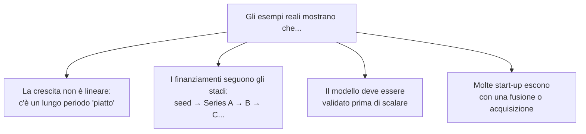

---

## 7. La start-up in Italia

### 7.1 La disciplina giuridica

In Italia esiste una **disciplina specifica** per le **start-up innovative**, introdotta dal:

- **decreto-legge 18 ottobre 2012, n. 179**, convertito con modificazioni dalla **legge 17 dicembre 2012, n. 221**.

La definizione è nell'**art. 25, comma 2**, del DL 179/2012, **modificato dalla legge 193/2024**.

> [!info] Definizione legale (sintesi)
> È **start-up innovativa** la **società di capitali**, costituita anche in forma **cooperativa**, le cui azioni o quote **non sono quotate** su un mercato regolamentato o su un sistema multilaterale di negoziazione, che possiede **determinati requisiti** e ha come **oggetto sociale esclusivo o prevalente** lo sviluppo, la produzione e la commercializzazione di **prodotti o servizi innovativi ad alto valore tecnologico**.

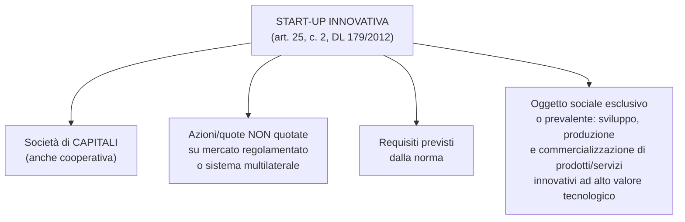

### 7.2 I requisiti (almeno uno dei tre)

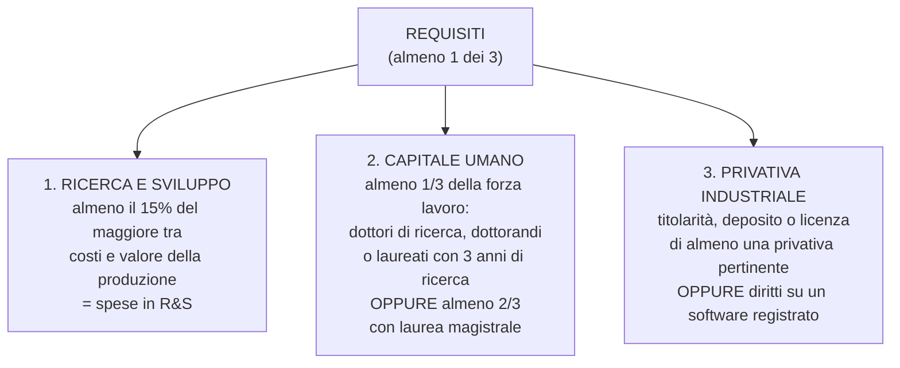

### 7.3 Gli incentivi per chi investe

Sono previste **agevolazioni fiscali** per chi investe nelle start-up.

| Investitore | Detrazione/deduzione | Tetto per periodo d'imposta | Vincolo |
|---|---|---|---|
| **Persona fisica** | Detrazione **IRPEF** del **30%** dell'investimento | fino a **1.000.000 €** | mantenere l'investimento **almeno 3 anni** |
| **Soggetto passivo IRES** | Deduzione dalla base imponibile del **30%** dell'investimento | fino a **1.800.000 €** | mantenere l'investimento **almeno 3 anni** |

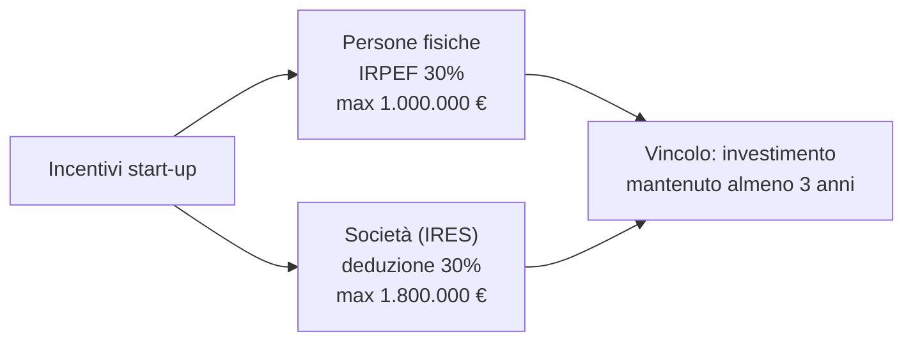

---

## 8. Glossario della lezione

| Termine | Significato essenziale |
|---|---|
| **Start-up** | Azienda giovane, innovativa, rapida, scalabile, replicabile, sostenibile e attuabile. |
| **Scalabilità** | Capacità di replicare il modello su dimensioni sempre più grandi con profitti crescenti. |
| **Bootstrapping** | Autofinanziamento, senza capitali esterni. |
| **MVP** | *Minimum Viable Product*: prima versione minima ma funzionante del prodotto. |
| **Beta** | Versione di prova aperta a un gruppo di utenti. |
| **Pitch deck** | Presentazione sintetica per raccogliere capitali. |
| **Freemium** | Modello con servizio base gratuito e versione premium a pagamento. |
| **Hockey stick** | Curva di crescita piatta all'inizio e poi esponenziale. |
| **Tinkering** | Fase di avvio: sperimentazione e problem-solution fit. |
| **Blade Years** | Fase di trazione: validazione sul mercato con MVP/beta. |
| **Growth Inflection Point** | Punto di svolta: il modello è perfezionato e i ricavi esplodono. |
| **Surging Growth** | Fase di maturità: crescita accelerata e consolidamento. |
| **Unicorno** | Start-up con valutazione superiore a 1 miliardo di dollari. |
| **Venture capitalist** | Investitore specializzato in start-up ad alto potenziale. |
| **Start-up innovativa** | Qualifica giuridica italiana (DL 179/2012) con requisiti e incentivi specifici. |

---

> **Collegamento con la lezione 5:** il bilancio e gli indici (ROI, ROS, ROE) servono a **misurare** un'impresa matura; la start-up è invece l'**impresa nascente**, che parte da un'idea, attraversa 4 stadi e solo alla fine diventa un'impresa "tradizionale" misurabile con quei numeri.
