# OGA — Organizzazione e gestione per lo start up aziendale

> Riassunto completo e lineare degli argomenti delle **lezioni 1–5** (Prof. Michelangelo Smeriglio).
> Documento didattico: spiegazioni semplici + schemi e grafici (diagrammi Mermaid).

---

## Indice

1. [Introduzione: di cosa parla il corso](#1-introduzione-di-cosa-parla-il-corso)
2. [L'impresa e l'approccio sistemico](#2-limpresa-e-lapproccio-sistemico)
3. [Il sistema impresa, l'organizzazione e l'ambiente](#3-il-sistema-impresa-lorganizzazione-e-lambiente)
4. [L'area organizzativa: i modelli organizzativi](#4-larea-organizzativa-i-modelli-organizzativi)
5. [Il ciclo di vita e il declino organizzativo](#5-il-ciclo-di-vita-e-il-declino-organizzativo)
6. [L'azienda, il bilancio e gli indici](#6-lazienda-il-bilancio-e-gli-indici)
7. [Glossario delle parole chiave](#7-glossario-delle-parole-chiave)

---

## 1. Introduzione: di cosa parla il corso

*(Lezione 1)*

Il corso approfondisce **l'impresa e il suo start-up**. L'obiettivo è dare uno strumento
per capire:

- **come è fatta e come funziona** un'impresa (organizzazione, funzioni, relazioni);
- **come nasce una start-up** partendo da un'idea;
- **come si scrive un business plan** (analisi di mercato, ricavi, costi, proiezioni).

Il programma si articola in **tre aree principali**:

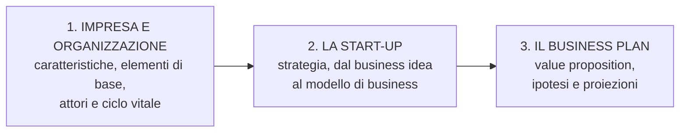

**Parole chiave del corso:** sistema / sovra-sistemi / sub-sistemi · organizzazione dell'impresa ·
funzioni aziendali · modello di business · conto economico · flussi di cassa · SWOT analysis ·
competitività e vantaggio competitivo.

**Il metodo di analisi adottato è quello *sistemico*:** guardare l'impresa come un tutto
integrato, non come una somma di parti separate.

---

## 2. L'impresa e l'approccio sistemico

*(Lezione 1)*

### 2.1 L'impresa come fenomeno

L'impresa può essere osservata sotto **tre profili**:

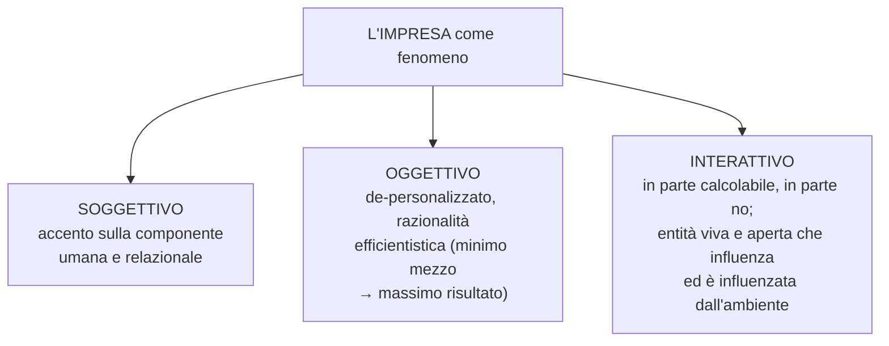

- **Soggettivo:** l'attenzione va alle **persone** e alle relazioni tra obiettivi
  dell'organizzazione e obiettivi dei singoli.
- **Oggettivo:** l'impresa è vista in modo **spersonalizzato**, secondo un principio di
  **razionalità efficientistica**. Si ignorano gli elementi immateriali per poter misurare tutto
  e fare calcoli razionali.
- **Interattivo:** una parte delle relazioni è **calcolabile**, un'altra risponde a logiche
  **non economiche** e quindi poco controllabili. L'impresa è un'entità viva e aperta, immersa
  in sistemi più vasti, che influenza ed è influenzata.

### 2.2 Gli approcci allo studio dell'impresa

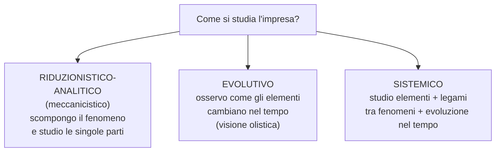

- **Riduzionistico-analitico** (meccanicistico): tipico delle teorie classiche (Taylor e
  l'"organizzazione scientifica del lavoro"). Si scompone il fenomeno in parti e si studiano
  separatamente.
- **Evolutivo:** si analizzano gli elementi tipici del fenomeno e la loro **evoluzione** nel
  tempo.
- **Sistemico:** combina i due precedenti: guarda le parti, i legami tra di esse e la loro
  evoluzione. Si appoggia a due grandi famiglie di teorie evolutive: l'**analogia biologica**
  e l'**analogia sociale**.

> [!info] In breve
> Studiare le parti da sole **non basta** a conoscere il tutto. Serve capire le **relazioni**.

### 2.3 L'approccio sistemico: cos'è un "sistema"

Un **sistema** è un tutto integrato: **una pluralità di parti e di relazioni tra le parti**.
Attenzione: **un sistema non è un insieme** (un insieme è solo un raggruppamento).

**Caratteristiche fondamentali di un sistema:**

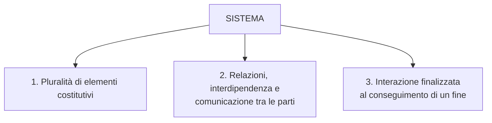

**Postulati della teoria dei sistemi:**

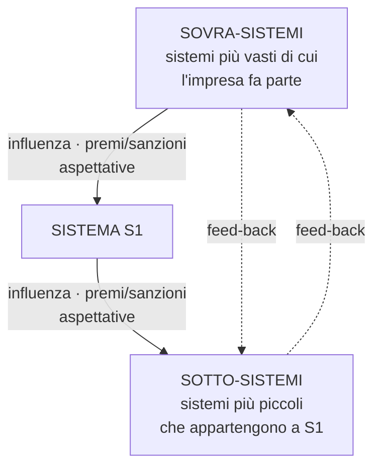

1. Ogni sistema fa parte di **sovra-sistemi** (sistemi più vasti).
2. Ogni sistema contiene **sotto-sistemi** (sub-sistemi).
3. **Il valore di un sistema è maggiore della somma delle parti** (le **sinergie**).

> [!example] È un sistema o no?
> - Un **sacco di riso**: se aggiungi/togli chicchi, resta sempre un sacco di riso → **non** è
>   un sistema (è una somma di elementi indipendenti).
> - Un **mucchio di foglie**: uguale → **non** è un sistema.
> - Un **gatto**: la somma di cellule e organi non "spiega" il gatto; le parti sono organizzate
>   e interagiscono → **è** un sistema.

### 2.4 Come nasce un sistema: struttura logica e struttura fisica

- La **struttura** è "un insieme di elementi a cui sono assegnati **ruoli**, attività e compiti,
  nel rispetto di vincoli e regole".
- **Struttura logica** = le componenti *logiche* (unità organizzative) e le relazioni tra esse:
  definisce **i criteri e i principi di funzionamento** del futuro sistema.
- **Struttura fisica** = gli elementi *fisici, tangibili* (tecnici, umani, finanziari) che
  interagiranno tra loro rispettando la struttura logica.

**Principio chiave:** una stessa **struttura logica** può concretizzarsi in **molte strutture
fisiche** diverse.

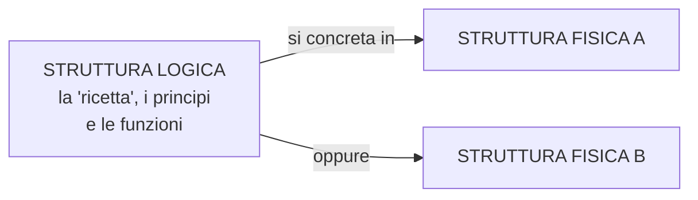

> [!example] Orologio
> *Struttura logica:* indica l'ora e la data, si alimenta in vari modi (meccanico, al quarzo,
> smart), ha valenza estetica, può integrarsi con altre tecnologie.
> *Struttura fisica:* orologio da polso, da taschino, da parete, da tavola.

> [!example] Pizzeria vs Banca
> **Pizzeria** — *logica:* prodotti (menù), processi (preparazione/cottura/servizio), relazione
> col cliente, gestione risorse. *Fisica:* layout del locale, attrezzature (forno, tavoli),
> formato di servizio (ristorante, asporto, catena).
> **Banca** — *logica:* servizi (conti, prestiti, investimenti), processi interni, relazione col
> cliente, normative. *Fisica:* filiali, sistemi tecnologici (ATM), ambienti di lavoro.

### 2.5 Le fasi di emersione del sistema impresa

Dalla struttura (astratta) al sistema (concreto) in **7 passi**:

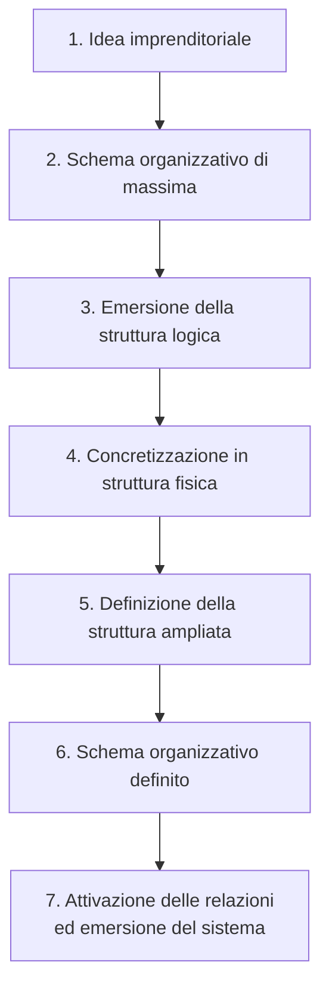

Si passa così **dall'astratto al concreto** e **dalle parti al tutto**.

### 2.6 Tipi di sistema, capacità e grado di apertura

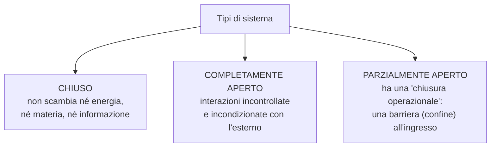

- **Capacità di apertura** = potenzialità che il sistema ha (per la sua struttura) di rapportarsi
  con l'esterno.
- **Grado di apertura** = scelta volontaria dell'**organo di governo** su *come* usare quella
  capacità.

### 2.7 L'impresa come sistema aperto

L'impresa riceve **input** dall'ambiente, **aggiunge valore** con un processo di trasformazione
e restituisce **output**.

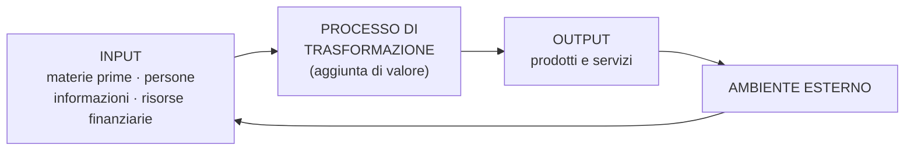

### 2.8 Relazioni, interazioni, consonanza e risonanza

- **Relazioni** = connessioni *logiche*.
- **Interazioni** = connessioni logiche che diventano *fisiche, tecniche, economiche*.
- Possono essere **intra-sistemiche** (dentro il sistema) o **inter-sistemiche** (tra sistemi
  diversi).

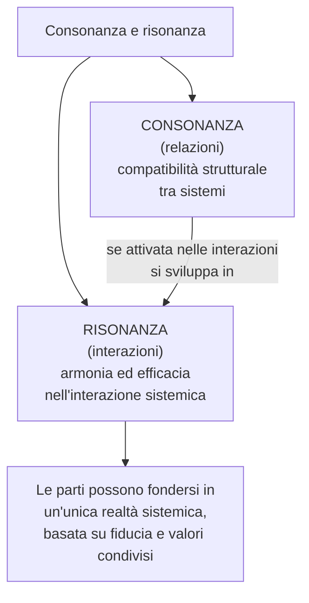

> [!example] La metafora dell'orchestra
> Strumenti diversi (**consonanza**: strutture compatibili) che suonano insieme in armonia
> (**risonanza**: interazione efficace) producono un'unica musica.

### 2.9 Le finalità e l'organo di governo

- La **finalità primaria del sistema impresa è la sopravvivenza** (e lo sviluppo) nel tempo.
- L'**organo di governo** è il "cervello" del sistema: è l'**organo decisore**.

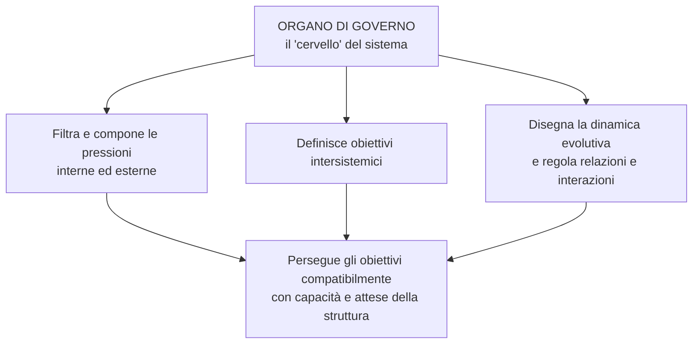

---

## 3. Il sistema impresa, l'organizzazione e l'ambiente

*(Lezione 2)*

### 3.1 Tre livelli di decisioni

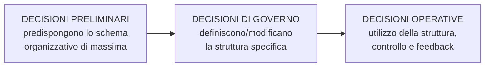

| Tipo di decisione | Cosa fa |
|---|---|
| **Preliminari** | Predispone lo schema organizzativo di massima, sceglie le componenti strutturali, fissa le relazioni. |
| **Di governo** | Definisce/modifica la struttura specifica e lo schema organizzativo definito. |
| **Operative** | Utilizza la struttura; controlla e dà feedback. |

### 3.2 Le quattro caratteristiche del sistema impresa

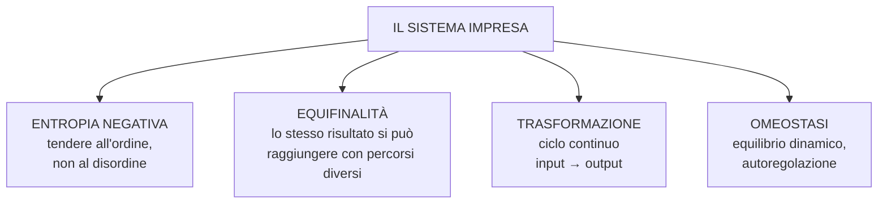

- **Entropia negativa.** L'**entropia** è la tendenza universale al disordine e alla
  disgregazione. I sistemi aperti, per sopravvivere, devono assicurarsi **entropia negativa**:
  ordine, norme, routine, processi standardizzati (un ambiente prevedibile e sotto controllo).
- **Equifinalità.** Uno stesso stato finale si può raggiungere da **condizioni iniziali diverse**
  e con **percorsi differenti**: non esiste una "one best way" (un solo modo migliore).
- **Trasformazione.** Ciclo continuo di trasformazione di **input in output**: il ritorno di
  energia dall'output riattiva il sistema.
- **Omeostasi.** Meccanismo di **regolazione**: il sistema mantiene un **equilibrio dinamico**
  (relativo), adattandosi ai cambiamenti.

> [!info] Entropia in ambito aziendale
> È la variazione costante dei collegamenti tra gli elementi aziendali: tendenza alla
> **flessibilità**, alla variabilità strategica e operativa e all'interazione con l'ambiente,
> necessaria per **sopravvivere**.

### 3.3 Le risorse di impresa

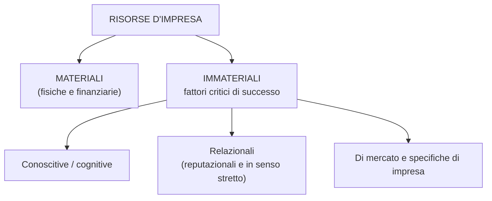

### 3.4 Che tipo di sistema è l'impresa?

L'impresa è un sistema:

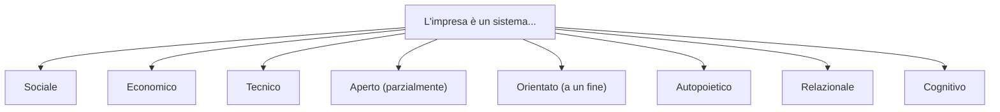

### 3.5 Le 7 S di McKinsey

Per capire se un'impresa è in grado di attuare una **strategia**, McKinsey propone l'analisi
delle **7 S**, divise in due gruppi:

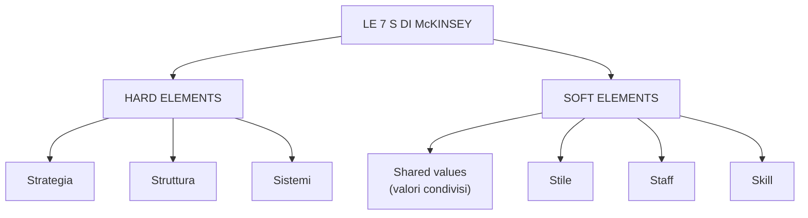

**Hard elements** (più "duri", misurabili):
- **Strategia** — come l'impresa costruisce o mantiene un **vantaggio competitivo**.
- **Struttura** — come è organizzata (gerarchica, centralizzata, autonoma/esternalizzata).
- **Sistemi** — i processi quotidiani (sviluppo prodotto, produzione, distribuzione...).

**Soft elements** (più "morbidi", umani):
- **Shared values** — i valori che definiscono cultura e modo di operare.
- **Stile** — lo stile di leadership e il comportamento dei capi come esempio.
- **Staff** — numero, motivazione, preparazione e capacità dei dipendenti.
- **Skill** — i talenti e le competenze del personale.

### 3.6 L'ambiente di riferimento

L'**ambiente** è tutto ciò che può influire (direttamente o indirettamente) sulla
sopravvivenza, la crescita e l'evoluzione dell'impresa.

L'impresa lo percepisce come:

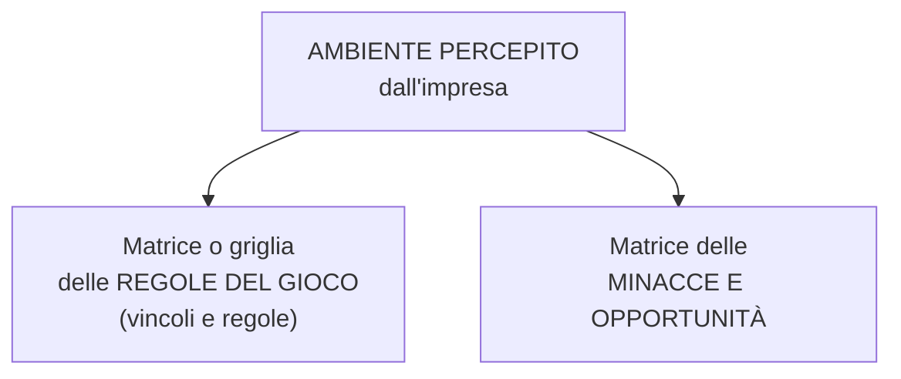

Esistono un **ambiente specifico** (di primo riferimento) e un **ambiente generale** più ampio.
L'impresa può inoltre percepirlo come:

- **Competitivo:** relazioni concorrenziali o cooperative.
- **Socio-culturale:** cultura, infrastrutture sociali, enti normativi, tecnologie disponibili.
- **Fisico-naturale (ecosistema):** l'ambiente e il paesaggio naturale.

> Il rapporto impresa–ambiente è **bidirezionale**: dall'ambiente all'impresa **e** viceversa.

### 3.7 Impresa passiva e impresa proattiva

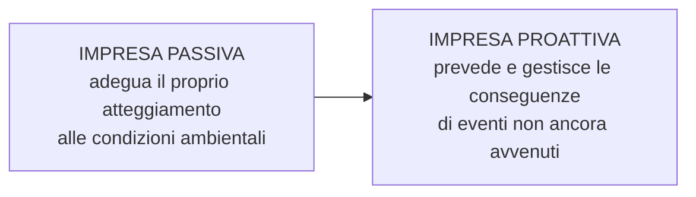

L'impresa moderna deve reagire alle **"sorprese strategiche"** e perseguire il
**"sincronismo adattivo"**: mantenere un rapporto **consonante** con l'ambiente, percependo e
anticipando i cambiamenti e adattando struttura e organizzazione in modo sincronico.

### 3.8 Le attuali tendenze ambientali

L'impresa opera oggi in un ambiente:

- **incerto** (alto grado di rischio);
- **complesso**:
  - **varietà nello spazio** → *varianza sincronica*;
  - **variabilità nel tempo** → *varianza diacronica*.

Servono quindi **elasticità/flessibilità operativa e strategica** e due condizioni di
sopravvivenza:

1. attenta **esplorazione dell'ambiente**;
2. sviluppo di **strutture interne** capaci di valutare minacce e opportunità.

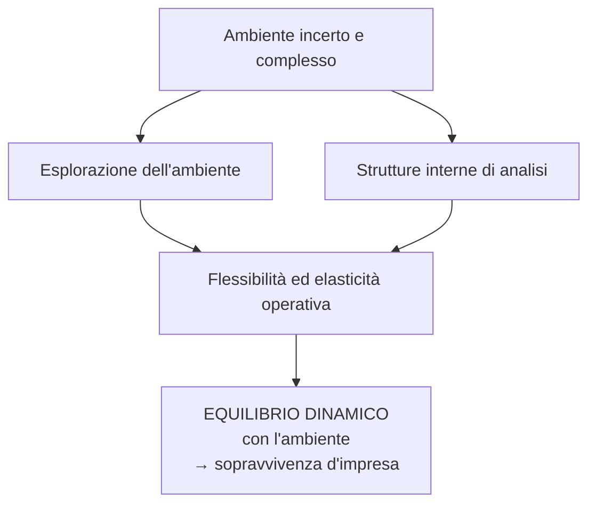

> L'equilibrio **non può essere ottimale**: il sistema resta comunque aperto alle interferenze
> esterne. L'equilibrio si ricerca solo nel **breve termine** e la struttura è costante solo nel
> breve termine (si parla di **morfogenesi autonoma**).

### 3.9 Complessità ambientale: i fattori critici

- **Economia:** dal 2019 eventi straordinari (Covid-19, conflitto russo-ucraino) → ridefinizione
  degli equilibri geopolitici ed economici mondiali.
- **Tecnologia:** progresso continuo e inarrestabile (AI, Industria 4.0, 5.0...).
- **Globalizzazione:** il mercato globale.
- **SistemPaese:** ammodernamento e razionalizzazione (PNRR).
- **Società, mode, crisi energetica, inflazione, sostenibilità, conoscenza.**
- **Cambiamenti nel rapporto domanda–offerta** e nuove sfide ambientali.

> Diventa sempre più difficile **tracciare i confini** di un sistema economico.

### 3.10 Internazionalizzazione e globalizzazione

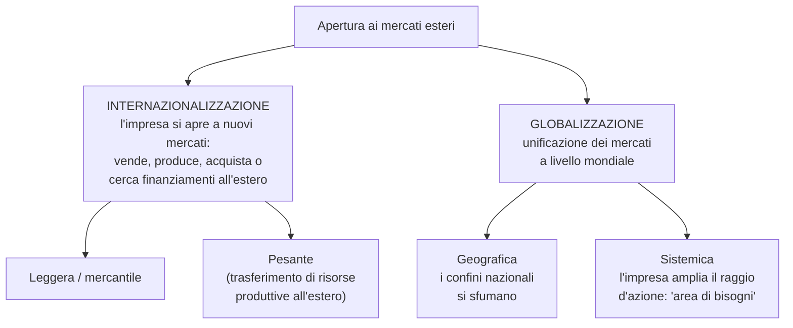

- **Internazionalizzazione:** processo con cui l'impresa si apre a nuovi mercati esteri,
  instaurando rapporti con aziende, consumatori e istituzioni di quei territori.
  - *Leggera/mercantile* (solo vendita/acquisto);
  - *Pesante* (trasferimento di risorse produttive all'estero).
- **Globalizzazione:** unificazione dei mercati mondiali, spinta dalla diffusione tecnologica.
  Porta a **omogeneità dei bisogni** e **scomparsa delle differenze** di gusto locali; consente
  **economie di scala** e **politiche di bassi prezzi**.

**Qualificazioni dell'organizzazione:**

| Tipo | Comportamento |
|---|---|
| **Impresa globale** | Vende lo **stesso** bene in tutto il mondo, con strategie uniformi. |
| **Impresa multinazionale** | Asseconda/influenza la **varietà** delle condizioni dei paesi in cui opera. |

**Conseguenze per la gestione:**

```mermaid
graph TD
    G["Globalizzazione"] --> A["Ipercompetizione"]
    G --> B["Focus sulle core competencies"]
    G --> C["Nuovi fornitori, concorrenti,<br/>clienti anche lontani"]
    G --> D["Nuove 'regole del gioco'<br/>(think global, act local)"]
    G --> E["Più decentramento<br/>e 'reticolarizzazione'"]
    A --> F["Necessità di mantenere<br/>flessibilità e integrazione tra le parti"]
    B --> F
    C --> F
    D --> F
    E --> F
```

---

## 4. L'area organizzativa: i modelli organizzativi

*(Lezione 3)*

### 4.1 La funzione organizzativa

**Organizzare** significa ordinare un sistema di parti interdipendenti e correlate, ciascuna con
una funzione specifica rispetto al complesso.

La **funzione organizzativa** definisce:

- i **centri decisionali, di controllo ed esecutivi**;
- l'**autorità** e la **responsabilità** di ciascuno;
- l'**organigramma** e la descrizione delle **mansioni**;
- le **procedure organizzative**.

### 4.2 La struttura organizzativa

La struttura organizzativa:

- è un **insieme di relazioni** tra le persone che vi operano;
- è la **distribuzione dell'autorità e delle responsabilità**;
- è un insieme di **processi** con cui si costituisce.

> La struttura organizzativa **non** deve seguire un modello ideale e astratto: deve adattarsi
> alla **realtà concreta** (meccanismi operativi, persone, stile di direzione).

**Due modi di scomporre la struttura:**

```mermaid
graph TD
    SO["STRUTTURA ORGANIZZATIVA"] --> HW["HARDWARE (di struttura)<br/>meccanismo di differenziazione:<br/>ogni parte assume<br/>una sub-funzione specifica"]
    SO --> SW["SOFTWARE (decisionali)<br/>stabilisce scopi, finalità e obiettivi,<br/>ed elabora norme e relazioni"]
    SO --> FO["FORMALE<br/>divisione in mansioni riconosciuta<br/>e rappresentabile con organigrammi"]
    SO --> IN["INFORMALE<br/>rapporti spontanei,<br/>influenza e potere"]
```

### 4.3 Gli organigrammi

Gli **organigrammi** sono **rappresentazioni grafiche** della struttura organizzativa **formale**.
Mostrano le posizioni e i collegamenti tra le funzioni aziendali.

**Limiti:**

- non dicono **l'importanza** delle posizioni;
- non mostrano i **rapporti non gerarchici**;
- non danno informazioni **sull'ambiente** in cui opera l'unità.

**Come si superano:** con documenti aggiuntivi:

- i **mansionari** → descrivono **cosa** fanno gli organi (compiti assegnati);
- le **norme procedurali** → specificano **come** svolgere i singoli compiti.

### 4.4 I modelli organizzativi principali

#### A. Modello gerarchico (struttura monofunzionale)

**Principi:**

- **Gerarchia:** autorità e competenze sono massime al vertice.
- **Delega:** le funzioni vengono delegate verso il basso.
- **Eccezione:** i problemi imprevisti tornano al vertice per la soluzione.
- **Unità di direzione:** ciascuno sa da chi prendere ordini e a chi rivolgersi.

**Caratteristiche:**

- sistema **chiuso**, pensato per un ambiente **stabile** (il mercato cambia più lentamente di
  quanto l'azienda si adatta);
- semplicità operativa, poca delega, decisioni **accentrate**, comunicazione verso il basso;
- coordinamento per **gerarchia**, controllo totale dell'imprenditore.

```mermaid
graph TD
    V["Vertice / Imprenditore"] --> A["Funzione 1"]
    V --> B["Funzione 2"]
    V --> C["Funzione 3"]
```

#### B. Modello gerarchico funzionale

Le attività sono raggruppate per **funzione comune**. Esalta la **specializzazione** delle aree.

```mermaid
graph TD
    DG["Direzione generale"] --> MK["Direzione<br/>Marketing"]
    DG --> PR["Direzione<br/>Produzione"]
    DG --> PE["Direzione<br/>Personale"]
    DG --> AF["Direzione<br/>Amministrazione e Finanza"]
    DG --> RS["Direzione<br/>Ricerca e Sviluppo"]
```

**Tre livelli organizzativi:**

| Livello | Compito |
|---|---|
| **Direzione generale** | Amministra l'azienda come **sistema unitario** (visione d'insieme), definisce obiettivi primari e coordina le aree. |
| **Direzioni dei dipartimenti funzionali** | Specializzate per funzione; vedono solo **problemi settoriali**, non generali. |
| **Unità operative** | Organi che dipendono dai dipartimenti funzionali; compiti **esecutivi** (uffici amministrativi, stabilimenti, filiali, laboratori). |

**Le principali direzioni funzionali:**

- **Direzione Marketing** — gestisce il **marketing mix**: prodotto, comunicazione,
  distribuzione, prezzo.
- **Direzione della Produzione** — coordina la trasformazione dei fattori produttivi in prodotti
  finiti; bilancia esigenze commerciali e produttive, minimizza i costi.
- **Direzione del Personale** — ricerca/selezione/assunzione, retribuzioni, carriere, relazioni
  sindacali, applicazione delle norme sul lavoro.
- **Direzione Amministrativa** — contabilità e adempimenti civilistici e fiscali; produce
  informazioni economico-finanziarie (consuntive e preventive).
- **Direzione Finanziaria** — gestione del **capitale**: dimensionamento, allocazione,
  reperimento delle risorse, rapporti con le banche, gestione valutaria.
- **Direzione Ricerca & Sviluppo** — scoperta e valorizzazione di nuove conoscenze per
  l'**innovazione** di prodotto e/o di processo.

**Punti di forza e debolezza:**

| Punti di forza | Punti di debolezza |
|---|---|
| Facilita le **economie di scala** nelle unità | Tempo di risposta **lento** ai cambiamenti |
| Sviluppa **conoscenze approfondite** | Accumulo di decisioni al vertice (sovraccarico) |
| Consegue obiettivi funzionali | **Scarso coordinamento orizzontale** |
| Preferibile con **uno o pochi prodotti** | **Minore innovazione**; visione ristretta |

> [!example] Apple
> `https://www.apple.com/it/leadership/` — Apple è passata nel tempo da **modello funzionale**
> (1976) → **divisionale** (1982) → di nuovo **funzionale** (1998).

#### C. Modello divisionale

Organizza **divisioni separate in forma decentrata**. Ogni divisione è responsabile di singoli
**prodotti/servizi** (è un centro di profitto). Detta anche *struttura per prodotto* o *per
funzioni strategiche*.

```mermaid
graph TD
    DG["Direzione generale"] --> PC["Direzione pianificazione<br/>e controllo"]
    DG --> FI["Direzione finanza"]
    DG --> RSC["Direzione R&S"]
    DG --> A["Divisione prodotto A"]
    DG --> B["Divisione prodotto B"]
    DG --> C["Divisione prodotto C"]
    A --> A1["vendite · marketing · produzione ·<br/>amministrazione · personale"]
    B --> B1["vendite · marketing · produzione ·<br/>amministrazione · personale"]
    C --> C1["vendite · marketing · produzione ·<br/>amministrazione · personale"]
```

**Principi:** si basa sull'**output**; massimizza il coordinamento tra unità funzionali di uno
stesso prodotto; **decentralizza** il processo decisionale. Adatto a un ambiente relativamente
**instabile**.

| Punti di forza | Punti di debolezza |
|---|---|
| Adatto a cambiamenti rapidi / ambiente instabile | Elimina le **economie di scala** funzionali |
| Chiare responsabilità sul prodotto → cliente soddisfatto | Scarso coordinamento **tra** linee di prodotto |
| Alto coordinamento **tra le funzioni** di una divisione | Riduce l'approfondimento e la **specializzazione tecnica** |
| Adatta a grandi dimensioni con **molti prodotti** | Difficile integrazione e standardizzazione tra linee |
| Decentralizza le decisioni | |

> [!example] Alphabet (Google)
> Sotto la **holding** Alphabet convivono divisioni/business separati: Google, YouTube, Android,
> Waymo, DeepMind, Verily, Fitbit, Nest Labs, ecc.

#### D. Modello per area geografica

Simile al divisionale, ma le divisioni sono organizzate **per area geografica**. Si basa sugli
**utenti/clienti** e aiuta l'azienda a espandersi in nuovi mercati e a usare meglio le risorse.

```mermaid
graph TD
    DG["Direzione generale"] --> A["Divisione America"]
    DG --> B["Divisione Europa"]
    DG --> C["Divisione Asia"]
    A --> A1["vendite · marketing · produzione"]
    B --> B1["vendite · marketing · produzione"]
    C --> C1["vendite · marketing · produzione"]
```

#### E. Modello a matrice

Combina i vantaggi dell'organizzazione **per funzioni** con quelli **per prodotti/progetti**.
Una stessa unità risponde a **due autorità**: una funzionale e una di progetto/prodotto/mercato.

```mermaid
graph TD
    DG["Direzione generale"] --> F["FUNZIONI<br/>Progettazione · Marketing · Finanza"]
    DG --> P["PROGETTI / PRODOTTI<br/>PM1 · PM2 · PM3"]
    F -.-> X["Ogni persona dipende da DUE capi:<br/>il responsabile funzionale<br/>e il responsabile di progetto"]
    P -.-> X
```

**Caratteristiche:** potente **meccanismo di collegamento orizzontale**; si usa quando contano
sia l'**esperienza tecnica** sia l'**innovazione di prodotto** e il cambiamento.

| Punti di forza | Punti di debolezza |
|---|---|
| Coordina richieste "duali" dei clienti | **Doppia autorità**: confusione, frustrazione |
| Condivisione **flessibile** delle risorse umane | Serve capacità interpersonale e formazione |
| Adatto a decisioni complesse e cambiamenti frequenti | **Molto tempo**: riunioni e risoluzione conflitti |
| Sviluppa competenze **sia funzionali sia di prodotto** | Richiede un delicato **bilanciamento del potere** |

#### F. Modello a rete e outsourcing

Estende la **collaborazione orizzontale** oltre i confini dell'organizzazione, affidando parti
del lavoro a **partner esterni**.

- **Outsourcing:** ricorso a fornitori esterni per compiti/funzioni (produzione, risorse umane,
  gestione crediti...).
- **Struttura a rete** (o *modulare*): l'azienda appalta molte funzioni/processi principali ad
  aziende separate e li coordina da un **quartier generale snello**.

```mermaid
graph TD
    C["L'azienda cura lo sviluppo<br/>dei prodotti e del marketing"] --- P["Aziende di produzione"]
    C --- L["Laboratori di ricerca<br/>e sperimentazione"]
    C --- I["Servizi informatici"]
    C --- AC["Aziende commerciali"]
```

**Regola:** le attività che danno **vantaggio competitivo** restano **dentro**; le altre si
**esternalizzano**.

| Punti di forza | Punti di debolezza |
|---|---|
| Piccole imprese possono operare su **scala globale** | I manager **non controllano** molte attività/persone |
| Ampio raggio d'azione senza grandi investimenti | Molto tempo per gestire **relazioni con i partner** |
| **Alta flessibilità** e risposta rapida | Rischio se un partner non consegna o chiude |
| **Riduce i costi** amministrativi | Fedeltà e cultura aziendale **deboli** |

#### G. Altri modelli organizzativi

```mermaid
graph TD
    A["ALTRI MODELLI"] --> B["Agili e responsivi"]
    A --> C["Auto-organizzati e distribuiti"]
    A --> D["Ibridi"]
    B --> B1["Scrum at Scale"]
    B --> B2["Squad Model"]
    B --> B3["Organizzazione adhocratica"]
    C --> C1["Holacracy"]
    C --> C2["Sociocrazia"]
    C --> C3["Modello Teal"]
    D --> D1["Modello ambidestro"]
    D --> D2["Organizzazione frattale"]
```

**Sintesi comparativa dei modelli:**

| Modello | Criterio | Ambiente tipico | Decisioni |
|---|---|---|---|
| Gerarchico (monofunzionale) | Vertice | Stabile, chiuso | Accentrate |
| Gerarchico funzionale | Funzione | Stabile | Centralizzate |
| Divisionale | Prodotto/divisione | Instabile | Decentralizzate |
| Per area geografica | Territorio | Mercati diversi | Decentralizzate |
| A matrice | Funzione × progetto | Dinamico, innovativo | Duali |
| A rete | Partner esterni | Molto dinamico | Distribuite |

---

## 5. Il ciclo di vita e il declino organizzativo

*(Lezione 4)*

### 5.1 Gli stadi del ciclo di vita

Man mano che l'impresa cresce, attraversa **stadi** separati da **crisi** che bisogna superare.

```mermaid
graph LR
    A["1. Imprenditoriale"] -->|"CRISI: bisogno di leadership"| B["2. Collettività"]
    B -->|"CRISI: bisogno di delega"| C["3. Formalizzazione"]
    C -->|"CRISI: eccesso di burocrazia"| D["4. Elaborazione"]
    D -->|"CRISI: bisogno di rivitalizzazione"| E["Snellimento / nuova crescita"]
```

```mermaid
xychart-beta
    title "Ciclo di vita: dimensione nel tempo"
    x-axis ["Imprenditoriale", "Collettività", "Formalizzazione", "Elaborazione", "Maturità", "Rivitalizzazione"]
    y-axis "Dimensione" 0 --> 100
    line [10, 30, 55, 80, 90, 65]
```

**Descrizione degli stadi:**

1. **Stadio imprenditoriale.** Si parte: enfasi su **creare** prodotto/servizio e
   **sopravvivere**. Organizzazione **informale**, controllo diretto del proprietario.
   - *Crisi → bisogno di leadership:* la crescita porta nuovi problemi di gestione; serve
     adattare la struttura.
2. **Stadio della collettività.** Leadership forte, obiettivi e direzione chiari. Nascono
   unità organizzative e una **gerarchia**. I dipendenti si identificano nella missione.
   - *Crisi → bisogno di delega:* i livelli inferiori cercano più autonomia; servono meccanismi
     di coordinamento senza supervisione diretta del vertice.
3. **Stadio della formalizzazione.** Introduzione di **regole, procedure, sistemi di controllo**.
   Comunicazione formale lungo la gerarchia, figure specializzate, incentivi sui risultati.
   - *Crisi → eccesso di burocrazia:* troppe procedure soffocano i manager intermedi.
4. **Stadio di elaborazione.** Nuovo **spirito di collaborazione e lavoro di squadra**. Il
   controllo sociale e l'autodisciplina riducono i controlli formali. Possibili gruppi di
   manager trasversali e divisioni per mantenere la "filosofia da piccola azienda".
   - *Crisi → bisogno di rivitalizzazione:* dopo la maturità può servire **snellimento e
     innovazione**.

**Tabella di sintesi dei 4 stadi:**

| Caratteristica | 1. Imprenditoriale | 2. Collettività | 3. Formalizzazione | 4. Elaborazione |
|---|---|---|---|---|
| **Struttura** | Informale, dipende da una persona | Prevalentemente informale, qualche procedura | Procedure formali, divisione del lavoro, specializzazioni | Lavoro di gruppo dentro un contesto burocratico |
| **Prodotti/servizi** | Singolo prodotto | Prodotto principale con varianti | Linea di prodotti | Molteplici linee |
| **Ricompense/controlli** | Personali, paternalistici | Personali | Impersonali, formalizzati | Diffusi, personalizzati |
| **Innovazione** | Del proprietario-manager | Di dipendenti e manager | Da gruppi dedicati | Da un centro R&S istituzionalizzato |
| **Obiettivi** | Sopravvivenza | Crescita | Stabilità interna, espansione | Reputazione, organizzazione completa |
| **Stile del top management** | Individualistico | Carismatico | Delega e controllo | Orientamento al gruppo |

### 5.2 La burocrazia

Diventando **più grandi e complesse**, le organizzazioni assumono caratteristiche **burocratiche**.
Per **Max Weber** la burocrazia è la forma di organizzazione **più efficiente e razionale**,
indispensabile per il capitalismo moderno.

Le teorie classiche (Weber, Taylor, Fayol) si basano su: ricorso alla **scienza**, ricerca di
**soluzioni ottime e universali**, enfasi sugli aspetti **formali**, **metafora della macchina**.

**I principi della burocrazia ideale (idealtipo):**

```mermaid
graph TD
    B["BUROCRAZIA IDEALE"] --> F["Formalizzazione<br/>tutto standardizzato e previsto"]
    B --> D["Divisione del lavoro<br/>compiti precisi per ogni ruolo"]
    B --> G["Gerarchia degli uffici<br/>chiara catena di comando"]
    B --> C["Competenza tecnica<br/>assunzioni e promozioni per merito"]
    B --> I["Impersonalità<br/>regole uguali per tutti"]
    B --> S["Separazione ufficio/vita privata"]
    B --> DOC["Documentazione scritta<br/>tracciabilità e continuità"]
```

**I limiti della burocrazia** (Weber stesso li avvertiva):

- **"Gabbia d'acciaio"** (*stahlhartes Gehäuse*): troppa razionalizzazione imprigiona
  l'individuo e soffoca creatività e libertà.
- **Potere dei funzionari:** la macchina burocratica può diventare troppo potente.
- **Spersonalizzazione e freddezza:** l'impersonalità elimina i rapporti umani (persone
  trattate come numeri).
- **Conservatorismo e burocratizzazione del fine:** le regole da **mezzo** diventano **fine**,
  rendendo l'apparato incapace di adattarsi.

### 5.3 Il declino organizzativo

Il **declino organizzativo** è una condizione in cui l'organizzazione vede una **diminuzione
sostanziale di risorse** in un certo periodo. Spesso è legato a un **declino ambientale**
(es. calo della domanda) o a un cambiamento delle preferenze dei consumatori.

**Tre cause tipiche:**

```mermaid
graph TD
    DEC["DECLINO ORGANIZZATIVO"] --> A["ATROFIA ORGANIZZATIVA<br/>organizzazioni inefficienti<br/>e sovra-burocratizzate"]
    DEC --> B["VULNERABILITÀ<br/>incapacità strategica di prosperare<br/>nel proprio ambiente"]
    DEC --> C["DECLINO AMBIENTALE<br/>o competizione<br/>meno energia e risorse disponibili"]
```

### 5.4 Gli stadi del declino (modello di Weitzel e Jonsson)

Se il declino **non viene gestito**, l'organizzazione attraversa **5 stadi** fino alla
dissoluzione.

```mermaid
xychart-beta
    title "Stadi del declino organizzativo (performance)"
    x-axis ["Efficace", "Cecità", "Inattività", "Errore", "Crisi", "Dissoluzione"]
    y-axis "Performance" 0 --> 100
    line [92, 80, 62, 42, 22, 5]
```

| Stadio | Cosa succede | Margine di recupero |
|---|---|---|
| **1. Cecità** | Cambiamenti negativi non percepiti; mancano sistemi di monitoraggio. | **Elevato** |
| **2. Inattività** | I problemi sono evidenti ma non si agisce (inerzia, timore dei costi). | Ancora possibile |
| **3. Azione errata** | Si interviene, ma con decisioni sbagliate o tardive. | **Critico** (ultima finestra utile) |
| **4. Crisi** | Caos; risultati crollano, sopravvivenza a rischio; serve un turnaround. | Estremamente difficile |
| **5. Dissoluzione** | Declino irreversibile: liquidazione o incorporazione. | Nessuno: l'impresa cessa |

**Dettaglio con le soluzioni:**

1. **Cecità (Blinded).** I manager non si rendono conto dei cambiamenti. *Soluzione:* sistemi di
   **monitoraggio e controllo** efficaci.
2. **Inattività (Inaction).** I problemi sono evidenti ma non si interviene. *Soluzione:*
   riconoscere il declino e agire tempestivamente (anche coinvolgendo dipendenti e clienti).
3. **Azione errata (Faulty Action).** Si reagisce male (panico, riforme tardive).
   *Soluzione:* cambiamenti drastici (riduzione costi, tagli), con **chiarezza e informazioni**
   verso gli stakeholder.
4. **Crisi (Crisis).** Caos e perdita di fiducia. *Soluzione:* **riorganizzazione radicale**,
   sostituzione del top management, rivoluzione di struttura, strategia e cultura.
5. **Dissoluzione (Dissolution).** Declino irreversibile. *Soluzione:* chiudere in modo
   **ordinato**, riducendo il trauma della separazione.

> [!example] Caso BlackBerry (RIM)
> - **Cecità (2007):** Apple lancia l'iPhone; i co-CEO lo considerano un "giocattolo" inadatto
>   ai clienti aziendali. BlackBerry non capisce il cambio di mercato (touch + app).
> - **Inattività (2008–2009):** iPhone e Android rubano quote, ma le vendite internazionali
>   mascherano il problema; si continua a puntare su tastiera fisica e BBM.
> - **Azione errata (2010–2011):** prodotti frettolosi e mal progettati (BlackBerry Storm,
>   PlayBook lanciato senza app email nativa).
> - **Crisi (2012–2014):** crollo delle quote, perdite miliardarie, licenziamenti, dimissioni
>   dei co-CEO; nuovo CEO (John Chen) taglia l'hardware.
> - **Dissoluzione (dal 2016):** il marchio telefonia cessa; diritti a terzi (TCL); nel 2022
>   stop al supporto storico. L'impresa si riconfigura come **software house** (cybersecurity,
>   QNX per le auto).

---

## 6. L'azienda, il bilancio e gli indici

*(Lezione 5)*

### 6.1 I tipi di azienda in Italia

**Art. 2555 Codice Civile:** *"L'azienda è il complesso dei beni organizzati dall'imprenditore
per l'esercizio dell'impresa."*

```mermaid
graph TD
    AZ["AZIENDA"] --> PR["Aziende di PRODUZIONE<br/>(imprese profit)"]
    AZ --> ER["Aziende di EROGAZIONE"]
    ER --> COR["Corporazioni<br/>(associazioni)<br/>prevale l'elemento personale"]
    ER --> FON["Fondazioni<br/>prevale l'aspetto patrimoniale"]
    PR --> IND["Forma INDIVIDUALE<br/>(ditta individuale)"]
    PR --> SOC["Forma COLLETTIVA<br/>(società)"]
    SOC --> PERS["Società di PERSONE<br/>s.s. · s.n.c. · s.a.s."]
    SOC --> CAP["Società di CAPITALI<br/>s.p.a. · s.a.p.a. · s.r.l. · s.r.l.s."]
```

- **Aziende di produzione (profit):** soddisfano i bisogni in via **indiretta**, mettendo a
  disposizione prodotti/servizi tramite lo **scambio di mercato**.
- **Aziende di erogazione:**
  - **Corporazioni:** prevale l'elemento **personale** (associazioni); soddisfano i bisogni dei
    soci con i contributi raccolti.
  - **Fondazioni:** prevale l'aspetto **patrimoniale**; nascono da lasciti/donazioni per scopi
    solidaristici e di utilità sociale.

### 6.2 Ditta individuale e società

**Ditta individuale** — il titolare risponde **illimitatamente** delle obbligazioni (confusione
dei patrimoni).

| Vantaggi | Svantaggi |
|---|---|
| Imposizione fiscale **unica** | **Responsabilità illimitata** |
| Contabilità **semplice** | Unico *focal point* |
| Gestione poco costosa (apertura partita IVA) | Impresa personale |

**Società (art. 2247 c.c.)** — *"con il contratto di società due o più persone conferiscono
beni o servizi per l'esercizio comune di un'attività economica allo scopo di dividerne gli
utili"*.

```mermaid
graph TD
    S["SOCIETÀ"] --> P["SOCIETÀ DI PERSONE<br/>s.s. · s.n.c. · s.a.s.<br/>soci illimitatamente responsabili"]
    S --> C["SOCIETÀ DI CAPITALI<br/>s.p.a. · s.a.p.a. · s.r.l. · s.r.l.s.<br/>la società risponde,<br/>non i patrimoni dei soci"]
    P --> PV["+ imposta unica, contabilità semplice<br/>− responsabilità illimitata,<br/>difficoltà ad attrarre capitali"]
    C --> CV["+ responsabilità limitata,<br/>attrae capitali di terzi<br/>− doppia imposizione,<br/>gestione onerosa"]
```

### 6.3 Soggetto giuridico ed economico

```mermaid
graph TD
    Q["Due soggetti"] --> G["SOGGETTO GIURIDICO<br/>a chi fanno capo gli effetti<br/>giuridici (diritti e obblighi)"]
    Q --> E["SOGGETTO ECONOMICO<br/>chi ha il controllo dell'impresa"]
    G --> G1["Persona fisica (ditta individuale)<br/>oppure la società<br/>(personalità giuridica autonoma)"]
    E --> E1["Persona fisica (ditta individuale)<br/>oppure: soci (di persone)<br/>o maggioranza del capitale (di capitali)"]
```

- **Soggetto giuridico:** chi possiede gli effetti **giuridici** dell'attività. Può essere una
  persona fisica o una **società** (che è un soggetto di diritto, con **capacità giuridica**
  propria, cioè possibilità di essere titolare di diritti e obblighi).
- **Soggetto economico:** chi ha il **controllo** dell'impresa. Può essere una persona fisica,
  i **soci** (società di persone) o la **maggioranza del capitale** (società di capitali); nella
  *public company* possono essere i **manager**.

### 6.4 Gli elementi costitutivi: il capitale

Il **capitale finanziario** è esposto tra gli **impieghi (investimenti)** e si divide in:

```mermaid
graph TD
    C["CAPITALE (impieghi/investimenti)"] --> F["CAPITALE FISSO<br/>o immobilizzato"]
    C --> CIR["CAPITALE CIRCOLANTE"]
    F --> FM["Immobilizzazioni MATERIALI<br/>fabbricati, impianti, attrezzature"]
    F --> FI["Immobilizzazioni IMMATERIALI<br/>brevetti, licenze, marchi"]
    F --> FF["Immobilizzazioni FINANZIARIE<br/>partecipazioni, titoli"]
    CIR --> MAG["Magazzino"]
    CIR --> CR["Crediti verso clienti"]
    CIR --> CAS["Cassa e depositi bancari"]
```

> Capitale **fisso** + capitale **circolante** = **capitale di funzionamento** dell'impresa.

### 6.5 Il bilancio d'esercizio

**Cos'è:** il documento di **sintesi dei risultati della gestione** che l'azienda redige alla fine
del periodo amministrativo.

**Finalità:**

- rappresenta la **situazione patrimoniale e finanziaria** e il **risultato economico**
  dell'esercizio;
- determina il **reddito d'esercizio** e il **capitale di funzionamento**;
- è il principale **strumento di comunicazione** dei risultati.

**Destinatari (portatori di interesse):** portatori di **capitale proprio** (imprenditore/soci),
**finanziatori esterni** (banche), **dipendenti, clienti, fornitori, Stato** ed enti locali.

**Chi lo redige:**

| Società di CAPITALI | Società di PERSONE e ditte individuali |
|---|---|
| Schema **obbligatorio** per legge; reso **pubblico** (Registro delle Imprese) | **Nessuno schema** prescritto: forma **libera**, non pubblicato (possibile forma abbreviata) |
| Rigidi obblighi informativi a tutela dei **creditori** (possono raccogliere risparmio pubblico; responsabilità limitata) | Obblighi **meno severi** (i creditori possono rivalersi sui beni personali dei soci) |

**Struttura del bilancio:**

```mermaid
graph TD
    B["BILANCIO D'ESERCIZIO"] --> SP["STATO PATRIMONIALE<br/>situazione patrimoniale<br/>e finanziaria"]
    B --> CE["CONTO ECONOMICO<br/>costi e ricavi →<br/>reddito d'esercizio"]
    B --> NI["NOTA INTEGRATIVA<br/>informazioni esplicative<br/>e complementari"]
    SP <-.->|"collegamento:<br/>utile o perdita"| CE
    NI -.->|"illustra"| SP
    NI -.->|"illustra"| CE
```

### 6.6 Lo stato patrimoniale

Rappresenta la **situazione patrimoniale e finanziaria**: **attività, passività e patrimonio
netto** alla data di chiusura. Forma a **sezioni contrapposte**: **Attivo** e **Passivo**.

| ATTIVITÀ (Attivo) | PASSIVITÀ E NETTO (Passivo) |
|---|---|
| **A.** Crediti verso soci per versamenti ancora dovuti | **A.** **Patrimonio netto** — Capitale, riserve, utili (perdite) portati a nuovo, utile (perdita) dell'esercizio |
| **B.** **Immobilizzazioni** — immateriali, materiali, finanziarie | **B.** Fondi per rischi e oneri |
| **C.** **Attivo circolante** — rimanenze, crediti, attività finanziarie non immobilizzate, disponibilità liquide | **C.** Trattamento di fine rapporto (TFR) |
| **D.** Ratei e risconti | **D.** **Debiti** |
| | **E.** Ratei e risconti |

### 6.7 Il conto economico

Evidenzia il **risultato economico dell'esercizio** (utile o perdita), confrontando **costi** e
**ricavi**. Lo schema (art. 2425 c.c.) ha **forma scalare** e un'unica sezione, con costi
classificati **per natura**.

```mermaid
graph TD
    A["Valore della produzione<br/>− Costi della produzione"] --> B["= DIFFERENZA valore e costi<br/>GESTIONE CARATTERISTICA<br/>(EBITDA)"]
    B --> C["± Proventi/Oneri finanziari<br/>= Risultato gestione finanziaria"]
    C --> D["± Proventi/Oneri straordinari<br/>= Risultato gestione straordinaria"]
    D --> E["− Imposte dell'esercizio"]
    E --> F["= RISULTATO ECONOMICO<br/>DELL'ESERCIZIO<br/>(utile o perdita)"]
```

**I tre differenziali:**

1. **Gestione caratteristica** = *Valore della produzione − Costi della produzione*. Primo
   risultato intermedio; misura l'**attività tipica** dell'azienda. È anche detto **EBITDA**
   (*Earnings Before Interest, Taxes, Depreciation and Amortization*).
   - *Valore della produzione:* ricavi da vendite, prestazioni di servizi, altri ricavi/proventi.
   - *Costi della produzione:* acquisti di fattori produttivi (merci, servizi, godimento beni di
     terzi, personale, ammortamenti) e variazione delle rimanenze.
2. **Gestione finanziaria e straordinaria:**
   - *Finanziaria:* **proventi finanziari − oneri finanziari** (es. interessi attivi vs passivi).
   - *Straordinaria:* **proventi straordinari − oneri straordinari** (eventi imprevedibili ed
     estranei all'attività normale, es. donazioni ricevute vs furti/incendi).
3. **Risultato d'esercizio** = *Risultato prima delle imposte − Imposte* = **utile o perdita**.

> [!info] L'utile compare due volte
> Nello **Stato Patrimoniale** (nel Passivo, tra il Patrimonio Netto) e nel **Conto Economico**
> (come risultato d'esercizio). È il **collegamento** tra i due schemi (SP e CE).

### 6.8 L'analisi di bilancio

L'**analisi di bilancio** è una tecnica per conoscere la gestione aziendale, con funzione
**storica** e **prospettica**.

```mermaid
graph TD
    A["ANALISI DI BILANCIO"] --> B["Obiettivi<br/>verificare gli equilibri di gestione,<br/>monitorare lo stato di salute"]
    A --> C["Limiti<br/>significatività dei dati,<br/>staticità di alcuni valori (SP)"]
    A --> D["Natura degli indicatori<br/>reddituale · finanziaria · patrimoniale"]
```

**Riclassificazione del bilancio:** operazione necessaria per usare i dati ai fini dell'analisi,
per (1) rendere **omogenei** i dati e (2) far emergere **informazioni non immediate**.
Principali riclassificazioni: SP **funzionale**, SP **finanziario**, **Conto Economico**.

**Stato Patrimoniale al criterio della liquidità ed esigibilità crescente:**

| ATTIVO | PASSIVO |
|---|---|
| Attivo immobilizzato | Patrimonio netto |
| Attivo corrente | Passivo consolidato |
| | Passivo corrente |

**Conto Economico riclassificato a valore della produzione / valore aggiunto:**

```mermaid
graph TD
    A["Ricavi per vendite + Altri ricavi<br/>= FATTURATO NETTO<br/>± Variazione rimanenze<br/>= VALORE DELLA PRODUZIONE"] --> B["− Acquisti, utenze, servizi esterni<br/>± Variazione rimanenze materie<br/>= VALORE AGGIUNTO"]
    B --> C["− Costo del personale<br/>− Ammortamenti<br/>− Accantonamenti<br/>= REDDITO OPERATIVO"]
    C --> D["± Gestione finanziaria / patrimoniale / straordinaria<br/>= REDDITO ANTE IMPOSTE"]
    D --> E["− Imposte<br/>= UTILE (PERDITA) D'ESERCIZIO"]
```

### 6.9 I principali indicatori di bilancio (ratio)

```mermaid
graph TD
    R["INDICATORI DI BILANCIO"] --> RED["Natura REDDITUALE<br/>indici di redditività<br/>e di economicità"]
    R --> FIN["Natura FINANZIARIA<br/>indici di liquidità<br/>e di indebitamento"]
    R --> PAT["Natura PATRIMONIALE<br/>indici di solidità<br/>e di solvibilità"]
```

**I tre indici di redditività:**

| Indice | Formula | Cosa misura |
|---|---|---|
| **ROI** | Reddito operativo / Capitale investito | Rendimento del **capitale investito** (gestione caratteristica). |
| **ROS** | Reddito operativo / Ricavi | Redditività delle **vendite**. |
| **ROE** | Utile / Mezzi propri | Rendimento del **capitale proprio** (per i soci). |

**Parametri di riferimento:**

- il **ROI** va confrontato con il **costo medio ponderato del capitale (WACC)**;
- il **ROE** va confrontato con il **costo del capitale proprio**.

> **Un'impresa crea valore quando** il rendimento sul capitale investito è **maggiore** del costo
> medio ponderato del capitale, ossia:

$$\textbf{ROI} > \textbf{WACC}$$

**WACC (Weighted Average Cost of Capital):**

$$WACC = C_{MP} \cdot \frac{MP}{(MP + D)} + C_D \cdot \frac{D}{(MP + D)}$$

dove **MP** = mezzi propri, **D** = debito, **C_MP** = costo del capitale di rischio,
**C_D** = costo del capitale di credito (tasso d'interesse).

**CAPM (Capital Asset Pricing Model):** serve a stimare il costo del capitale di rischio.

$$C_{MP} = R_f + \beta \cdot (R_m - R_f)$$

- **R_f** = rendimento *risk free* (tipicamente titoli di Stato);
- **R_m** = rendimento del mercato;
- **β** = coefficiente che misura la **rischiosità specifica** dell'azienda.

```mermaid
graph TD
    B["Coefficiente beta (β)"] --> A["β > 1<br/>l'impresa è PIÙ rischiosa<br/>del mercato"]
    B --> C["0 < β < 1<br/>l'impresa è MENO rischiosa<br/>del mercato"]
```

---

## 7. Glossario delle parole chiave

| Termine | Significato essenziale |
|---|---|
| **Sistema** | Tutto integrato di parti in relazione, finalizzato a un fine. Non è un semplice insieme. |
| **Sovra-sistema** | Sistema più vasto di cui il sistema fa parte. |
| **Sotto-sistema** | Sistema più piccolo contenuto in un altro. |
| **Struttura logica** | Principi, ruoli e relazioni che definiscono il funzionamento del sistema. |
| **Struttura fisica** | Elementi tangibili che realizzano la struttura logica. |
| **Entropia negativa** | Capacità dei sistemi aperti di tendere all'ordine (vs disordine). |
| **Equifinalità** | Stesso risultato raggiungibile con percorsi e partenze diverse. |
| **Omeostasi** | Autoregolazione per mantenere l'equilibrio dinamico. |
| **Organo di governo** | "Cervello" del sistema: organo decisore. |
| **Consonanza** | Compatibilità strutturale tra sistemi (relazioni). |
| **Risonanza** | Armonia ed efficacia nell'interazione (interazioni). |
| **Funzione organizzativa** | Definisce centri decisionali, autorità, organigrammi e procedure. |
| **Organigramma** | Rappresentazione grafica della struttura formale. |
| **Outsourcing** | Affidare a fornitori esterni compiti o funzioni. |
| **Modello a rete** | Coordinamento di partner esterni da un quartier generale snello. |
| **Ciclo di vita** | Sequenza di stadi (imprenditoriale → collettività → formalizzazione → elaborazione). |
| **Burocrazia** | Forma organizzativa razionale basata su regole, gerarchia, impersonalità. |
| **Declino organizzativo** | Diminuzione sostanziale di risorse in un periodo. |
| **Stato Patrimoniale** | Documento che espone attività, passività e patrimonio netto. |
| **Conto Economico** | Documento che espone costi e ricavi e il risultato d'esercizio. |
| **Nota Integrativa** | Documento descrittivo che illustra SP e CE. |
| **EBITDA** | Margine della gestione caratteristica (valore − costi della produzione). |
| **ROI / ROS / ROE** | Indici di redditività: capitale investito / vendite / capitale proprio. |
| **WACC** | Costo medio ponderato del capitale. |
| **CAPM** | Modello per stimare il costo del capitale di rischio. |

---

> Documento generato come sintesi delle slide delle lezioni 1–5 del corso
> *"Organizzazione e gestione per lo start up aziendale"* — Facoltà di Informatica.
