# OGA — Lezioni 6-7-8: Dalla start-up al modello di business

> **Lezioni n. 6 (16/10), 7 (20/10) e 8 (27/10/2026)**
> Appunti sintetici e lineari. Sono omesse le slide amministrative (Business Game del 5 novembre, aggiornamento esonero, formazione gruppi).

---

## Indice

### Parte I — Lezione 6: dal bilancio alla start-up
1. [Un esempio reale di bilancio: AST SpA 2025](#1-un-esempio-reale-di-bilancio-ast-spa-2025)
2. [Che cos'è una start-up](#2-che-cosè-una-start-up)
3. [Start-up e impresa: le differenze](#3-start-up-e-impresa-le-differenze)
4. [La crescita "hockey stick"](#4-la-crescita-hockey-stick)
5. [I quattro stadi della crescita](#5-i-quattro-stadi-della-crescita)
6. [Esempi reali](#6-esempi-reali)
7. [La start-up in Italia](#7-la-start-up-in-italia)
8. [Glossario della lezione 6](#8-glossario-della-lezione-6)

### Parte II — Lezione 7: dall'idea al modello di business
9. [L'idea di business: le tre fasi](#9-lidea-di-business-le-tre-fasi)
10. [La mappa dei trend](#10-la-mappa-dei-trend)
11. [Pensiero creativo, pensiero critico e brainstorming](#11-pensiero-creativo-pensiero-critico-e-brainstorming)
12. [Dal Business Model Canvas al modello di business](#12-dal-business-model-canvas-al-modello-di-business)
13. [Il business model e le 4 caratteristiche](#13-il-business-model-e-le-4-caratteristiche)
14. [Business model vs business plan](#14-business-model-vs-business-plan)

### Parte III — Lezione 8: i 12 business model
15. [Panoramica dei 12 modelli](#15-panoramica-dei-12-modelli)
16. [I modelli in dettaglio](#16-i-modelli-in-dettaglio)
17. [Schema di sintesi](#17-schema-di-sintesi)

### Glossario
18. [Glossario delle lezioni 7-8](#18-glossario-delle-lezioni-7-8)

---

# PARTE I — LEZIONE 6: DAL BILANCIO ALLA START-UP

*Lezione n. 6 — 16/10/2026*

## 1. Un esempio reale di bilancio: AST SpA 2025

La lezione parte da un **bilancio vero**, scaricato dalla **CCIAA** (Camera di Commercio). Serve a capire come i concetti della lezione 5 (Stato Patrimoniale, Conto Economico, indici) si applicano a un'azienda reale.

### 1.1 Cosa contiene un fascicolo di bilancio

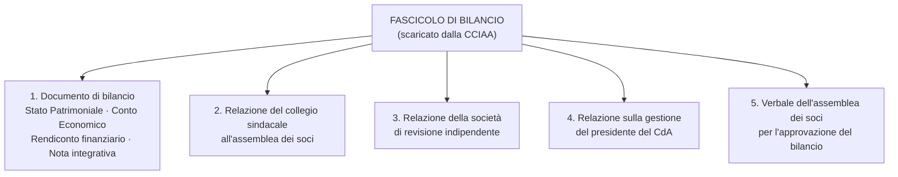

> [!info] Da ricordare
> Il bilancio **non è solo** SP + CE + Nota Integrativa: il fascicolo include anche **Rendiconto finanziario**, relazioni dei sindaci e dei revisori, relazione sulla gestione e verbale assembleare.

### 1.2 Gli indici calcolati su AST SpA 2025

| Indice | Formula | Valori AST SpA 2025 | Risultato |
|---|---|---|---|
| **ROI** | Reddito operativo / Capitale investito | 25.392.314 / (500.471.797 + 1.389.154.732) | **1,34%** |
| **ROS** | Reddito operativo / Ricavi | 25.392.314 / 2.299.218.712 | **1,10%** |
| **ROE** | Utile / Mezzi propri | 981.348 / 599.221.122 | **0,16%** |

**Come leggerli:**

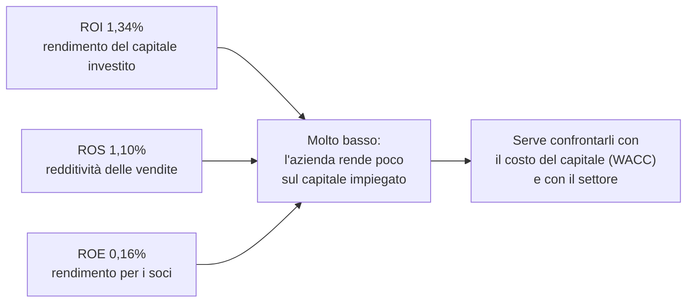

> Un ROI dell'1,34% è **molto contenuto**: se il costo medio del capitale (WACC) fosse superiore, l'impresa **non creerebbe valore** (ROI < WACC). Il ROE dello 0,16% dice che il rendimento per i soci è quasi nullo. Sono numeri tipici di settori **capital intensive** o a **bassa marginalità**: non basta il valore assoluto, serve il **confronto** con il costo del capitale e con i concorrenti.

---

## 2. Che cos'è una start-up

Non esiste una definizione unica. La lezione ne riporta **tre**, poi le combina.

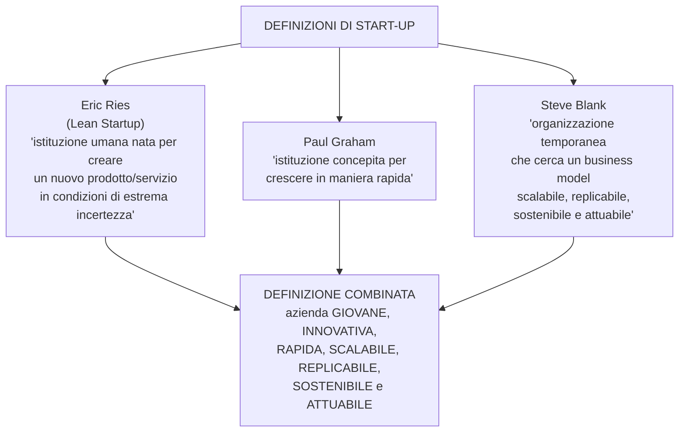

> [!example] La definizione da ricordare
> La start-up è un'**azienda giovane, innovativa, rapida, scalabile, replicabile, sostenibile e attuabile**.

Le tre definizioni mettono l'accento su aspetti diversi:

- **Ries** → l'**incertezza**: si crea qualcosa di nuovo senza sapere se funzionerà.
- **Graham** → la **crescita rapida**.
- **Blank** → la **ricerca del business model**, temporanea e per definizione non ancora stabile.

---

## 3. Start-up e impresa: le differenze

### 3.1 Ogni impresa ha la sua fase di start-up

> Ogni impresa attraversa un periodo iniziale di "startup", in cui si definiscono **processi organizzativi** e **investimenti economici**.

La differenza non è quindi "start-up = giovane, impresa = vecchia". La differenza è **strutturale**.

### 3.2 La differenza principale: la scalabilità

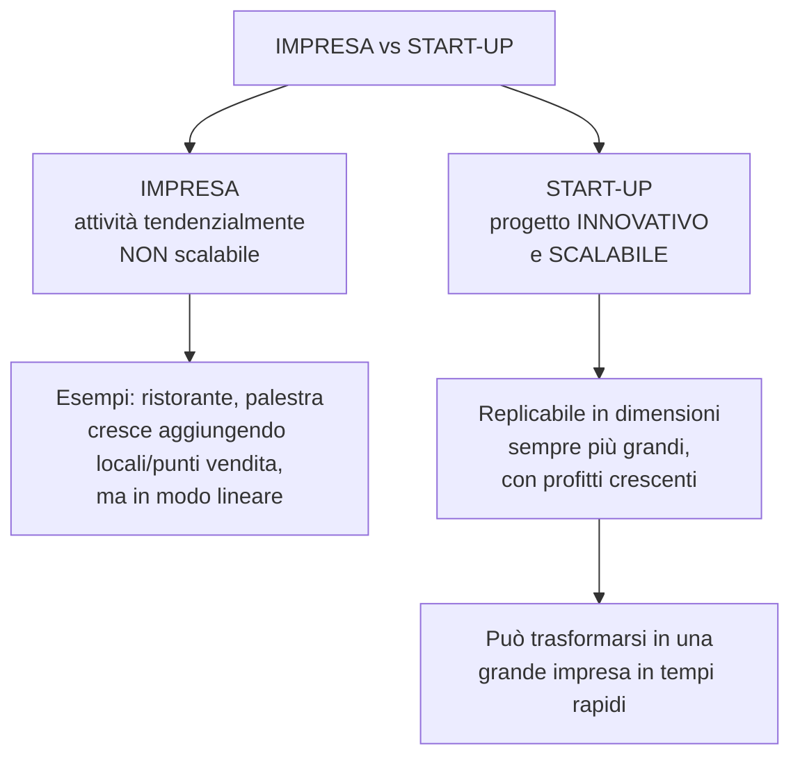

- **Impresa "tradizionale":** non ha tendenzialmente un'attività **scalabile** (es. aprire un ristorante o una palestra). Per crescere deve moltiplicare i punti vendita.
- **Start-up:** si fonda su un **progetto innovativo e scalabile**, cioè **replicabile** su scala sempre più grande, con **profitti crescenti**, per diventare una grande impresa in tempi rapidi.

### 3.3 La differenza di obiettivo

| | Impresa | Start-up innovativa |
|---|---|---|
| **Obiettivo principale** | Generare **profitto** | **Stupire il mercato** con un'idea nuova che può cambiare la vita delle persone o un intero settore |
| **Modo di crescere** | Lineare (più punti vendita, più capacità) | Esponenziale (replicabilità del modello) |
| **Rischio** | Contenuto / noto | Alto (estrema incertezza) |

---

## 4. La crescita "hockey stick"

La start-up è associata a un modello di crescita a **"bastone da hockey"**:

- **fase iniziale** di crescita **lenta o stagnante**;
- poi un'**improvvisa impennata** verso l'alto;
- crescita **esponenziale**.

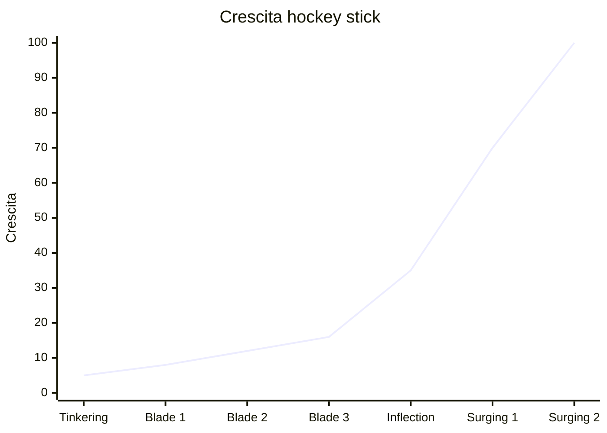

> [!info] Perché si chiama così
> Il grafico ricorda la forma di un **bastone da hockey**: lungo e quasi piatto all'inizio, poi piegato verso l'alto. È la rappresentazione visiva della **crescita esponenziale**.

---

## 5. I quattro stadi della crescita

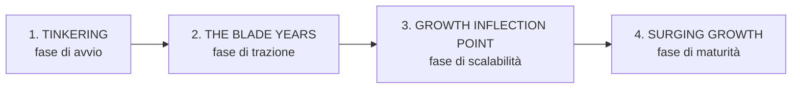

### 5.1 Tinkering — fase di avvio

- Gli imprenditori **analizzano ed esplorano** l'idea, verificano la **fattibilità commerciale** e cercano l'equilibrio tra **problema e soluzione**.
- Termina quando i fondatori si **impegnano a fondo** per trasformare l'idea in realtà.
- Di solito i fondatori **non abbandonano** il proprio lavoro in questa fase.
- È la fase con **meno pressione**, ma alcuni errori possono rovinare tutto:
  - perdere tempo a costruire un **business model elaborato**;
  - **non mostrare campioni reali** e non cercare feedback per paura che i concorrenti copino l'idea.

> **Focus:** sperimentazione e sviluppo dell'offerta **sulla base del feedback** dei potenziali clienti.

### 5.2 The Blade Years — fase di trazione

- L'idea viene **convalidata sul mercato** con le prime versioni (**MVP**, versione **beta**).
- Si sviluppano l'**offerta finale** e il **business model**.
- I fondatori **lasciano il lavoro** e si dedicano completamente all'azienda.
- Dura in genere **3-4 anni**; i ricavi sono **esigui**.
- Si finanzia spesso con **bootstrapping** (autofinanziamento).

**Errori tipici:**

1. Dedicare troppo tempo a **pitch deck** elaborati per raccogliere capitali;
2. spendere cifre esorbitanti in **vendite e marketing**;
3. **non essere disposti** a modificare ulteriormente il prodotto.

### 5.3 Growth Inflection Point — fase di scalabilità

- È il **punto di svolta**: il business model viene **perfezionato**.
- La start-up registra un **aumento esponenziale dei ricavi**.
- Si possono attirare **venture capitalist** e altri investitori.

**Rischi:**

1. la crescita è **troppo rapida** e alcune start-up **crollano**;
2. si cambia un modello che **funzionava già bene**.

> **Obiettivo:** valutare attentamente le operazioni e **sincronizzarle** con la crescita dei ricavi.

### 5.4 Surging Growth — fase di maturità

- La crescita **accelera** e attira sempre più clienti.
- Si devono gestire le **complessità** organizzative dell'esplosione del mercato.
- Molte grandi aziende fanno **offerte di acquisto**.

**Tre scelte possibili:**

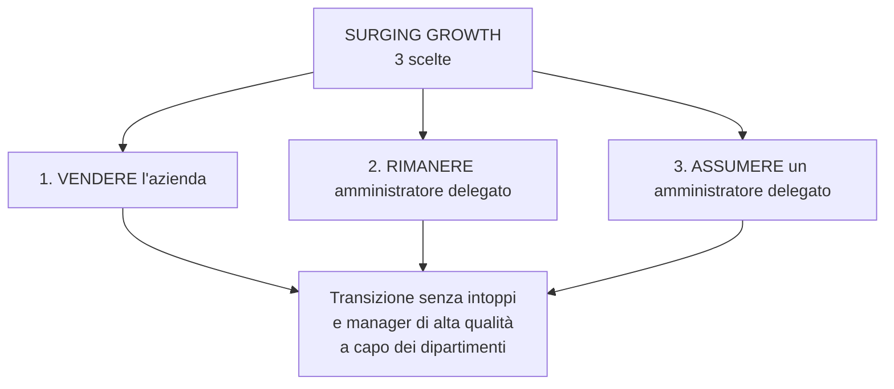

> **Attenzione:** assumere manager **di alta qualità**, non persone non qualificate dalla propria rete personale.

### 5.5 Schema riassuntivo dei 4 stadi

| Stadio | Obiettivo | Chi lavora | Ricavi | Rischio principale |
|---|---|---|---|---|
| **Tinkering** | Verificare fattibilità e problem-solution fit | Fondatori, spesso con altri lavori | Nessuno | Non testare il prodotto / perdere tempo |
| **Blade Years** | Validare sul mercato (MVP/beta) | Fondatori full-time | Esigui (3-4 anni) | Pitch deck e marketing eccessivi |
| **Growth Inflection Point** | Scalare il modello | Team in crescita + VC | Crescita esponenziale | Crescere troppo e crollare |
| **Surging Growth** | Gestire la complessità e consolidare | Manager professionali | Elevati e crescenti | Perdere il controllo / transizione |

---

## 6. Esempi reali

La lezione applica i 4 stadi a **9 start-up**. Qui la sintesi essenziale.

### 6.1 Tabella comparativa

| Start-up | Tinkering | Blade Years | Growth Inflection | Surging Growth |
|---|---|---|---|---|
| **Airbnb** | 2007-08: materassi gonfiabili, 2 prenotazioni a SXSW | 2009-10: nome Airbnb, app, Instant Book | 2011-13: 1 mln di notti, ufficio a Berlino | 2014-17: 10 mln ospiti (2013) → 150 mln (2015) → 260 mln (2016) |
| **Spotify** | 2006-07: tecnologia streaming + accordi con le case discografiche | 2008-10: lancio in Europa, mobile, 10 mln utenti, freemium | 2011-14: ingresso negli USA ed espansione | 2015-18: Discover Weekly, 71 mln Premium (2017), IPO 2018 |
| **Netflix** | 1997-99: noleggio DVD via Internet, abbonamento | 2000-06: raccomandazioni, catalogo, IPO 2002, 5 mln abbonati | 2007-12: streaming, Canada, America Latina, Europa | 2013-18: House of Cards, 130 Paesi (2016), 190+ mercati (2018) |
| **YOOX** | 2000-02: e-commerce di moda e design | 2003-06: USA, Giappone, partnership con i brand | 2007-12: crescita ricavi, IPO 2009, automazione logistica | 2013-15: FTSE MIB, fusione con Net-a-Porter (2015) |
| **Satispay** | 2013-15: problema dei piccoli pagamenti elettronici, lancio app | 2015-17: rete di esercenti, massa critica | 2018-21: 500k utenti (2018), 1 mln (2020), 93 mln € | 2022-26: unicorno (2022), welfare (2023), 6,5 mln utenti (2026) |
| **Scalapay** | 2019: BNPL, lancio in Italia | 2020: Francia, rate nei negozi fisici | 2021: 40 mln € seed + 155 mln $ Series A, ~700 mln $ | 2022-25: 497 mln $ Series B, unicorno ~1,9 mld $, partnership Visa/Deutsche Bank |
| **Musixmatch** | 2010: catalogo di testi autorizzati, API | 2013-18: 10 mln download, Apple Music (2016) | 2019-22: Instagram, Spotify globale, TPG | 2023-24: Musixmatch Pro, 80 mln appassionati, 1,2 mln artisti |
| **Freetrade** | 2015-18: app di investimento senza commissioni | 2019-20: abbonamenti e modello commerciale | 2020-22: crescita del trading da smartphone | 2023-25: ricavi +32% (£27,5 mln), EBITDA positivo, acquisizione IG Group |
| **Exein** | 2018-20: sicurezza informatica dei dispositivi IoT | 2021-23: piattaforma e commercializzazione | 2024: 15 mln € Series B, 80 mln dispositivi protetti | 2025-26: 170 mln €, round da 270 mln $, valutazione 1,7 mld $ |

### 6.2 Cosa insegnano gli esempi

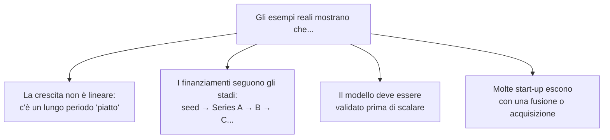

---

## 7. La start-up in Italia

### 7.1 La disciplina giuridica

In Italia esiste una **disciplina specifica** per le **start-up innovative**, introdotta dal:

- **decreto-legge 18 ottobre 2012, n. 179**, convertito con modificazioni dalla **legge 17 dicembre 2012, n. 221**.

La definizione è nell'**art. 25, comma 2**, del DL 179/2012, **modificato dalla legge 193/2024**.

> [!info] Definizione legale (sintesi)
> È **start-up innovativa** la **società di capitali**, costituita anche in forma **cooperativa**, le cui azioni o quote **non sono quotate** su un mercato regolamentato o su un sistema multilaterale di negoziazione, che possiede **determinati requisiti** e ha come **oggetto sociale esclusivo o prevalente** lo sviluppo, la produzione e la commercializzazione di **prodotti o servizi innovativi ad alto valore tecnologico**.

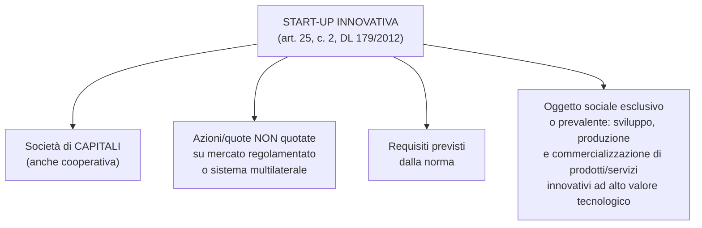

### 7.2 I requisiti (almeno uno dei tre)

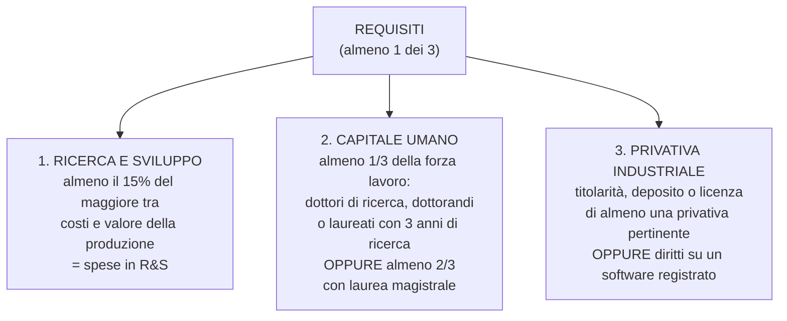

### 7.3 Gli incentivi per chi investe

Sono previste **agevolazioni fiscali** per chi investe nelle start-up.

| Investitore | Detrazione/deduzione | Tetto per periodo d'imposta | Vincolo |
|---|---|---|---|
| **Persona fisica** | Detrazione **IRPEF** del **30%** dell'investimento | fino a **1.000.000 €** | mantenere l'investimento **almeno 3 anni** |
| **Soggetto passivo IRES** | Deduzione dalla base imponibile del **30%** dell'investimento | fino a **1.800.000 €** | mantenere l'investimento **almeno 3 anni** |

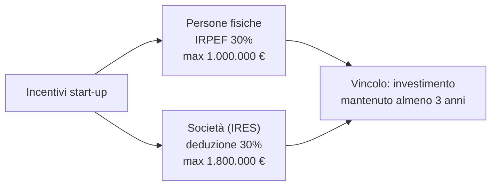

---

## 8. Glossario della lezione 6

| Termine | Significato essenziale |
|---|---|
| **Start-up** | Azienda giovane, innovativa, rapida, scalabile, replicabile, sostenibile e attuabile. |
| **Scalabilità** | Capacità di replicare il modello su dimensioni sempre più grandi con profitti crescenti. |
| **Bootstrapping** | Autofinanziamento, senza capitali esterni. |
| **MVP** | *Minimum Viable Product*: prima versione minima ma funzionante del prodotto. |
| **Beta** | Versione di prova aperta a un gruppo di utenti. |
| **Pitch deck** | Presentazione sintetica per raccogliere capitali. |
| **Freemium** | Modello con servizio base gratuito e versione premium a pagamento. |
| **Hockey stick** | Curva di crescita piatta all'inizio e poi esponenziale. |
| **Tinkering** | Fase di avvio: sperimentazione e problem-solution fit. |
| **Blade Years** | Fase di trazione: validazione sul mercato con MVP/beta. |
| **Growth Inflection Point** | Punto di svolta: il modello è perfezionato e i ricavi esplodono. |
| **Surging Growth** | Fase di maturità: crescita accelerata e consolidamento. |
| **Unicorno** | Start-up con valutazione superiore a 1 miliardo di dollari. |
| **Venture capitalist** | Investitore specializzato in start-up ad alto potenziale. |
| **Start-up innovativa** | Qualifica giuridica italiana (DL 179/2012) con requisiti e incentivi specifici. |

---

---

# PARTE II — LEZIONE 7: DALL'IDEA AL MODELLO DI BUSINESS

*Lezione n. 7 — 20/10/2026*

## 9. L'idea di business: le tre fasi

La messa a fuoco di un'**idea di business** segue **tre passaggi sequenziali**:

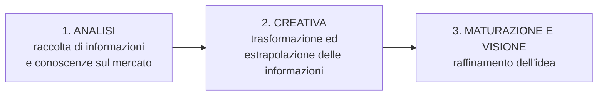

1. **Fase di analisi** — si acquisiscono informazioni e conoscenze sullo sviluppo del mercato in cui ci si vuole inserire. Si parte dalla **raccolta e analisi di dati** per basare le fasi successive su dati **oggettivi**.
2. **Fase creativa** — si trasformano ed estrapolano le informazioni, generando idee nuove.
3. **Fase della maturazione e della visione** — l'idea viene **raffinata** e si fanno emergere gli elementi, i concetti e le risorse necessari alla sua realizzazione.

> [!info] Pensiero produttivo
> Nella fase di analisi si stimola il **pensiero produttivo**: si cercano idee innovative e sorprendenti che si celano nei dati ma non sono ancora riconosciute.

---

## 10. La mappa dei trend

Uno degli strumenti della fase di analisi è la **mappa dei trend**: una **mappa concettuale** che raggruppa i trend del momento per analizzare il mercato alla ricerca di un'idea di business.

**I 6 passi:**

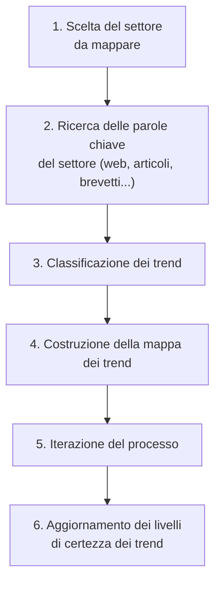

---

## 11. Pensiero creativo, pensiero critico e brainstorming

La fase creativa si basa sul **pensiero produttivo**, che combina **due abilità** diverse e complementari:

| Pensiero **creativo** | Pensiero **critico** |
|---|---|
| **Genera** cose nuove dal nulla (sogni ad occhi aperti) | È **analitico**: sonda, si domanda, verifica |
| Le idee nuove sono **fragili ed effimere** | **Giudica**: l'idea raggiunge o no i criteri di successo? |
| È **espansivo**: più idee generano altre idee | È **selettivo**: cancella molte idee per lasciarne poche, ma buone |

### 11.1 Il brainstorming

Il **brainstorming** è una delle tecniche più usate per generare idee. Nasce nel **1941** con **Alex Osborn**, che capì l'importanza di **separare** il pensiero creativo da quello critico.

**Le 4 regole per un buon brainstorming:**

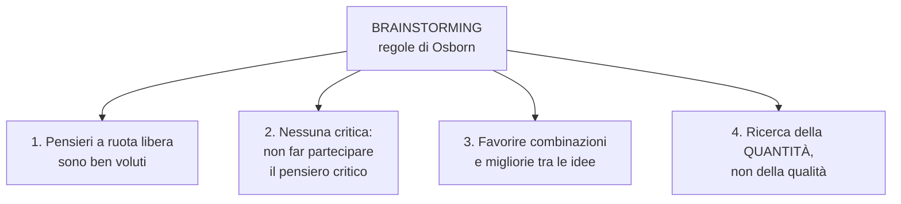

**Le 3 parti di una seduta:**

1. **Primo terzo** → idee a cui tutti hanno già pensato.
2. **Secondo terzo** → idee più insolite e interessanti, verso i confini.
3. **Terzo terzo** → i **"diamanti"**, le idee *breakthrough*, base delle soluzioni innovative.

> Dopo la raccolta, si valutano le idee e si sceglie quella più **interessante**.

---

## 12. Dal Business Model Canvas al modello di business

Nella fase di **maturazione e visione** l'idea viene raffinata. Un'**idea grandiosa non basta**: per avere successo deve avere un **business model che funziona**.

Un'idea di business deve:

- **piacere ai clienti** e rispondere a un loro **bisogno** (creare valore per loro);
- essere **finanziariamente sostenibile**;
- essere **scalabile**, cioè crescere velocemente.

### 12.1 Il Business Model Canvas

Per passare dall'idea al modello di business si usa il **Business Model Canvas** di **Alexander Osterwalder e Yves Pigneur**: una metodologia **grafica e pratica** che permette di concentrarsi sugli elementi chiave del business model.

> È lo strumento più utilizzato dalle **start-up** e anche dalle **grandi aziende** quando lanciano un prodotto o servizio innovativo. È oggetto della **prima esercitazione**.

**I 9 blocchi del Canvas:**

| Area | Blocco | Domanda guida |
|---|---|---|
| **Offerta** | Value proposition | Che valore offriamo? |
| **Clienti** | Customer segments | A chi ci rivolgiamo? |
| **Clienti** | Channels | Come raggiungiamo i clienti? |
| **Clienti** | Customer relationships | Che relazione costruiamo? |
| **Clienti** | Revenue streams | Come generiamo ricavi? |
| **Infrastruttura** | Key resources | Di quali risorse abbiamo bisogno? |
| **Infrastruttura** | Key activities | Quali attività sono cruciali? |
| **Infrastruttura** | Key partnerships | Chi sono i partner chiave? |
| **Finanze** | Cost structure | Quali sono i costi principali? |

---

## 13. Il business model e le 4 caratteristiche

Il **business model** (o modello di business) è *"l'insieme delle soluzioni organizzative e strategiche attraverso le quali l'impresa acquisisce un vantaggio competitivo"*.

Il business model di una start-up deve avere **4 caratteristiche fondamentali**:

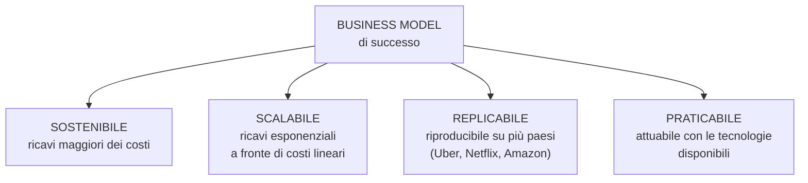

1. **Sostenibile** — deve produrre reddito, cioè generare **ricavi maggiori dei costi**.
2. **Scalabile** — deve poter **crescere velocemente**: ricavi che aumentano **esponenzialmente** a fronte di costi **lineari**.
3. **Replicabile** — si deve poter **replicare il modello** su più paesi e crescere grazie al modello con cui si è partiti (es. Uber, Netflix, Amazon).
4. **Praticabile** — deve essere **attuabile**: non si può inventare qualcosa che non sia sviluppabile. Esempio: la **macchina del tempo** è sostenibile, scalabile e replicabile, ma **non praticabile** con le tecnologie di oggi.

---

## 14. Business model vs business plan

Uno degli errori più comuni è predisporre il **Business Plan** come primo documento, **prima** di aver analizzato e progettato il **Business Model**.

| | **Business Model** | **Business Plan** |
|---|---|---|
| **Cosa è** | Visione d'insieme di **come l'azienda crea valore** | **Roadmap dettagliata** per l'implementazione |
| **Risponde a** | *Come funziona il business?* | *Che cosa, quanto tempo, quanti soldi?* |
| **Contenuto** | Soluzioni organizzative e strategiche | Analisi, previsioni, numeri, tempi |
| **Destinatari** | Interni (e primi interlocutori) | **Stakeholder, investitori, finanziatori** |

> Il **Business Plan** indica **che cosa**, **quanto tempo** e **quanti soldi** servono per mettere in pratica il Business Model. È un documento complesso, fondamentale per presentarsi agli stakeholder e ottenere finanziamenti. I due strumenti sono **complementari**.

---

# PARTE III — LEZIONE 8: I 12 BUSINESS MODEL

*Lezione n. 8 — 27/10/2026*

## 15. Panoramica dei 12 modelli

I **12 tipi di business model** più diffusi:

| # | Modello | Idea in una riga |
|---|---|---|
| 1 | **Transazionale** | Vendita diretta di prodotti/servizi |
| 2 | **Marketplace** | Piattaforma che mette in contatto domanda e offerta |
| 3 | **SaaS** | Software via cloud in abbonamento |
| 4 | **Freemium** | Base gratuita + funzioni premium |
| 5 | **Pay as you go** | Paghi solo per l'uso effettivo |
| 6 | **Noleggio / leasing** | Canone periodico per usare un bene |
| 7 | **Franchising** | Marchio e format concessi a terzi |
| 8 | **Broker** | Intermediazione a commissione |
| 9 | **Community** | Comunità come prodotto |
| 10 | **Affiliazione** | Commissioni sulla promozione di prodotti |
| 11 | **Inserzione** | Ricavi dalla pubblicità |
| 12 | **Donazione** | Contributi volontari |

---

## 16. I modelli in dettaglio

### 16.1 Transazionale

Modello **tradizionale**: si vendono prodotti o servizi **direttamente ai consumatori**, generando ricavi dalle transazioni. I canali possono essere **fisici** (negozi) o **digitali** (e-commerce).  
**Vantaggi:** flessibilità dell'offerta, relazione diretta con il cliente.  
**Sfide:** costruire un **brand forte**, fare marketing efficace, gestire l'intera **catena del valore**.

### 16.2 Marketplace

Una **piattaforma** fa da **intermediario** tra due o più gruppi di utenti. L'azienda **non possiede** i beni scambiati: offre l'**infrastruttura** e le **regole**. Il valore deriva dalla **riduzione dei costi di transazione**, dalla **trasparenza** e dagli **effetti di rete**.  
**Fattori critici:** fiducia, sistemi di **rating**, risoluzione delle dispute, transazioni sicure.

### 16.3 SaaS (Software as a Service)

Software distribuito via **cloud** con **abbonamento** e pagamenti ricorrenti. Il software è ospitato centralmente: niente installazioni locali né manutenzione IT. Il cliente paga un **canone mensile o annuale** (aggiornamenti, supporto, archiviazione).  
**Vantaggi:** basse barriere all'ingresso, flessibilità, scalabilità, **entrate prevedibili** per il fornitore.  
**Sfide:** qualità e affidabilità del servizio, sicurezza, innovazione continua.

### 16.4 Freemium

Si offre un **prodotto base gratuito** e si vendono **funzioni premium**. La versione gratuita attira un ampio bacino di utenti e genera passaparola; le conversioni al piano a pagamento generano ricavi.  
**Chiave:** trovare l'equilibrio tra ciò che è gratis e ciò che è premium, mantenendo alta la qualità per tutti.

### 16.5 Pay as you go

Il cliente paga **solo in base all'utilizzo effettivo** del prodotto/servizio. Offre grande **flessibilità** e personalizzazione.  
**Vantaggio:** abbatte le barriere all'ingresso.  
**Sfida:** gestire i costi operativi e mantenere un **flusso di cassa stabile** nonostante la variabilità dei ricavi.

### 16.6 Noleggio / leasing

Si concede l'**uso** di un bene o immobile in cambio di un **canone periodico**. Adatto a prodotti ad **alto costo**, che diventano accessibili senza un grande investimento iniziale.  
**Vantaggi:** flussi di cassa **stabili e prevedibili**, relazioni di lungo periodo, vendite incrociate.

### 16.7 Franchising

Il **franchisor** (azienda madre) concede a **franchisee** (affiliati) il diritto di usare **marchio, know-how e sistemi operativi**; in cambio riceve una **royalty**. Il franchisee opera con un **format già collaudato**.  
**Vantaggi:** espansione rapida senza costi diretti di apertura/gestione; il franchisee parte con un brand affermato.  
**Sfide:** qualità del supporto, mantenimento degli **standard**, coerenza dell'esperienza.  
> Un franchising è come una **"filiale"** ma con **autonomia giuridica e finanziaria**.

### 16.8 Broker

Il broker sfrutta la **distanza** tra venditori e clienti: offre una piattaforma dove acquirenti e venditori entrano in contatto, gestisce le transazioni e garantisce la sicurezza. I ricavi derivano da **piccole commissioni** sulle transazioni.

### 16.9 Community

Si costruisce e gestisce una **piattaforma/ambiente** che facilita le interazioni tra i membri, creando un forte **senso di appartenenza** e valore condiviso. La community è il **prodotto principale**.  
**Ricavi:** quote di iscrizione, abbonamenti premium, eventi esclusivi, contenuti a pagamento.  
**Vantaggio:** ecosistema **autoalimentato** ed effetto network.  
**Sfide:** moderazione, contenuti di valore, coinvolgimento costante.

### 16.10 Affiliazione

Si **promuovono link** a prodotti pertinenti e si ricevono **commissioni sulle vendite**. Può combinarsi con la pubblicità.  
**Vantaggio:** genera più ricavi dei modelli basati solo sulla pubblicità.  
**Limite:** il guadagno dipende dalla **dimensione del settore**, dai prodotti e dal pubblico.

### 16.11 Inserzione

Si offre gratuitamente un prodotto o una piattaforma e si generano ricavi vendendo **spazi pubblicitari**. Le entrate arrivano da **pay-per-click** e **pay-per-impression**.  
**Chiave:** un'audience ampia e mirata; equilibrio tra **esperienza utente** e monetizzazione (troppa pubblicità allontana gli utenti).

### 16.12 Donazione

Gli utenti sostengono volontariamente il progetto con **donazioni**. Adatto a **non profit**, piattaforme digitali e progetti sociali/culturali.  
**Vantaggio:** grande flessibilità (si dona se, quando e quanto si vuole).  
**Nota:** spesso si combina con altre fonti (sponsorizzazioni, merchandising, servizi premium) in un **modello ibrido**.  
> Esempio: **Wikipedia**.

---

## 17. Schema di sintesi

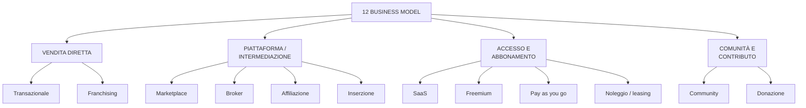

| Logica | Modelli | Fonte di ricavo tipica |
|---|---|---|
| **Vendita diretta** | Transazionale, Franchising | Prezzo di vendita / royalty |
| **Piattaforma** | Marketplace, Broker, Affiliazione, Inserzione | Commissioni / pubblicità |
| **Accesso** | SaaS, Freemium, Pay as you go, Leasing | Abbonamento / uso / canone |
| **Comunità** | Community, Donazione | Iscrizioni / donazioni |

---

## 18. Glossario delle lezioni 7-8

| Termine | Significato essenziale |
|---|---|
| **Idea di business** | Intuizione imprenditoriale che nasce da analisi, creatività e maturazione. |
| **Pensiero produttivo** | Pensiero che genera idee nuove; combina creatività e critica. |
| **Mappa dei trend** | Mappa concettuale dei trend di un settore, usata per cercare idee. |
| **Pensiero creativo** | Genera ed espande idee; è fragile ed effimero. |
| **Pensiero critico** | Analizza, giudica e seleziona le idee. |
| **Brainstorming** | Tecnica di generazione idee (Osborn, 1941) con 4 regole. |
| **Business Model Canvas** | Strumento grafico in 9 blocchi per progettare il business model. |
| **Business model** | Insieme delle soluzioni organizzative e strategiche per acquisire vantaggio competitivo. |
| **Business plan** | Documento che indica cosa, quanto tempo e quanti soldi servono per attuare il modello. |
| **Sostenibile** | Il modello genera ricavi maggiori dei costi. |
| **Scalabile** | Ricavi esponenziali a fronte di costi lineari. |
| **Replicabile** | Il modello si può riprodurre in più paesi. |
| **Praticabile** | Il modello è attuabile con le tecnologie disponibili. |
| **Transazionale** | Vendita diretta di prodotti/servizi. |
| **Marketplace** | Piattaforma che mette in contatto domanda e offerta. |
| **SaaS** | Software in cloud con abbonamento ricorrente. |
| **Freemium** | Base gratuita + funzionalità premium a pagamento. |
| **Pay as you go** | Pagamento solo per l'uso effettivo. |
| **Leasing** | Noleggio di un bene con canone periodico. |
| **Franchising** | Concessione di marchio, know-how e format a terzi (royalty). |
| **Broker** | Intermediario che guadagna commissioni sulle transazioni. |
| **Community** | La comunità stessa è il prodotto; ricavi da iscrizioni/eventi. |
| **Affiliazione** | Commissioni sulla promozione di prodotti tramite link. |
| **Inserzione** | Ricavi dalla vendita di spazi pubblicitari. |
| **Donazione** | Contributi volontari degli utenti. |
| **Effetto di rete** | Il valore della piattaforma cresce con il numero di utenti. |

---

> **Collegamento tra le lezioni:** la lezione 6 racconta **come nasce e cresce** una start-up (bilancio, definizioni, hockey stick, start-up in Italia); la lezione 7 spiega **come si passa dall'idea al business model** (analisi, creatività, Canvas); la lezione 8 approfondisce **i 12 modelli di business** con cui quell'idea può generare valore. In sintesi: **idea → modello di business → business plan → impresa**.
